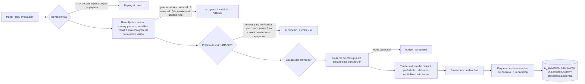

# MainSpot AI Core — arquitectura, operación y estado (issue #9)

Alcance: desarrollo/piloto controlado en `https://app.mainspot.local.io`. Nada aquí es producción.
Canon: FR-0012…FR-0019, NFR-0006…0008, BR-0007, ARC-0001, DAT-0001, SEC-0001, OPS-0001,
`DECIDED` por APR-0003 (ANS-0017), delta vigente 0.5.0: DEC-0074 actualiza FR-0012, FR-0019, NFR-0006,
BR-0007, ARC-0001, DAT-0001 y OPS-0001 sobre los deltas 0.3.0 (DEC-0066…0072) y 0.4.0 (DEC-0073). Plan:
[`INC-0008`](../../.canonflow/increments/INC-0008.md). DEC-0074 procede de la directiva humana externa
[`SRC-0012`](../../.canonflow/sources/SRC-0012-anthropic-manual-lab-directive.md), no de otra sesión HDC, y
sustituye solo la asignación generativa de desarrollo de DEC-0073/SRC-0011 (conservados como historia).
**Anthropic directo** cubre todo texto y razonamiento, **OpenAI directo** solo imágenes, **TypeSafe/Jev** sigue como
clasificador semántico primario; ambos adaptadores disponibles sin fallback. Las rutas generativas son DRAFT y
las prueba **el propietario en runtime** bajo un grant de laboratorio; el agente no ejecuta evaluaciones
generativas ni llamadas API de prueba. No es una elección comercial irreversible de producción: la investigación
de proveedores sigue independiente en su propia rama. Se preservan QS/ANS-0017, DEC-0066…0073 y los
resultados históricos (30-oct y OpenAI 2026-11-03), sin reinterpretarlos como aprobación de esta configuración.

## 1. Cómo funciona una invocación

- **Registro** (`src/ai/registry.ts`): casos de uso, proveedores (secreto por *nombre*), modelos con
  precio, fuente y fecha de observación; revisiones de prompt y rutas **inmutables** (trigger);
  rollout por entorno (`lab`/`test`) con activa + canary; historial auditado; rollback sin redeploy.
- **Despacho** (`src/ai/dispatcher.ts`): un único punto para texto estructurado, herramientas,
  imágenes y Jev (TypeSafe). 4xx del cliente no abren el circuito; 429/5xx sí (y se reintentan acotado).
- **Jobs durables** (`src/ai/jobs.ts`): `website.design`, `website.edit`, `social.compose`. Lease +
  `claim_token` (fencing), 3 intentos, rutas fijadas al crear el job (un cambio de rollout no altera un
  job en curso). Cada intento usa su clave, pero un paso que ya terminó bien se reutiliza: no se paga dos veces.
- **Evaluaciones** (`src/ai/evals.ts`, `scripts/ai-eval.ts`): suites sintéticas por caso de uso con
  umbrales (NFR-0008). Una ruta solo se aprueba si está `TESTED`: por su última evaluación PASS o, solo en
  laboratorio, por una revisión manual aceptada (`ai_manual_review`, DEC-0074); ambas vías quedan
  distinguibles en la ruta y la manual no habilita producción.
- **Proveedores directos** (`src/ai/providers/`, DEC-0074): Anthropic Messages (texto estructurado,
  herramientas y razonamiento; `claude-haiku-5-5` eficiente, `claude-sonnet-5-5` diseño inicial/edición
  compleja/planeación de campañas) para toda generación de texto; OpenAI Images (`gpt-image-2`) para imágenes.
  Jev usa TypeSafe directo. Los modelos de texto OpenAI (`gpt-6-luna`, `gpt-6.1-sol`) están deshabilitados y
  sus rutas RETIRED; las rutas Anthropic RETIRED por DEC-0073 no se reviven: las candidatas son revisiones
  DRAFT nuevas sembradas por `ensureAiCatalog`. Ningún adaptador cae a otro proveedor. OpenRouter permanece
  deshabilitado; su evidencia y costos no se borran.
- **Laboratorio manual** (`src/ai/lab.ts`, migración 0031, DEC-0074): grants de laboratorio
  (`ai_lab_grant` + allowlist inmutable `ai_lab_grant_route`) que permiten ejecutar una ruta DRAFT concreta a un
  usuario concreto de un negocio concreto, solo con `AI_ENVIRONMENT=lab`, durante 5–120 min, revocables y
  auditados. El despachador, el worker de jobs y el replay revalidan grant, tenant, usuario, emisor, ruta y
  proveedor; DRAFT nunca por simple pin ni por cabecera; fallo explícito `lab_grant_invalid`, sin fallback. La
  invocación registra `assignment=manual_lab`, `lab_grant_id` y `output_sha256`. La clasificación Jev recibe el
  `labGrantId` solo como contexto (trazabilidad/revocación) pero **siempre** resuelve su ruta normal TypeSafe:
  un grant nunca autoriza una ruta Jev DRAFT.
- **Independencia de OMP:** runtime, catálogo, presupuesto, evaluaciones y secretos son de MainSpot.
  No lee configuración/OAuth/modelos de OMP. Disponibilidad en OMP no acredita acceso a la API comercial.

## 2. Capacidades para el negocio (panel `#/ia`)

| Capacidad | Dónde | Garantías |
|---|---|---|
| Mi marca (FR-0013) | `#/ia/marca`, `src/brand/service.ts` | Hechos versionados (append-only); solo lo **confirmado** se usa como dato; promociones con vigencia; los datos del alta se importan como propios |
| Biblioteca (FR-0013) | `#/ia/biblioteca`, `src/media/service.ts` | WebP sin EXIF/GPS, variantes responsivas y de redes, ALT obligatorio, derechos declarados, URL de capacidad de 128 bits; en el host del sitio solo imágenes del propio negocio |
| Página con IA (FR-0014) | `#/ia/pagina`, `src/website/ai-site.ts`, `design.ts`, `design-edit.ts` | DSL de bloques (sin HTML/JS del modelo), contraste AA garantizado, hechos verificados; vista previa con el HTML real del servidor; publicar exige aprobación; `base_version` evita pisar versiones |
| Facebook (FR-0015) | `#/ia/publicar`, `#/ia/calendario` | 2–3 variantes, ≤3 emojis, hashtags aparte, promociones solo confirmadas, aviso de casi-duplicado; termina en un **borrador** con la aprobación social existente |
| Atención (FR-0016) | `src/engagement/ai-semantics.ts` | Jev lee sentimiento/categoría/riesgos; contactos reconocibles se redactan antes del envío; riesgos deterministas solo se suman; sin lectura → humano; ledger único por destino. Respuesta generada automática revela IA; plantilla determinista no se etiqueta como generada |
| Asistente (FR-0017) | `#/ia` | Herramientas de solo lectura del negocio de la sesión, según permisos; toda cifra debe salir de una herramienta; evidencia = herramientas ejecutadas |
| Resumen / campañas (FR-0017) | `#/ia/resumen`, `#/ia/campanas` | Se abstiene con <7 días de actividad (sin gastar IA); campañas: plan + creatividades; aprobar el plan **no** autoriza gasto (constraint en BD) |

## 3. Consolas de plataforma

- **Administration** `https://app.mainspot.local.io/plataforma` (`platform_admin`, `platform_support`):
  negocios, consumo, salud, planes, clasificación `synthetic`/`real`, acceso de soporte temporal con
  motivo (visible en la auditoría del negocio), presupuestos.
- **Engineering Console** `https://app.mainspot.local.io/ingenieria` (`ai_engineer`): casos de uso,
  modelos/proveedores, Prompt Studio (versiones inmutables), rutas, evaluaciones, rollout/canary/rollback,
  trazas saneadas, costos y jobs.
- Identidad propia: contraseña + TOTP (anti-replay), sesión de 30 min, **step-up** TOTP de 10 min para
  acciones con efecto; auditoría inmutable `platform_audit_event`. Los tokens del panel y de la
  plataforma no son intercambiables.

### Cambiar modelo o prompt sin tocar código
1. *Prompt Studio* → «Nueva versión de prompt» (inmutable, con nota).
2. *Rutas* → «Nueva ruta» (modelo + versión de prompt + parámetros + costo máximo).
3. Evidencia para `TESTED`, por una de dos vías distinguibles en la ruta:
   - «Evaluar» (suite sintética; proveedores reales solo si `AI_REAL_PROVIDERS=on`). Conservada; DEC-0074 no
     ordena ejecutarla desde el agente.
   - **Revisión manual de laboratorio** (DEC-0074): detalle del caso de uso → «Evidencia manual» lista las
     invocaciones reales `manual_lab` (id, negocio, actor, estado, proveedor/modelo, costo, latencia, hash de
     salida; sin texto de clientes ni salidas crudas); seleccionar invocaciones, notas y checklist
     (`result_reviewed`, `task_fit`, `safety_privacy`, `cost_acceptable`), «Notas (10–2000)» y decisión «Aceptar»
     o «Rechazar» (rechazo por omisión) → «Registrar revisión» con step-up. La ruta muestra «revisión manual» o «suite».
     Aceptar exige evidencia real, exitosa, no simulada, de la misma ruta/prompt/caso de uso y con costo
     trazable, y marca DRAFT → TESTED guardando `ai_manual_review` (snapshot, hash, actor, notas, fechas) y
     `tested_manual_review_id`; nunca crea `ai_eval_run` ni un PASS. Rechazar deja DRAFT.
4. «Aprobar» (requiere `TESTED`; paso separado con step-up) → *Rollout*: canary % → «Promover» o «Rollback»
   (con motivo y step-up). `APPROVED` es un estado global de la ruta; pero una ruta cuya evidencia es solo la
   revisión manual únicamente puede desplegarse (canary/activa) en `lab`: fuera de `lab` producción sigue
   exigiendo suite PASS. Aceptar nunca aprueba ni activa por sí mismo.

### Laboratorio manual: grants (DEC-0074)
1. `https://app.mainspot.local.io/ingenieria#/laboratorio` (`ai_engineer` o `platform_admin`, step-up): negocio
   y usuario, ruta(s) DRAFT permitidas (por defecto la candidata objetivo de cada capacidad, leída de los datos:
   Haiku eficiente, Sonnet complejas, `gpt-image-2`; botón «Seleccionar últimas candidatas»), plazo 5–120 min
   (60 por defecto), motivo 10–500 caracteres → «Emitir autorización» (`POST /ai/lab/grants`). «Revocar» por fila
   con motivo (`POST /ai/lab/grants/:id/revoke`). Se muestran costos/controles y el enlace
   `https://app.mainspot.local.io/panel#/ia/laboratorio`.
2. En el panel del negocio, `#/ia/laboratorio` (`GET /ai/lab`): el usuario elige el grant y pulsa «Usar rutas
   de laboratorio»; solo el id se guarda en `sessionStorage`, viaja como cabecera `X-AI-Lab-Grant` en las
   peticiones de IA autenticadas y se borra al salir/cambiar de sesión. Banner con proveedor/modelo/ruta y
   caducidad. `/ai/status` añade `lab:{grant_id,expires_at,capabilities[]}` sin alterar `capabilities.active`.
3. Con el grant activo, las pantallas habituales (`#/ia/pagina`, `#/ia/publicar`, `#/ia`, calendario, resumen,
   campañas) usan la ruta DRAFT permitida; `#/ia/laboratorio` añade los formularios explícitos «Imagen
   independiente» («Generar imagen de prueba», `POST /ai/lab/images`) y «Respuesta propuesta a un comentario o
   reseña» («Proponer respuesta», `POST /ai/lab/replies`). Resultados: solo medios o borradores con «ID de
   invocación» (y «ID de clasificación»), modelo, ruta y costo; ninguna publicación externa ni agente de fondo.
   Banner «Rutas de laboratorio en uso hasta las HH:MM»; «Dejar de usar»/«Salir del laboratorio» borra la
   selección (`sessionStorage` clave `mainspot.lab.grant`, solo el id). Un 403 por autorización rechazada o caducada
   muestra «Elegir otra autorización», sin reintentar la petición sin cabecera.
   Ningún usuario de negocio puede autoautorizarse; la cabecera sola no concede nada. Fuera de `AI_ENVIRONMENT=lab`
   el laboratorio está deshabilitado en el backend: una petición que llegue con grant/cabecera se **rechaza**
   (`lab_grant_invalid`), sin fallback a la ruta normal ni cabecera ignorada.

## 4. Configuración y cobertura contractual

- `~/.config/mainspot/ai-core.env` (0600, fuera de Git; lo carga `scripts/dev-panel.sh`):
  `AI_ENVIRONMENT=lab`, `AI_REAL_PROVIDERS=on`, `ANTHROPIC_API_KEY`, `OPENAI_API_KEY`, `TYPESAFE_API_KEY`,
  `PLATFORM_MFA_KEY`. No usar credenciales de consumidor, de OMP ni de otro proyecto; Responses/Images y
  Messages sin retención opt-in. Los créditos declarados por el propietario (USD 100 promocionales Anthropic,
  saldo OpenAI) no se verifican ni se imprimen desde el repositorio; un rechazo por saldo/cuota se reporta tal cual.
  La clave TypeSafe de `.env` da 403; al ejecutar herramientas, cargar el archivo protegido **después**.
- Personas de plataforma: `scripts/platform-user.ts`; laboratorio `lab-admin`, `lab-ingenieria`, `carlos`
  con credenciales/TOTP en archivos 0600 separados.
- DEC-0067/0071 autorizan datos reales bajo verificación única, sin aprobación por mensaje o tenant.
  `ai_provider.real_data=allowed` exige base documental y fecha; sin cobertura se bloquea solo ese
  proveedor para datos reales. `synthetic` sigue existiendo para corpus ficticios, no como bypass.
- Informe: [`ai-providers-data-terms.md`](ai-providers-data-terms.md). MCA/DPA de TypeSafe cubren API y
  clasificación de texto; sin entrenamiento, **sin plazo numérico de retención publicado y sin ZDR
  asumido**. No se inspeccionó un acuerdo privado de cuenta. Anthropic y OpenAI: DPA incorporados,
  sin entrenamiento por defecto, retención estándar y excepciones documentadas. La revisión no
  certifica asesoría legal ni configuración privada de opt-in/ZDR.
- Jev del intake: `dev-panel.sh` fija `JEV_MODE=primary`, `JEV_DATA_SCOPE=all`,
  `JEV_MODEL=jev-1.14.0` cuando existe clave. El gate de versión/código/corpus sigue siendo obligatorio;
  permisos y acciones permanecen en el backend.
- Presupuestos: generativo de laboratorio **USD 25 acumulados**, incluyendo OpenRouter histórico
  (DEC-0068): `lab_total` es el techo global estricto de TODO el gasto de pago, de operación y de laboratorio.
  Registro tras las evaluaciones OpenAI de DEC-0073: USD 0.096726; ninguna generación directa
  exitosa acreditada por el agente. Por debajo (FB-3, DEC-0078, migración 0039) el gasto se separa por
  propósito: la operación comercial (sin grant) reserva contra el `tenant_day` de su negocio (fila propia o la
  por defecto de OPS-0001) y las invocaciones `manual_lab` bajo grant contra `lab_experiment`, una fila global
  por día UTC **sin valor sembrado**: hasta que un platform_admin la fija (step-up, motivo y auditoría; nunca por
  encima de `lab_total`) el laboratorio no gasta (`budget_exhausted`, detalle `lab_experiment`). Ninguno consume
  el del otro y ambos siguen bajo `lab_total` (y `platform_month`, opcional); las ventanas diaria y mensual son
  UTC. El gasto se atribuye por propósito y canal (`ai_use_case.channel`, uno por caso de uso) en
  `GET /api/platform/ai/spend` (Engineering › Costos y Administration › Salud), sin límites ni particiones por
  canal. Reversión de 0039: `scripts/ai-budget-segregation-rollback.sql` (se niega si `lab_experiment` está
  configurado). Los créditos declarados por el propietario no amplían el techo. Las llamadas rechazadas por
  saldo/cuota no acreditan calidad ni disponibilidad operativa. No es una autorización mensual recurrente ni de Ads.
  TypeSafe: USD 1/día UTC (DEC-0032), compartido entre `jev_classification`, `jev_evaluation_run` y
  `ai_invocation` TypeSafe.
- Contabilidad: costo directo estimado por uso × precio publicado; TypeSafe conserva la procedencia
  informada por su cliente. Un fallo de red/timeout generativo no acredita costo cero: reserva retenida
  con costo desconocido. Los presupuestos de plataforma/tenant existentes siguen limitando operaciones;
  no constituyen una nueva autorización de gasto del propietario.

## 5. Rutas actuales y evidencia (2026-11-03, DEC-0074)

Solo pasan a aprobadas/activas las revisiones `TESTED` contra **la API directa** (suite PASS o, en `lab`,
revisión manual aceptada). Las rutas generativas de OpenRouter y las de texto OpenAI (DEC-0073) están
RETIRED; nada se usa como fallback. **El agente no ejecutó ninguna invocación generativa nueva al aplicar
DEC-0074**; la columna «Resultado observado» de las candidatas refleja solo el estado de catálogo/semilla.

| Capacidad | Modelo directo | Resultado observado | Ruta operativa |
|---|---|---|---|
| Intención/capacidad del intake | `jev-1.14.0` | 240/240 evaluados; intención 236/240; 0 fallos finales de riesgo (histórico, sigue vigente) | PRIMARY con gate abierto |
| Alcance de edición | `ts:jev-1.14.0` | 8/8 | Activa |
| Comentarios Facebook | `ts:jev-1.14.0` | 17/20 exactos; sentimiento 90 %; 0 riesgos omitidos | Activa, pasa umbrales |
| Reseñas Google | `ts:jev-1.14.0` | 17/20 exactos; sentimiento 90 %; 0 riesgos omitidos | Activa, pasa umbrales; conector Google real sigue aparte |
| Texto eficiente (edición simple, copy social, creatividades, respuestas, asistente, análisis, calendario) | `claude-haiku-5-5` | Sin invocación ni evaluación ejecutada por el agente; pendiente de prueba del propietario en runtime | DRAFT, ejecutable solo con grant de laboratorio |
| Diseño inicial, edición compleja, planeación de campañas | `claude-sonnet-5-5` | Sin invocación ni evaluación ejecutada por el agente; pendiente de prueba del propietario en runtime | DRAFT, ejecutable solo con grant de laboratorio |
| Imágenes web/social | `gpt-image-2` | Observación previa (DEC-0073): generación rechazada por saldo/cuota; sin nueva comprobación | DRAFT, ejecutable solo con grant de laboratorio; sin imagen real acreditada |
| Texto OpenAI (`gpt-6-luna`, `gpt-6.1-sol`) | — | Historia DEC-0073: 20 suites / 50 casos rechazados por `insufficient_credit`, sin calidad medida | Modelos deshabilitados; rutas RETIRED (migración 0030) |

Precios publicados guardados en el catálogo: Haiku 5.5 USD 0.1/0.5 y Sonnet 5.5 USD 2/10 por millón de tokens
entrada/salida (fecha de observación en `ai_model.price_observed_at`). La selección responde a DEC-0074, no a
una comparación de calidad: la calidad la juzga el propietario con la revisión manual de laboratorio. Los
créditos Anthropic (USD 100 promocionales) y OpenAI son declaraciones del propietario, no verificadas aquí; la
observación previa de saldo insuficiente Anthropic (HTTP 400 `credit_balance_too_low`, 2026-11-03 06:19 UTC,
`evidence/ai-core/direct-provider-access-2026-11-03.json`) es anterior a los créditos declarados y no se recomprobó.
Las 3 rutas TypeSafe siguen activas; ninguna ruta generativa está TESTED, aprobada ni activa.

## 6. Estado por capacidad y desbloqueos

| Capacidad | Estado actual | Falta exacta |
|---|---|---|
| Clasificación TypeSafe directa y política de datos reales | LOCAL_REAL_VERIFIED con fixture ficticia marcada `real` | No acredita datos sensibles especiales ni conectores externos |
| Consolas, alta, marca, biblioteca de fotos propias | Verificación de navegador HTTPS del subconjunto alcanzable | No sustituye aceptación completa E01–E20 |
| Anthropic texto/razonamiento (DEC-0074) | Configurado en el corte DEC-0074 (migración 0030 + semilla); rutas DRAFT; ninguna invocación ejecutada por el agente | Prueba del propietario en runtime con grant de laboratorio → revisión manual aceptada → aprobar → activar (lab). Créditos declarados, no verificados |
| OpenAI imágenes (`gpt-image-2`) | Rutas DRAFT; observación previa BLOCKED_EXTERNAL por saldo/cuota, sin recomprobar | Igual que arriba; si la API vuelve a rechazar por saldo/cuota/verificación de organización, se reporta tal cual |
| OpenAI texto | RETIRED (migración 0030) | Nada; historia DEC-0073 conservada |
| Diseño/edición/copy/asistente/campañas generativos directos | Sin generación nueva acreditada por el agente | Pruebas en runtime del propietario (INC-0008 «Procedimiento»); no reemplazarlas por mocks ni historia |
| Laboratorio manual (grants, evidencia, revisión) | Entregado y verificado sin gasto: pruebas locales y recorrido HTTPS emitir → usar → revocar → bloqueo (`manual-lab-verification-2026-11-03.json`) | Primer grant del propietario con generación real y su revisión manual |
| Datos reales a proveedores verificados | Autorizados con condiciones, DEC-0067/0071 | No repetir HDC; revisar solo incompatibilidad material nueva |
| Meta/Google/Telegram auténticos | BLOCKED_EXTERNAL | Autorizaciones, credenciales y pruebas/read-back propios de issues #6/#8 |
| Gasto publicitario | NO-GO por diseño | Autorización específica de cuenta, importe, destino y límites |

No activar rutas por un GET del catálogo, por pruebas con proveedor falso ni por una aceptación manual sin
invocaciones reales. Los créditos del proveedor no autorizan gasto recurrente ni cambian el techo acumulado. El
agente no ejecuta `scripts/ai-eval.ts`, suites de calidad ni `scripts/ai-core-lab-e2e.ts` con proveedores
reales bajo DEC-0074; esas comprobaciones quedan disponibles para el propietario o para una instrucción futura.

### Limitaciones conocidas

- TypeSafe comparte gasto terminado entre ambos pipelines; no tiene una reserva atómica común para
  llamadas concurrentes. El umbral diario se comprueba antes de llamar, no promete un techo duro
  multi-proceso. El presupuesto generativo sí usa reserva transaccional.
- Caída a mitad de llamada: a los 15 min se cierra como `uncertain_abandoned`; el gasto conserva la reserva.
  El job recupera su lease a los 10 min; pasos terminados se reutilizan. No hay heartbeat de lease.
- Los bytes de imagen no se guardan en la traza: caída entre generación y biblioteca puede perder la imagen.
  Imágenes publicadas se etiquetan como generadas y requieren revisión; fotos propias conservan sus derechos.
- Propuestas clásicas anteriores al AI Core no tienen `base_version`; las propuestas IA sí lo tienen.
- El resumen se abstiene con menos de 7 días de actividad. La marca importa como confirmados los datos del alta.
- Minimización por patrones no es anonimización garantizada del texto libre.
- Retención aprobada de trazas (DAT-0001/OPS-0001): el job existente elimina `ai_invocation.output`
  y detalles de validación después de 90 días, también para evaluaciones sin tenant; conserva
  costo/uso/modelo y claves de idempotencia. Un replay purgado falla explícitamente, sin éxito vacío
  ni cobro nuevo. Esto no cambia el ciclo de los artefactos aprobados ni añade una política distinta
  para `ai_job.input` (actualmente se borra con la baja del negocio).

## 7. Pruebas

- `tests/unit/ai-core.test.ts`: DSL, parches atómicos, contraste AA, render seguro, prompts con datos no
  confiables, esquemas, TOTP/anti-replay, tokens no intercambiables, marca, reglas de dominio, lectura Jev.
- `tests/integration/ai-core.test.ts` (simulador y proveedor falso inyectado): diseño→aprobación→HTML sin
  scripts e imágenes acotadas; ruta fijada ante cambio de rollout; reinicio de job sin doble cobro;
  política de datos y techo con reservas concurrentes; MFA/step-up/roles; Jev + ledger; asistente aislado;
  resumen, calendario, composición social y campañas sin gasto; baja y anonimización (DEC-0024/0027) de un
  negocio que usó la IA: exporta marca/jobs/biblioteca (sin bytes), borra sus datos, re-etiqueta el costo
  de IA (`ai_invocation` sin contenido ni actores) y la auditoría de plataforma (migración 0027).
- `scripts/ai-core-lab-e2e.ts`: recorrido de proveedores **directos**, sin provisionar infraestructura.
  Con saldo/cuota pendientes, `--blocked-providers` ejercita alta/marca/biblioteca, fixture `real`,
  clasificación TypeSafe auténtica y consolas; **sale con código 1 y estado BLOCKED**, no PASS global.
  Último informe (DEC-0073, histórico): `evidence/ai-core/openai-development-e2e-2026-11-03.txt`; capturas en
  `openai-development-screens-2026-11-03/`. Bajo DEC-0074 el script se adapta a la distribución Anthropic
  texto / OpenAI imágenes pero **no se ejecuta por el agente**; no certifica la configuración actual.
- Evidencia nueva de DEC-0073: `evidence/ai-core/openai-development-catalog-2026-11-03.json`,
  `openai-development-evals-2026-11-03.json`, `openai-development-verification-2026-11-03.json`.
  Su existencia no sustituye leer resultados, cuotas, gates y consumo antes de declarar activación.
  Gate intake: `jev-gate-dev-2026-11-03.json`. Historia: `direct-*`, `lab-e2e.txt` y los resultados
  del handoff del 30-oct; no se reetiquetan como generación OpenAI verificada.
- Verificación reproducible anterior: [`direct-verification-2026-11-03.json`](../../evidence/ai-core/direct-verification-2026-11-03.json).
  Suite completa previa a las últimas correcciones: 167 unitarias, 162 integración, 5 smoke, 4 E2E.
  Después: 19 pruebas de adaptadores (incluido deadline durante el cuerpo), 15 de integración AI Core/retención,
  typecheck y smoke del CLI de retención sobre una fixture temporal de `mainspot_test`.
- Corte DEC-0073 (histórico): `npm test` pasó **169 unitarias, 164 integración, 5 smoke y 4 E2E**.
  El contrato de herramientas sin estado pasó otras 10 pruebas del adaptador OpenAI; typecheck y
  sincronización final de semilla verificados. La regresión de migración prueba retirar Anthropic activo y
  canary sin promover OpenAI automáticamente ni modificar costos históricos.
- Corte DEC-0074 (`evidence/ai-core/manual-lab-verification-2026-11-03.json`): sin claves API en el proceso de
  prueba y con HTTP externo bloqueado, typecheck + **171 unitarias, 174 integración, 5 smoke y 4 E2E** sin fallos.
  Nuevas: `ai-manual-lab.test.ts` (grants, dispatcher, jobs con degradación de rol, revisión manual),
  `ai-lab-business.test.ts` (API del negocio, imágenes con transporte sustituido, replay aislado) y
  `tests/unit/panel-ai-lab.test.ts` (cambio de sesión y 403 sin reintento). El E2E de interfaz falló una vez en
  el paso 6 por una aserción probabilística previa (id simulado `sim-` + 12 hex puede contener 10 dígitos
  seguidos, ≈2–3 %); la repetición pasó los 42 pasos. Navegador por `https://app.mainspot.local.io`: emisión
  de grant (13 rutas, 15 min), selección en el panel, todas las pantallas IA con la ruta de laboratorio
  visible, revocación y panel bloqueado sin volver a la ruta normal; 444 invocaciones y USD 0.096726 antes y
  después. Ninguna prueba generativa, suite de calidad ni E2E pagado ejecutado por el agente (INC-0008).
