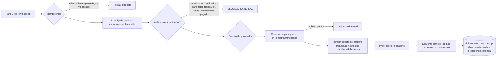

# MainSpot AI Core — arquitectura, operación y estado (issue #9)

Alcance: desarrollo/piloto controlado en `https://app.mainspot.local.io`. Nada aquí es producción.
Canon: FR-0012…FR-0019, NFR-0006…0008, BR-0007, ARC-0001, DAT-0001, SEC-0001, OPS-0001,
`DECIDED` por APR-0003 (ANS-0017), delta 0.3.0 con DEC-0066…0071. Plan:
[`INC-0008`](../../.canonflow/increments/INC-0008.md). Evidencia nueva: `evidence/ai-core/direct-*`;
los resultados del 30-oct con OpenRouter se conservan **solo como historia**.

## 1. Cómo funciona una invocación

- **Registro** (`src/ai/registry.ts`): casos de uso, proveedores (secreto por *nombre*), modelos con
  precio, fuente y fecha de observación; revisiones de prompt y rutas **inmutables** (trigger);
  rollout por entorno (`lab`/`test`) con activa + canary; historial auditado; rollback sin redeploy.
- **Despacho** (`src/ai/dispatcher.ts`): un único punto para texto estructurado, herramientas,
  imágenes y Jev (TypeSafe). 4xx del cliente no abren el circuito; 429/5xx sí (y se reintentan acotado).
- **Jobs durables** (`src/ai/jobs.ts`): `website.design`, `website.edit`, `social.compose`. Lease +
  `claim_token` (fencing), 3 intentos, rutas fijadas al crear el job (un cambio de rollout no altera un
  job en curso). Cada intento usa su clave, pero un paso que ya terminó bien se reutiliza: no se paga dos veces.
- **Evaluaciones** (`src/ai/evals.ts`, `scripts/ai-eval.ts`): suites sintéticas por caso de uso con
  umbrales (NFR-0008). Una ruta solo se aprueba si su última evaluación pasó (`TESTED`).
- **Proveedores directos** (`src/ai/providers/`): Anthropic Messages (esquema nativo o herramienta de
  salida cuando excede sus límites), OpenAI Images (`gpt-image-2`) y Responses (`store:false`, solo
  alternativa de texto evaluada). Jev usa su cliente TypeSafe directo. No existe adaptador OpenRouter
  operativo; migración 0028 retira sus rollouts/modelos sin borrar evidencia ni costos.
- **Independencia de OMP:** runtime, catálogo, presupuesto, evaluaciones y secretos son de MainSpot.
  No lee configuración/OAuth/modelos de OMP. Disponibilidad en OMP no acredita acceso a la API comercial.

## 2. Capacidades para el negocio (panel `#/ia`)

| Capacidad | Dónde | Garantías |
|---|---|---|
| Mi marca (FR-0013) | `#/ia/marca`, `src/brand/service.ts` | Hechos versionados (append-only); solo lo **confirmado** se usa como dato; promociones con vigencia; los datos del alta se importan como propios |
| Biblioteca (FR-0013) | `#/ia/biblioteca`, `src/media/service.ts` | WebP sin EXIF/GPS, variantes responsivas y de redes, ALT obligatorio, derechos declarados, URL de capacidad de 128 bits; en el host del sitio solo imágenes del propio negocio |
| Página con IA (FR-0014) | `#/ia/pagina`, `src/website/ai-site.ts`, `design.ts`, `design-edit.ts` | DSL de bloques (sin HTML/JS del modelo), contraste AA garantizado, hechos verificados; vista previa con el HTML real del servidor; publicar exige aprobación; `base_version` evita pisar versiones |
| Facebook (FR-0015) | `#/ia/publicar`, `#/ia/calendario` | 2–3 variantes, ≤3 emojis, hashtags aparte, promociones solo confirmadas, aviso de casi-duplicado; termina en un **borrador** con la aprobación social existente |
| Atención (FR-0016) | `src/engagement/ai-semantics.ts` | Jev lee sentimiento/categoría/riesgos; contactos reconocibles se redactan antes del envío; riesgos deterministas solo se suman; sin lectura → humano; ledger único por destino. Respuesta generada automática revela IA; plantilla determinista no se etiqueta como generada |
| Asistente (FR-0017) | `#/ia` | Herramientas de solo lectura del negocio de la sesión, según permisos; toda cifra debe salir de una herramienta; evidencia = herramientas ejecutadas |
| Resumen / campañas (FR-0017) | `#/ia/resumen`, `#/ia/campanas` | Se abstiene con <7 días de actividad (sin gastar IA); campañas: plan + creatividades; aprobar el plan **no** autoriza gasto (constraint en BD) |

## 3. Consolas de plataforma

- **Administration** `https://app.mainspot.local.io/plataforma` (`platform_admin`, `platform_support`):
  negocios, consumo, salud, planes, clasificación `synthetic`/`real`, acceso de soporte temporal con
  motivo (visible en la auditoría del negocio), presupuestos.
- **Engineering Console** `https://app.mainspot.local.io/ingenieria` (`ai_engineer`): casos de uso,
  modelos/proveedores, Prompt Studio (versiones inmutables), rutas, evaluaciones, rollout/canary/rollback,
  trazas saneadas, costos y jobs.
- Identidad propia: contraseña + TOTP (anti-replay), sesión de 30 min, **step-up** TOTP de 10 min para
  acciones con efecto; auditoría inmutable `platform_audit_event`. Los tokens del panel y de la
  plataforma no son intercambiables.

### Cambiar modelo o prompt sin tocar código
1. *Prompt Studio* → «Nueva versión de prompt» (inmutable, con nota).
2. *Rutas* → «Nueva ruta» (modelo + versión de prompt + parámetros + costo máximo).
3. «Evaluar» (suite sintética; proveedores reales solo si `AI_REAL_PROVIDERS=on`).
4. «Aprobar» (requiere `TESTED`) → *Rollout*: canary % → «Promover» o «Rollback» (con motivo y step-up).

## 4. Configuración y cobertura contractual

- `~/.config/mainspot/ai-core.env` (0600, fuera de Git; lo carga `scripts/dev-panel.sh`):
  `AI_ENVIRONMENT=lab`, `AI_REAL_PROVIDERS=on`, `ANTHROPIC_API_KEY`, `OPENAI_API_KEY`,
  `TYPESAFE_API_KEY`, `PLATFORM_MFA_KEY`. No usar credenciales de OMP ni otro proyecto.
  La clave TypeSafe de `.env` da 403; al ejecutar herramientas, cargar el archivo protegido **después**.
- Personas de plataforma: `scripts/platform-user.ts`; laboratorio `lab-admin`, `lab-ingenieria`, `carlos`
  con credenciales/TOTP en archivos 0600 separados.
- DEC-0067/0071 autorizan datos reales bajo verificación única, sin aprobación por mensaje o tenant.
  `ai_provider.real_data=allowed` exige base documental y fecha; sin cobertura se bloquea solo ese
  proveedor para datos reales. `synthetic` sigue existiendo para corpus ficticios, no como bypass.
- Informe: [`ai-providers-data-terms.md`](ai-providers-data-terms.md). MCA/DPA de TypeSafe cubren API y
  clasificación de texto; sin entrenamiento, **sin plazo numérico de retención publicado y sin ZDR
  asumido**. No se inspeccionó un acuerdo privado de cuenta. Anthropic y OpenAI: DPA incorporados,
  sin entrenamiento por defecto, retención estándar y excepciones documentadas. La revisión no
  certifica asesoría legal ni configuración privada de opt-in/ZDR.
- Jev del intake: `dev-panel.sh` fija `JEV_MODE=primary`, `JEV_DATA_SCOPE=all`,
  `JEV_MODEL=jev-1.14.0` cuando existe clave. El gate de versión/código/corpus sigue siendo obligatorio;
  permisos y acciones permanecen en el backend.
- Presupuestos: generativo de laboratorio **USD 25 acumulados**, incluyendo OpenRouter histórico
  (DEC-0068). USD 0.096726 registrados hasta el recorrido directo; ningún cargo generativo directo
  exitoso. No es una autorización mensual recurrente ni de Ads. TypeSafe: USD 1/día UTC (DEC-0032),
  compartido entre `jev_classification`, `jev_evaluation_run` y `ai_invocation` TypeSafe.
- Contabilidad: costo directo estimado por uso × precio publicado; TypeSafe conserva la procedencia
  informada por su cliente. Un fallo de red/timeout generativo no acredita costo cero: reserva retenida
  con costo desconocido. Los presupuestos de plataforma/tenant existentes siguen limitando operaciones;
  no constituyen una nueva autorización de gasto del propietario.

## 5. Evaluación directa y rutas actuales (2026-11-03)

Solo pasan a activas las revisiones evaluadas contra **la API directa**. Las rutas generativas anteriores
de OpenRouter fueron retiradas; no se usan como fallback durante el bloqueo.

| Capacidad | Modelo directo | Resultado observado | Ruta operativa |
|---|---|---|---|
| Intención/capacidad del intake | `jev-1.14.0` | 240/240 evaluados; intención 236/240; 0 fallos finales de riesgo | PRIMARY con gate abierto |
| Alcance de edición | `ts:jev-1.14.0` | 8/8 | Activa |
| Comentarios Facebook | `ts:jev-1.14.0` | 17/20 exactos; sentimiento 90 %; 0 riesgos omitidos | Activa, pasa umbrales |
| Reseñas Google | `ts:jev-1.14.0` | 17/20 exactos; sentimiento 90 %; 0 riesgos omitidos | Activa, pasa umbrales; conector Google real sigue aparte |
| Texto/razonamiento | `claude-haiku-5-5` (Sonnet/Opus catalogados) | Catálogo autenticado 200; Messages 400: saldo insuficiente | Candidatas DRAFT, sin aprobación/activación |
| Imágenes web/social | `gpt-image-2` | Modelo autenticado 200; Images 429, tipo `insufficient_quota`, código `credit_balance_exhausted` | Candidatas DRAFT, sin imagen real acreditada |

Los fallos no son pruebas de calidad del modelo. No se evaluaron alternativas para eludir falta de saldo:
Sonnet o GPT-6 Luna se comparan cuando haya acceso generativo; solo se usa alternativa directa si la calidad
lo justifica. El guardrail OpenRouter del 30-oct es evidencia histórica, no el bloqueo actual.

## 6. Estado por capacidad y desbloqueos

| Capacidad | Estado actual | Falta exacta |
|---|---|---|
| Clasificación TypeSafe directa y política de datos reales | LOCAL_REAL_VERIFIED con fixture ficticia marcada `real` | No acredita datos sensibles especiales ni conectores externos |
| Consolas, alta, marca, biblioteca de fotos propias | Verificación de navegador HTTPS del subconjunto alcanzable | No sustituye aceptación completa E01–E20 |
| Anthropic texto, herramientas y razonamiento | IMPLEMENTED / BLOCKED_EXTERNAL | Saldo en cuenta **API Anthropic**, ejecutar suites, aprobar y activar rutas exactas |
| OpenAI imágenes `gpt-image-2` | IMPLEMENTED / BLOCKED_EXTERNAL | Saldo/cuota en proyecto/organización **API OpenAI**; después generar y verificar bytes/metadata, evaluar, aprobar y activar |
| Diseño/edición/copy/asistente/campañas generativos directos | BLOCKED_EXTERNAL por los proveedores anteriores | E2E completo con generación auténtica; pruebas históricas no certifican el transporte nuevo |
| Datos reales a proveedores verificados | Autorizados con condiciones, DEC-0067/0071 | No repetir HDC; revisar solo incompatibilidad material nueva |
| Meta/Google/Telegram auténticos | BLOCKED_EXTERNAL | Autorizaciones, credenciales y pruebas/read-back propios de issues #6/#8 |
| Gasto publicitario | NO-GO por diseño | Autorización específica de cuenta, importe, destino y límites |

No activar rutas por un GET del catálogo ni por pruebas con proveedor falso. Habilitar saldo/cuota no autoriza
gasto recurrente ni cambia el techo acumulado. Tras desbloqueo: `scripts/ai-eval.ts`, evaluación de calidad,
aprobar/activar desde Engineering Console, y `scripts/ai-core-lab-e2e.ts` completo.

### Limitaciones conocidas

- TypeSafe comparte gasto terminado entre ambos pipelines; no tiene una reserva atómica común para
  llamadas concurrentes. El umbral diario se comprueba antes de llamar, no promete un techo duro
  multi-proceso. El presupuesto generativo sí usa reserva transaccional.
- Caída a mitad de llamada: a los 15 min se cierra como `uncertain_abandoned`; el gasto conserva la reserva.
  El job recupera su lease a los 10 min; pasos terminados se reutilizan. No hay heartbeat de lease.
- Los bytes de imagen no se guardan en la traza: caída entre generación y biblioteca puede perder la imagen.
  Imágenes publicadas se etiquetan como generadas y requieren revisión; fotos propias conservan sus derechos.
- Propuestas clásicas anteriores al AI Core no tienen `base_version`; las propuestas IA sí lo tienen.
- El resumen se abstiene con menos de 7 días de actividad. La marca importa como confirmados los datos del alta.
- Minimización por patrones no es anonimización garantizada del texto libre.
- Retención aprobada de trazas (DAT-0001/OPS-0001): el job existente elimina `ai_invocation.output`
  y detalles de validación después de 90 días, también para evaluaciones sin tenant; conserva
  costo/uso/modelo y claves de idempotencia. Un replay purgado falla explícitamente, sin éxito vacío
  ni cobro nuevo. Esto no cambia el ciclo de los artefactos aprobados ni añade una política distinta
  para `ai_job.input` (actualmente se borra con la baja del negocio).

## 7. Pruebas

- `tests/unit/ai-core.test.ts`: DSL, parches atómicos, contraste AA, render seguro, prompts con datos no
  confiables, esquemas, TOTP/anti-replay, tokens no intercambiables, marca, reglas de dominio, lectura Jev.
- `tests/integration/ai-core.test.ts` (simulador y proveedor falso inyectado): diseño→aprobación→HTML sin
  scripts e imágenes acotadas; ruta fijada ante cambio de rollout; reinicio de job sin doble cobro;
  política de datos y techo con reservas concurrentes; MFA/step-up/roles; Jev + ledger; asistente aislado;
  resumen, calendario, composición social y campañas sin gasto; baja y anonimización (DEC-0024/0027) de un
  negocio que usó la IA: exporta marca/jobs/biblioteca (sin bytes), borra sus datos, re-etiqueta el costo
  de IA (`ai_invocation` sin contenido ni actores) y la auditoría de plataforma (migración 0027).
- `scripts/ai-core-lab-e2e.ts`: recorrido de proveedores **directos**, sin provisionar infraestructura.
  Con saldo/cuota pendientes, `--blocked-providers` ejercita alta/marca/biblioteca, fixture `real`,
  clasificación TypeSafe auténtica y consolas; **sale con código 1 y estado BLOCKED**, no PASS global.
  Evidencia `evidence/ai-core/direct-e2e-2026-11-03.txt` y `direct-screens-2026-11-03/`.
- APIs directas: `direct-evals-2026-11-03.json`, `direct-provider-access-2026-11-03.json`.
  Gate intake: `jev-gate-dev-2026-11-03.json`. Historia conservada: `lab-e2e.txt`, evaluaciones y resultados
  del handoff del 30-oct; no se reetiquetan como directos.
- Verificación reproducible: [`direct-verification-2026-11-03.json`](../../evidence/ai-core/direct-verification-2026-11-03.json).
  Suite completa previa a las últimas correcciones: 167 unitarias, 162 integración, 5 smoke, 4 E2E.
  Después: 19 pruebas de adaptadores (incluido deadline durante el cuerpo), 15 de integración AI Core/retención,
  typecheck y smoke del CLI de retención sobre una fixture temporal de `mainspot_test`.
