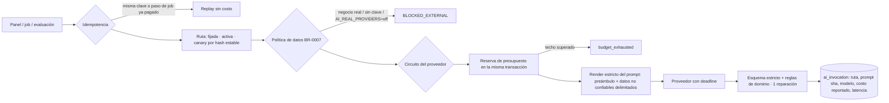

# MainSpot AI Core — arquitectura, operación y estado (issue #9)

Alcance: desarrollo/piloto controlado en `https://app.mainspot.local.io`. Nada aquí es producción.
Canon: FR-0012…FR-0019, NFR-0006…0008, BR-0007, ARC-0001, DAT-0001, SEC-0001, OPS-0001 (estado
`PROPOSED` hasta la respuesta de QS-0016). Evidencia: `evidence/ai-core/`.

## 1. Cómo funciona una invocación

- **Registro** (`src/ai/registry.ts`): casos de uso, proveedores (secreto por *nombre*), modelos con
  precio, fuente y fecha de observación; revisiones de prompt y rutas **inmutables** (trigger);
  rollout por entorno (`lab`/`test`) con activa + canary; historial auditado; rollback sin redeploy.
- **Despacho** (`src/ai/dispatcher.ts`): un único punto para texto estructurado, herramientas,
  imágenes y Jev (TypeSafe). 4xx del cliente no abren el circuito; 429/5xx sí (y se reintentan acotado).
- **Jobs durables** (`src/ai/jobs.ts`): `website.design`, `website.edit`, `social.compose`. Lease +
  `claim_token` (fencing), 3 intentos, rutas fijadas al crear el job (un cambio de rollout no altera un
  job en curso). Cada intento usa su clave, pero un paso que ya terminó bien se reutiliza: no se paga dos veces.
- **Evaluaciones** (`src/ai/evals.ts`, `scripts/ai-eval.ts`): suites sintéticas por caso de uso con
  umbrales (NFR-0008). Una ruta solo se aprueba si su última evaluación pasó (`TESTED`).

## 2. Capacidades para el negocio (panel `#/ia`)

| Capacidad | Dónde | Garantías |
|---|---|---|
| Mi marca (FR-0013) | `#/ia/marca`, `src/brand/service.ts` | Hechos versionados (append-only); solo lo **confirmado** se usa como dato; promociones con vigencia; los datos del alta se importan como propios |
| Biblioteca (FR-0013) | `#/ia/biblioteca`, `src/media/service.ts` | WebP sin EXIF/GPS, variantes responsivas y de redes, ALT obligatorio, derechos declarados, URL de capacidad de 128 bits; en el host del sitio solo imágenes del propio negocio |
| Página con IA (FR-0014) | `#/ia/pagina`, `src/website/ai-site.ts`, `design.ts`, `design-edit.ts` | DSL de bloques (sin HTML/JS del modelo), contraste AA garantizado, hechos verificados; vista previa con el HTML real del servidor; publicar exige aprobación; `base_version` evita pisar versiones |
| Facebook (FR-0015) | `#/ia/publicar`, `#/ia/calendario` | 2–3 variantes, ≤3 emojis, hashtags aparte, promociones solo confirmadas, aviso de casi-duplicado; termina en un **borrador** con la aprobación social existente |
| Atención (FR-0016) | `src/engagement/ai-semantics.ts` | Jev lee sentimiento/categoría/riesgos (ironía, negación, mixto); riesgos deterministas solo se suman; sin lectura → humano; respuesta con hechos verificados; **ledger único** por destino público (atención y reputación) |
| Asistente (FR-0017) | `#/ia` | Herramientas de solo lectura del negocio de la sesión, según permisos; toda cifra debe salir de una herramienta; evidencia = herramientas ejecutadas |
| Resumen / campañas (FR-0017) | `#/ia/resumen`, `#/ia/campanas` | Se abstiene con <7 días de actividad (sin gastar IA); campañas: plan + creatividades; aprobar el plan **no** autoriza gasto (constraint en BD) |

## 3. Consolas de plataforma

- **Administration** `https://app.mainspot.local.io/plataforma` (`platform_admin`, `platform_support`):
  negocios, consumo, salud, planes, clasificación `synthetic`/`real`, acceso de soporte temporal con
  motivo (visible en la auditoría del negocio), presupuestos.
- **Engineering Console** `https://app.mainspot.local.io/ingenieria` (`ai_engineer`): casos de uso,
  modelos/proveedores, Prompt Studio (versiones inmutables), rutas, evaluaciones, rollout/canary/rollback,
  trazas saneadas, costos y jobs.
- Identidad propia: contraseña + TOTP (anti-replay), sesión de 30 min, **step-up** TOTP de 10 min para
  acciones con efecto; auditoría inmutable `platform_audit_event`. Los tokens del panel y de la
  plataforma no son intercambiables.

### Cambiar modelo o prompt sin tocar código
1. *Prompt Studio* → «Nueva versión de prompt» (inmutable, con nota).
2. *Rutas* → «Nueva ruta» (modelo + versión de prompt + parámetros + costo máximo).
3. «Evaluar» (suite sintética; proveedores reales solo si `AI_REAL_PROVIDERS=on`).
4. «Aprobar» (requiere `TESTED`) → *Rollout*: canary % → «Promover» o «Rollback» (con motivo y step-up).

## 4. Configuración del entorno local

- `~/.config/mainspot/ai-core.env` (0600, fuera de Git; lo carga `scripts/dev-panel.sh`):
  `AI_ENVIRONMENT=lab`, `AI_REAL_PROVIDERS=on`, `OPENROUTER_API_KEY`, `TYPESAFE_API_KEY`, `PLATFORM_MFA_KEY`.
  La clave TypeSafe de `.env` del repo está revocada (403); la vigente es la del archivo protegido.
- Personas de plataforma: `printf %s "$PASS" | node scripts/platform-user.ts create --login … --roles … --secret-file ~/.config/mainspot/platform-<login>.txt`
  (laboratorio: `lab-admin`, `lab-ingenieria`, `carlos`; archivos 0600 con TOTP y contraseña).
- Un negocio solo usa proveedores reales si `platform_admin` lo marca `synthetic` (motivo + step-up).
- Presupuestos (`ai_budget`): laboratorio total USD 25 (decisión del propietario 2026-10-30, la consola no
  lo sube), mensual de plataforma, diario por negocio; TypeSafe USD 1/día (DEC-0032).

## 5. Rutas activas en `lab` (2026-10-30)

Criterio: pasa la suite real (`TESTED`) → entre las que pasan, Anthropic por instrucción del propietario
(«usa los modelos de Anthropic, cuidando el consumo»), salvo que Anthropic no pase. GPT-6 Luna fue más
barato por caso en varias suites: cambiarlo es un rollout desde la consola, sin código.

| Caso de uso | Activa | Suite real (última) | USD/caso | p95 | Alternativa medida |
|---|---|---|---|---|---|
| conversation.intent.classify | Jev 1.14.0 | 8/8 | 0.000034 | 0.9 s | — |
| engagement.facebook.comment.classify · engagement.google.review.classify | Jev 1.14.0 | sentimiento 89 % (umbral 85 %), 0 riesgos omitidos; 16/20 exactos | 0.000046 | 0.9 s / 10 s | — |
| website.initial.design | Claude Haiku 5.5 | 3/3, 3 firmas de diseño distintas | 0.001847 | 23 s | Luna 3/3, 0.001113; Sonnet bloqueado |
| conversation.owner.assistant | Claude Haiku 5.5 | 3/3 | 0.000773 | 12 s | Luna 3/3, 0.000356 |
| social.facebook.post.compose | Claude Haiku 5.5 | 3/3 | 0.001642 | 15 s | Luna 3/3, 0.000457 |
| marketing.campaign.creatives | Claude Haiku 5.5 | 2/2 | 0.001149 | 13 s | Luna 2/2, 0.000580 |
| business.insights.generate | Claude Haiku 5.5 | 2/2 | 0.000520 | 6 s | Luna 2/2, 0.000336 |
| engagement.facebook.comment.reply · engagement.google.review.reply | Claude Haiku 5.5 | 4/4 · 4/4 (incluye inyección) | 0.00022 | 3.5 s | Luna 4/4, 0.000155 |
| website.edit.simple | GPT-6 Luna | 5/5 | 0.000217 | 14 s | Haiku 0/5: el esquema de parche tiene 17 uniones (límite de Anthropic: 16); DeepSeek 0/5 |
| website.edit.complex | GPT-6 Luna | 2/2 | 0.001042 | 19 s | Haiku 0/2 (mismo límite) |
| marketing.campaign.plan | GPT-6 Luna | 2/2 | 0.000779 | 10 s | Haiku 1/2 |
| editorial.calendar.suggest | GPT-6 Luna | 1/1 | 0.001124 | 15 s | Haiku 0/1 |
| website.image.generate · social.facebook.image.generate | — | 0/1 (guardrail) | — | — | BLOCKED_EXTERNAL (ver §6) |

## 6. Estado por capacidad (GO local / NO-GO externo)

| Capacidad | Estado | Falta (exacto) |
|---|---|---|
| Despacho, rollout, evaluaciones, consolas, presupuesto, jobs | GO local (pruebas + E2E real) | — |
| Diseño/edición web con modelos reales | GO local | — |
| Imágenes generadas por IA | **BLOCKED_EXTERNAL** | El guardrail de la cuenta OpenRouter bloquea todos los modelos de imagen (`provider_account_policy`). Desbloqueo: permitir en https://openrouter.ai/workspaces/default/guardrails un modelo con endpoint ZDR (p. ej. `google/gemini-3.1-flash-lite-image`, `microsoft/mai-image-2.6-flash`), evaluar y aprobar en la consola. Mientras tanto: fotos propias de la biblioteca |
| Claude Sonnet 5.5 | **BLOCKED_EXTERNAL** | Mismo guardrail; Haiku 5.5 cubre los casos que pasan |
| Datos reales de clientes hacia proveedores de IA | **NO-GO** | Decisión de privacidad QS-0016 (DEC-0019 vigente) |
| Meta/Google reales, Telegram real | **BLOCKED_EXTERNAL** | Ver DEV-E2E-04 (credenciales y autorizaciones de titulares) |
| Gasto publicitario | **NO-GO por diseño** | Cuenta publicitaria + autorización explícita del titular |

### Limitaciones conocidas (documentadas, no ocultas)

- **Caída a mitad de una llamada**: la invocación queda `running`; a los 15 min el worker la cierra como
  `uncertain_abandoned` sin costo informado (el gasto cuenta la reserva completa: conservador). El job se
  recupera cuando vence su lease (10 min) y reintenta con clave de intento nueva; los pasos ya terminados
  se reutilizan. No hay renovación de lease por latido: la recuperación tarda hasta 10 min.
- **Imágenes generadas**: sus bytes no se guardan en la traza; si el proceso cae entre la generación y el
  guardado en la biblioteca, esa imagen se pierde (el hueco usa fotos propias o queda sin imagen).
- **Propuestas clásicas de la página** (formulario/chat, anteriores al AI Core) no llevan `base_version`:
  aprobarlas tarde puede reemplazar un diseño publicado después (patrón previo). Las propuestas IA sí lo llevan.
- **Resumen del negocio** se abstiene con menos de 7 días de actividad (no inventa tendencias).
- **Mi marca** se inicializa con los datos del alta la primera vez que se abre (o al diseñar): esos datos
  cuentan como confirmados por el dueño.

## 7. Pruebas

- `tests/unit/ai-core.test.ts`: DSL, parches atómicos, contraste AA, render seguro, prompts con datos no
  confiables, esquemas, TOTP/anti-replay, tokens no intercambiables, marca, reglas de dominio, lectura Jev.
- `tests/integration/ai-core.test.ts` (simulador y proveedor falso inyectado): diseño→aprobación→HTML sin
  scripts e imágenes acotadas; ruta fijada ante cambio de rollout; reinicio de job sin doble cobro;
  política de datos y techo con reservas concurrentes; MFA/step-up/roles; Jev + ledger; asistente aislado;
  resumen, calendario, composición social y campañas sin gasto; baja y anonimización (DEC-0024/0027) de un
  negocio que usó la IA: exporta marca/jobs/biblioteca (sin bytes), borra sus datos, re-etiqueta el costo
  de IA (`ai_invocation` sin contenido ni actores) y la auditoría de plataforma (migración 0027).
- `scripts/ai-core-lab-e2e.ts`: recorrido real en Chrome por HTTPS con OpenRouter y TypeSafe (negocio
  sintético) → `evidence/ai-core/lab-e2e.txt` y capturas.
