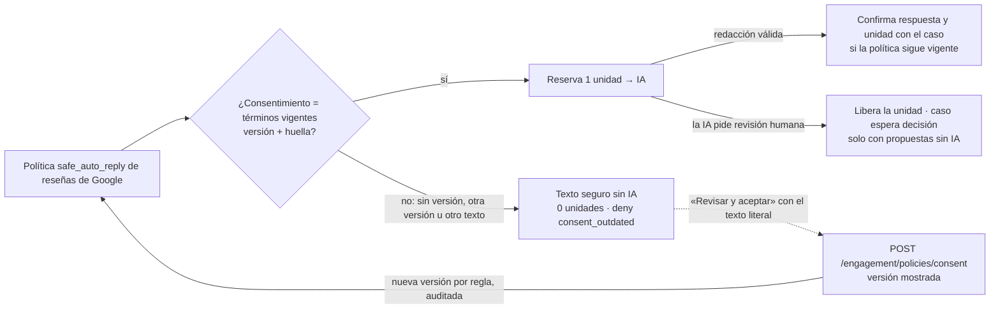
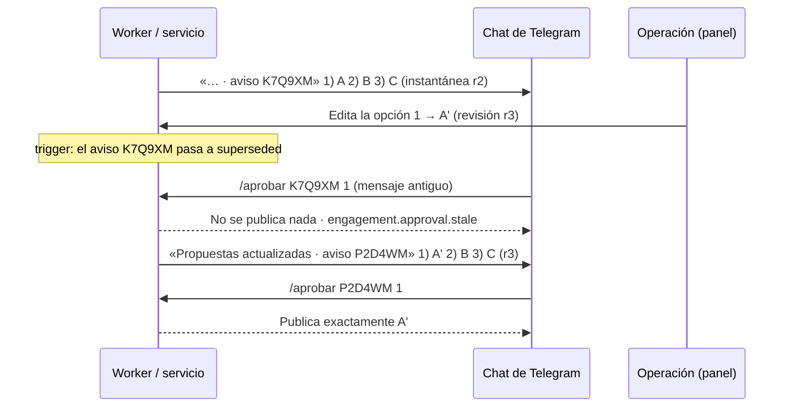

# Salvaguardas de la cuota de respuestas con IA (DEC-0077): consentimiento versionado y aprobación por Telegram ligada al aviso

- Estado: **implementado en local** en la rama `feat/commercial-governance-safeguards-20261105`, apilada sobre PR #17 (`b809510`) → PR #16 → PR #15 → PR #14 → PR #13. **Producción: NO-GO** (§9).
- Autoridad: **DEC-0077** (canon funcional 0.8.0: FR-0008, FR-0010, FR-0016, BR-0007, NFR-0006; nuevos FR-0020 y FR-0021). Fuentes: directiva literal del propietario **SRC-0017** (abre esta sesión y enumera con sus palabras las siete decisiones confirmadas) y **SRC-0016** (copia byte a byte de `SRC-006` del repositorio documental; la única palabra literal del propietario allí es «Adelante»).
- Especificación del ciclo: `docs/handoffs/commercial-policy-2026-11-05/{OWNER-RESOLUTION,NEXT-LOCAL-ROUND}.md` (PR #17). Retención de 60 días (solo especificación): [`retention-60d-spec.md`](retention-60d-spec.md).
- No fija cuotas, nombres, precios, proveedor de pago, prorrateo, umbrales ni límites de la demostración pública. Ningún valor lo eligió el agente.
- Evidencia y dictamen: [`evidence/commercial-governance/README.md`](../../evidence/commercial-governance/README.md).

## 1. Punto de partida verificado

| Elemento | Estado observado |
|---|---|
| Checkout principal | `feat/canonflow-implementation` en `2f91053`: 2 commits locales sin publicar (`0cf90bf`, `2f91053`: botones de Telegram, conversación y conexión de Facebook) **fuera** de la cadena de PR; no se tocó. Sus botones aprueban con `approve(…, { draft_index }, 'telegram')`, que esta rama retira (§8, riesgo 1) |
| PR #13 → #17 | Abiertos y apilados: #13 `feat/plan-policy-catalog-impl-20261104` (base `feat/canonflow-implementation` remota `95f9436`) → #14 → #15 → #16 (DEC-0076) → #17 `docs/owner-commercial-resolution-20261105` (`b809510`) |
| Esta rama | Worktree `../mainspot-platform-governance` desde `b809510` |
| Línea base `b809510` (BD desechable) | tsc 0 · unitarias 187/187 · integración 270/270 |

## 2. Gobernanza canónica (DEC-0077)

Registro por el procedimiento P1 del proyecto (como DEC-0073…DEC-0076): sin sesión HDC, sin QS/ANS ni APR; contador `dec` 76 → 77 con su instantánea. Validación offline con `canonflow-keystone` (sin red, sin modificar su checkout): `validate_schemas_v2.py` VALID para `DEC-0077.json`, `source-register.yaml`, `decision-state/index.json`, `links.yaml`, `functional-canon-state.yaml` e `implementation-state.yaml`; `validate_traceability.py` 5/106 con los mismos 5 fallos previos (enlaces 62, 68, 73, 79, 83) y los enlaces nuevos en verde.

| R | Decisión (palabras de SRC-0017) | Canon | Estado |
|---|---|---|---|
| R1 | Recepción de reseñas sin límite comercial | FR-0008, FR-0010 | Implementado desde DEC-0076; confirmado |
| R2 | Generación de respuestas con IA bajo demanda | FR-0016 (AC-16004 aclarado) | Implementado desde DEC-0076; esta rama corrige la rama en que la redacción de una respuesta automática pide revisión humana (§3) |
| R3 | Cuota mensual compartida entre automáticas con IA y propuestas pedidas | FR-0016, BR-0007 | Implementado; el consentimiento informado lo completa R8 |
| R4 | Facebook fuera de esta cuota, sin eliminar controles de costo | FR-0016 AC-16011, NFR-0006 AC-6004 | Verificado (§5) |
| R5 | Laboratorio fuera de cuotas comerciales, con permisos y presupuestos | NFR-0006 AC-6005/AC-6006, BR-0007 | Verificado (§5) |
| R6 | Demostración pública gratuita separada del Trial administrativo | FR-0021 (nuevo) | Especificado; duración, volumen y antiabuso **OPEN** (AC-21003 pendiente de confirmación) |
| R7 | Recuperación de 60 días tras fin efectivo del servicio o suspensión | FR-0020 (nuevo), `retention-60d-spec.md` | Especificado; **BLOCKED** por G-LEGAL y G-PAY |
| R8 | SEC-CONSENT-01 | BR-0007, FR-0016 AC-16003/16007/16008 | Implementado (local) — §3 |
| R9 | SEC-TG-APPROVAL-01 | FR-0016 AC-16009/16010 | Implementado (local) — §4 |

Precedencias (tabla completa en `DEC-0077.md`): DEC-0076 se confirma íntegro; **DEC-0018 prevalece para el Trial administrativo** y C14 solo rige la demostración pública; **DEC-0077 prevalece sobre DEC-0024/DEC-0027 solo en el plazo** de la cancelación con fin efectivo del servicio y de la suspensión efectiva por impago tras la gracia (`SUPERSEDES` parciales), y DEC-0024/DEC-0027 siguen rigiendo todo lo demás (anonimización verificable, exportación previa, respaldos —14 días, nunca más de 16 según el contrato de respaldos, DEC-0046/DEC-0057—, baja confirmada fuera de esos estados a 30 días); la purga de contenido de Google a 30 días no cambia.

## 3. SEC-CONSENT-01 — consentimiento informado y versionado

| Pieza | Implementación |
|---|---|
| Términos versionados | `src/engagement/consent.ts`: texto literal, versión y huella por origen. El de Google dice que cada respuesta automática con IA usa 1 de la misma bolsa que «Redactar con IA», que puede agotarla antes de la renovación y que sin saldo responde con texto seguro sin IA. Cambiar un texto exige subir su versión: `tests/unit/engagement-consent-terms.test.ts` fija la huella de cada versión |
| Registro | Migración 0037: `engagement_policy.consent_version` y `consent_sha256`. CHECK NOT VALID: toda `safe_auto_reply` nueva lleva versión, y versión y huella van juntas y con formato. Trigger `engagement_policy_guard`: política append-only (sin UPDATE) y huella = sha256 del texto guardado. Las políticas previas quedan sin versión |
| Gasto | `EngagementService.classifyCase`: solo `consentCoversAiSpend` (versión **y** huella de los términos vigentes, `consentIsCurrent`) llega a `meteredReply`. Si no, sin invocar a la IA ni reservar: texto seguro sin IA, que el consentimiento anterior autorizaba, y auditoría `engagement.ai_reply` deny `consent_outdated`. Una fila con la versión vigente y otro texto no cubre nada |
| Redacción que pide revisión humana (R2) | Si la redacción de la respuesta automática vuelve con `needs_human`, se libera la reserva (`ai_reply_needs_human`), se descarta el texto de IA y el caso espera decisión con sus propuestas sin IA, sin `reply_invocation_id`: la propuesta con IA se pide aparte con «Redactar con IA», que es lo que consume. También si la regla se revocó durante la redacción |
| Consentimiento al confirmar | En la transacción que confirma la respuesta automática y su unidad se toma el candado de la política y se exige que siga siendo la misma. Si se revocó o se reconsintió mientras se redactaba, no se confirma nada: se libera la reserva y el caso sigue `received` para el siguiente ciclo |
| API | `GET /engagement/policies` (con `consent_terms` y `reconsent_required`). `PUT /engagement/policies` exige la `consent_version` mostrada: 400 sin ella, 409 si ya no es la vigente. `POST /engagement/policies/consent` (`engagement.policy.manage`): una versión nueva por regla afectada, con el mismo modo y límite por hora, auditada `engagement.policy.changed` `…:reconsent:<versión>`. Es idempotente y respeta RBAC y el aislamiento por negocio |
| Panel | Aviso «Actualiza tu autorización…» en Atención y en Reglas. La hoja muestra literalmente el texto y la versión del servidor y no acepta sin la casilla. La hoja de activación también muestra las condiciones literales de cada origen |
| Facebook | No gasta esta cuota: el consentimiento previo sigue cubriendo sus respuestas automáticas sin reconsentimiento. Las nuevas activaciones guardan su versión `auto_reply.facebook_comment.v2` |

## 4. SEC-TG-APPROVAL-01 — `/aprobar` solo publica lo que se vio

| Pieza | Implementación |
|---|---|
| Revisión de propuestas | `engagement_case.drafts_revision`: el trigger la sube con cada cambio de `drafts` y la conserva en cualquier otra escritura (no se puede fijar a mano) |
| Instantánea por aviso | `engagement_approval_offer`: chat, persona, código de 6 caracteres (único por chat), revisión, opciones mostradas y su sha256. Inmutable: solo pasa de `active` a `used` o `superseded`, y a `purged` vaciando las opciones sin tocar qué se aprobó ni cuándo. Al subir la revisión, el trigger marca `superseded` los avisos activos anteriores |
| Texto del aviso | `notificationText`: el código va al final de la primera línea (`… · aviso CÓDIGO`); la reseña y su autor (texto de terceros) van en una sola línea —cuenta como salto cualquier terminador: `\n`, `\r`, NEL, LS, PS— y sin comandos `/aprobar`/`/rechazar`; solo las opciones empiezan una línea con «N) » (sus líneas siguientes van sangradas, con el mismo criterio de salto); al final `/aprobar CÓDIGO 1 (o 2, 3) · /rechazar CÓDIGO`. «Propuestas actualizadas» solo si ese chat ya recibió un aviso de una revisión anterior; un caso con entrega incierta (`delivery_uncertain`) avisa que la respuesta pudo publicarse |
| Aprobar | `approveFromNotice`: busca el aviso de ESE chat y ESA persona del negocio y bloquea primero el caso y después el aviso, en el mismo orden que el trigger, sin interbloqueos. Exige el aviso activo, la misma revisión y el mismo texto, y aprueba con un UPDATE condicional (revisión + texto). Publica el texto de la instantánea y marca el aviso `used` |
| Obsoleto o ya usado | No publica: audita `engagement.approval.stale` y envía al chat el aviso vigente con otro código (`sendNoticeTo`). La respuesta distingue «las propuestas cambiaron» de «ese aviso ya se usó» (`approval_used`), y en este caso dice si la publicación falló o si no se pudo confirmar |
| Referencias ajenas o heredadas | Un código de otro chat, otra persona u otro negocio recibe la misma respuesta genérica (auditada `engagement.approval.ref_invalid` en el negocio de quien lo intentó). `/aprobar <case_id> N` (mensajes previos) nunca publica: si el caso es del negocio y sigue pendiente, se reenvía su aviso vigente. Sin número de opción se pide; no se elige por defecto |
| Negocio inactivo | Un chat vinculado a un negocio `suspended` o `exiting` no decide ni publica (`tenant_inactive`), aunque su aviso siga vigente |
| Editores simultáneos | `editDraft` compara la revisión que leyó: dos ediciones de opciones distintas no se pisan (la segunda recibe 409). Cada edición vuelve a avisar a los chats |
| Envío de avisos | Solo a chats vinculados activos. Tras enviar, la fila de entrega solo queda «enviada» bajo candado compartido del caso y si su revisión sigue vigente; si no, queda pendiente (el caso queda `pending`, no `failed`) y el siguiente ciclo envía la revisión vigente. El ciclo también recoge las filas pendientes de chats activos. Si una publicación aprobada se agota (`failed`) o su entrega queda incierta, las filas se re-encolan y los chats reciben el aviso vigente |
| Panel | `POST /engagement/cases/:id/approve` exige el texto visible (lo que envía el panel) o `draft_number` + `drafts_revision`, comparada en el UPDATE: sin ellos 400, revisión vieja 409. Telegram no pasa por aquí |
| Chat simulado del panel (desarrollo) | `GET /dev/simulator/telegram` devuelve las instantáneas (`notices`, con su estado) del chat de la persona. Solo los avisos vigentes llevan botones, armados con su instantánea a partir del código de la primera línea; la segunda confirmación muestra el texto de la instantánea, nunca el texto analizado del mensaje. En un aviso sustituido se puede escribir su comando, como en Telegram, y el servidor no publica nada |
| Retención | La purga de contenido de Google (30 días) vacía `engagement_case.ai_draft` y las opciones de las instantáneas, y conserva su huella (`ai_draft` no se purgaba en `b809510`). La baja del negocio bloquea sus casos y después borra las instantáneas (`TENANT_TABLES`), en el mismo orden de candados que `/aprobar` |

## 5. Facebook y laboratorio: límites técnicos fuera de la cuota comercial

Verificación independiente (subagente `CostBoundsFbLab`, Claude Opus 5.5, esfuerzo máximo): prueba `tests/integration/ai-cost-bounds.test.ts` (9 pruebas, proveedores falsos y sin red) e informe `evidence/commercial-governance/cost-bounds-report.md`. En una copia desechable se le inyectaron seis mutantes y la prueba los detectó todos.

| Camino | Control que lo acota | Veredicto |
|---|---|---|
| Comentario de Facebook frente a `ai_review_replies` | No pasa por el libro de cuotas: con la cuota en 0 o sin definir sigue su camino, y la misma cuota bloquea «Redactar con IA» en Google | Fuera de la cuota (R4) |
| Redacción con IA de Facebook | Reserva previa contra `tenant_day` y `lab_total` (`reserveBudget`, `dispatcher.ts`). Agotado: invocación `blocked budget_exhausted`, sin llamada al proveedor; el caso sigue sin IA | Acotado en costo |
| Lectura Jev de Facebook | Tope diario de TypeSafe (DEC-0032). Alcanzado: revisión humana sin redacción | Acotado (sin reserva atómica: TS-1) |
| Publicación automática de Facebook | `max_auto_replies_per_hour` (ventana móvil). Limita lo que se **publica**, no lo que se redacta (AC-16011 lo precisa) | Acotado (publicación) |
| Laboratorio: emisión y uso del grant | Roles, step-up, allowlist, caducidad y revocación, revalidados en servidor en cada uso; solo `AI_ENVIRONMENT=lab` | Acotado |
| Laboratorio: gasto | Mismas reservas `tenant_day`, `lab_total` y tope TypeSafe; nunca toca el libro de cuotas comerciales | Acotado |
| Techos sin configurar (HUECO-GLOBAL-1) | Antes, una base sin filas `ai_budget` no limitaba nada. **Corregido** (`3e9eb8c`): sin `lab_total`, o sin ningún `tenant_day` del negocio, la reserva de pago se deniega. Los techos globales (`lab_total`, `platform_month`) solo cuentan con su fila global (`fa7b7ea`): una fila asociada a un negocio nunca hace de techo de la plataforma | Cerrado (NFR-0006 AC-6006) |
| Laboratorio en producción (HUECO-LAB-1) | `AI_ENVIRONMENT` vale `lab` por omisión. **Corregido** (`3e9eb8c`): con `APP_ENV=production` el laboratorio no se habilita y todo grant se rechaza (`lab_disabled`). `/ai/status` informa `lab_enabled` y el panel oculta «Laboratorio de IA» cuando es falso (`4bb8ee4`) | Cerrado (NFR-0006 AC-6006) |

Huecos que quedan, sin cambio de comportamiento porque cada uno requiere una decisión del propietario o un incremento propio:
- **FB-1**: todo comentario de Facebook que Jev lee se redacta con IA, aunque vaya a revisión humana o no tenga política. Solo lo frena el presupuesto técnico. Limitarlo a respuestas automáticas cambiaría el producto vigente (DEC-0076 conservó ese comportamiento) y le corresponde a la «futura política por canal» de R4.
- **FB-2**: el máximo por hora no limita el gasto, solo la publicación (está documentado en el canon).
- **FB-3**: el presupuesto diario del negocio es uno para todas sus funciones de IA: Facebook o el laboratorio pueden agotarlo ese día. Un presupuesto por caso de uso o por origen queda OPEN.
- **TS-1**: el tope de TypeSafe se comprueba sin reservar (conocido como V2-GAP-07).
- No existe un entorno de IA de producción distinto de `lab` (`AI_ENVIRONMENTS = ['lab','test']`): definirlo es una decisión aparte.

*Estado (2026-11-06, rama local `feat/facebook-ai-policy-20261106`)*: el propietario decidió los cuatro huecos (SRC-0018 = SRC-007) y **DEC-0078** los cierra en local: FB-1 con modos de sugerencias (`off`, `on_demand` predeterminado, `auto_suggest` con consentimiento versionado) y un medidor propio `ai_facebook_suggestions` (sin valor aprobado ⇒ deny; activación comercial BLOCKED); FB-2 sin redacción para publicar si ya no cabe en la hora; FB-3 con `lab_experiment` segregado de `tenant_day` bajo `lab_total` y atribución por canal; TS-1 con reservas atómicas de TypeSafe (migración 0040). Diseño y evidencia: [`facebook-ai-policy.md`](facebook-ai-policy.md). Este apartado se conserva como historia de DEC-0077.

## 6. Migración y reversión

`migrations/0037_consent_and_approval_binding.sql` es aditiva, transaccional y re-ejecutable. No modifica políticas, casos ni avisos existentes: solo añade columnas con valor por defecto, restricciones NOT VALID (no recorren las tablas con el candado exclusivo; las filas previas las cumplen por construcción), triggers y la tabla de avisos. Reversión: `scripts/consent-approval-binding-rollback.sql`, en una transacción con `ON_ERROR_STOP`, el candado de migraciones y `ACCESS EXCLUSIVE`. Se niega (55000) si 0037 no está registrada, si hay migraciones posteriores, o si existe cualquier consentimiento versionado o aviso registrado (son la prueba de qué aceptó y qué vio cada persona). Orden: **0037 → 0036 → 0035 → 0034**. Exige volver al código de `b809510`, que no aplica ninguna de las dos salvaguardas: sirve solo para laboratorio.

## 7. Matriz requisito → código → prueba → gate

| Requisito | Código | Pruebas | Gate / estado |
|---|---|---|---|
| R8 · AC-16007: consentimiento previo ⇒ sin IA ni unidad, texto seguro, auditado | `consent.ts` (`consentCoversAiSpend`, `consentIsCurrent`); `service.ts` `classifyCase` | `engagement-consent`: «consentimiento anterior…», «otra versión…», «versión vigente pero OTRO texto…», «Facebook…»; unitaria `engagement-consent-terms` (huella fija por versión) | IMPLEMENTADO (local) · producción: G-MIG/G-SEC |
| R8 · AC-16008: aceptación versionada (versión mostrada, huella, actor, auditoría, 409, idempotente, RBAC, aislamiento) | `service.ts` `setPolicy`/`reconsent`; `engagement-routes.ts`; panel | `engagement-consent` (aceptar, RBAC/concurrencia, activar exige versión, BD append-only); E2E `governance-safeguards-ui` checks 1–15 | IMPLEMENTADO (local) |
| R8 · revocación durante la redacción | `classifyCase` (`PolicyChangedError`) | `engagement-consent`: «Revocación durante la redacción…», «revocar la regla mientras la IA redacta y la redacción pide revisión humana…» | IMPLEMENTADO (local) |
| R2 · AC-16004: la propuesta con IA va aparte y solo a pedido, también si la redacción automática pide revisión humana | `classifyCase` (liberación `ai_reply_needs_human`) | `engagement-consent`: «R2: si la redacción para la respuesta automática pide revisión humana…»; `commercial-quota` (AC02/AC03/AC05, «La propuesta con IA va aparte…») | IMPLEMENTADO (local) |
| R9 · AC-16009: publica exactamente la opción del aviso; cambio posterior ⇒ obsoleto + aviso nuevo | `notice-offer.ts`; `service.ts` `approveFromNotice`/`notificationText`/`issueNotice`/`deliverNotice`; `telegram.ts`; 0037 | `telegram-approval-binding` (instantánea, adversarial del handoff, formato heredado, «Formato del aviso…»); `commercial-quota` («la propuesta con IA va aparte…»); `engagement-agent` (AG-02); E2E checks 16–30 | IMPLEMENTADO (local) · entrega real de Telegram: **TELEGRAM_WEBHOOK_REAL_VERIFIED pendiente** |
| R9 · AC-16010: carreras editor/aprobador, mensajes antiguos, reentregas, aislamiento, código usado | `approveFromNotice` (candados y CAS), `editDraft` (CAS), dedupe `telegram_update`, re-encolado tras fallo | `telegram-approval-binding` (orden forzado y 12 carreras libres, dos editores, reentregas y repeticiones, aislamiento, integridad BD, «Publicación aprobada que falla…», «Reintento del canal…»); `engagement-agent` (webhook concurrente, pool de 1 conexión) | IMPLEMENTADO (local) |
| R9 · panel: aprobar solo lo visto | `approve` (texto o número + revisión); chat simulado con `notices` | `telegram-approval-binding`: «Panel: aprobar por número exige la revisión…»; `engagement-agent` AG-04; E2E checks 16–30 | IMPLEMENTADO (local) |
| Negocio suspendido o en baja no decide por Telegram | `telegram.ts` (`tenant_inactive`); anonimización caso → aviso | `telegram-approval-binding`: «Negocio suspendido o en baja…» | IMPLEMENTADO (local) |
| Purga de Google cubre las copias nuevas | `google/retention.ts`; `retention/service.ts`; guard de purga en 0037 | `telegram-approval-binding` («Purga de contenido de Google…», «Integridad en BD…»); `retention`, `google-connector` | IMPLEMENTADO (local) |
| 0037 y su reversión | migración, script psql | `consent-approval-migration` (4); `commercial-quota-migration` (4) | IMPLEMENTADO (local) · **G-MIG** sobre copia restaurada de producción: no ejecutado |
| R4 · AC-16011 / AC-6004: Facebook fuera de la cuota, acotado por presupuesto (y la publicación automática por hora) | sin cambios en el camino de Facebook; `governance.ts` (fail-closed) | `ai-cost-bounds` (a), (b) ×2, (c), (e) | VERIFICADO (local, simulado) · FB-1/FB-3/TS-1 quedan como riesgos (§5) |
| R5 · AC-6005: laboratorio fuera de las cuotas, con grant y presupuestos | `lab.ts` (desactivado en producción); `ai-routes.ts` `lab_enabled`; panel | `ai-cost-bounds` (d) ×3, (f); `ai-manual-lab` | VERIFICADO (local, simulado) |
| NFR-0006 · AC-6006: sin techo no hay gasto; laboratorio nunca con `APP_ENV=production` | `governance.ts` `reserveBudget`; `lab.ts` `AiLab` | `ai-cost-bounds` (e), (f) | IMPLEMENTADO (local) |
| R6 · FR-0021 demostración pública | — | — | **OPEN** (parámetros del propietario) |
| R7 · FR-0020 recuperación de 60 días | — (el código conserva la baja confirmada a 30 días) | — | **BLOCKED** G-LEGAL + G-PAY |
| Sin cambios involuntarios (PR #13–#16) | — | suites completas y E2E de regresión en verde (evidencia) | IMPLEMENTADO |

## 8. Riesgos residuales

1. **Commits locales fuera de la cadena (`0cf90bf`, `2f91053`)**: sus botones de Telegram aprueban por índice. Al integrarlos, chocan con esta rama (`approve()` ya no acepta `'telegram'` ni índices sin revisión) y deben adoptar el código del aviso en `callback_data`. Hasta entonces, no se pueden desplegar juntos.
   - *Estado (2026-11-06, rama local `integrate/telegram-channels-notice-binding-20261106`, sin publicar)*: integrados sobre `122e74d`. Cada tarjeta de caso es un aviso con instantánea registrada antes de enviarse; sus botones llevan `np|na:<código>:<N>` y `nb|nr:<código>` y solo llaman a `approveFromNotice`/`rejectFromNotice`; los botones con el id del caso nunca deciden y reenvían el aviso vigente. Prueba: `tests/integration/telegram-button-binding.test.ts`. Sin entrega real de Telegram de estos botones (riesgo 2).
2. **Entrega real de Telegram no verificada**: todo lo de aquí usa el canal simulado (`telegram-webhook-starlink.md`). Con un fallo ambiguo del canal (enviado pero reportado como error), el primer aviso queda activo y se reintenta con otro código; ambos muestran la misma revisión y cada uno solo publica su propia instantánea.
3. **Avisos repetidos**: un aviso obsoleto envía uno nuevo al momento, y un ciclo concurrente del worker puede mandar otro. Son mensajes de más, no publicaciones: cada código solo aprueba su instantánea.
4. **Más fricción**: cualquier edición de las propuestas invalida el aviso entero, también para opciones que no cambiaron (es la regla más estricta).
5. **Texto de las opciones**: se muestra tal como se publicará (solo se sangran sus líneas siguientes); si quien edita escribe algo con forma de comando, aparece dentro de la opción. Solo la primera línea y la línea «Para publicar» son del servidor, y un código ajeno no aprueba nada.
6. **Reconsentimiento**: hasta que el negocio acepte, sus respuestas automáticas a reseñas salen con el texto seguro sin IA. Un cambio futuro de los términos (versión nueva) vuelve a exigir aceptación.
7. **Presupuestos obligatorios** (`3e9eb8c`): un despliegue sin `ensureAiCatalog` (sin fila global `lab_total` ni `tenant_day`) deniega toda IA de pago (Anthropic, OpenAI, OpenRouter). La lectura Jev (TypeSafe) no es de pago en ese sentido y sigue limitada por su propio tope diario (DEC-0032). Es el comportamiento buscado (fail-closed), pero exige sembrar los techos en cada entorno; el valor de `lab_total` para un entorno de producción no está decidido.
8. **Retención de 60 días**: el código sigue anonimizando la baja confirmada a los 30 días (DEC-0024/DEC-0025). No debe usarse para lo que comercialmente sea una cancelación hasta que FR-0020 se desbloquee (Q-L10 de la especificación).
9. **Facebook sin purga por plazo** y **archivo de exportación previa a la baja sin borrado**: son huecos de retención previos y ajenos a R7, documentados en la especificación.
10. **Facebook y laboratorio**: FB-1, FB-2, FB-3 y TS-1 (§5) siguen abiertos por diseño hasta una decisión del propietario.
   - *Estado (2026-11-06)*: decididos por el propietario y cerrados en local por DEC-0078 (ver §5 y [`facebook-ai-policy.md`](facebook-ai-policy.md)); la activación comercial del medidor de Facebook y el valor de `lab_experiment` siguen sin decidir.
11. **0037 cambió antes de publicarse**: la revisión independiente endureció 0037 (guard de purga, NOT VALID) después de aplicarse en bases de prueba, y `scripts/migrate.ts` no guarda huella del contenido de cada migración. Solo existen bases desechables recreadas en cada ejecución (ninguna persistente aplicó 0037: `mainspot-local` corre el checkout principal sin 0037); cualquier otra base que haya aplicado una versión de desarrollo de 0037 debe recrearse.
12. **Consentimiento en la BD**: la BD comprueba que la huella corresponde al texto guardado, pero no ata cada versión a su texto canónico; esa regla vive en el código (`consentIsCurrent`) y en la prueba que fija las huellas. Una fila escrita por SQL con la versión vigente y otro texto no habilita gasto, pero queda registrada.

## 9. Preparación

Dictamen local y de producción, por separado, en [`evidence/commercial-governance/README.md`](../../evidence/commercial-governance/README.md).
