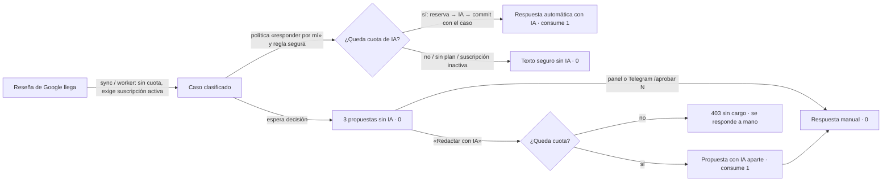

# Cuotas comerciales de reseñas: recibir y responder a mano sin cuota, respuestas con IA por ciclo mensual

- Estado: **implementado en local** en la rama `feat/commercial-quota-semantics-20261105`, apilada sobre PR #15 (`83619f0`) → PR #14 (`f68746b`) → PR #13 (`b1cd3df`). **Producción: NO-GO** (ver §8).
- Autoridad: **DEC-0076** (canon funcional 0.7.0: FR-0008, FR-0010, FR-0016). Fuentes: la directiva literal del propietario **SRC-0015** (mensaje de apertura de la sesión del 2026-11-05), que adopta las decisiones C01–C14 del extracto **SRC-0014** (copia byte a byte de `SRC-005` del repositorio documental; no literal, G-SOURCE abierto).
- Especificación operativa: `docs/handoffs/commercial-policy-2026-11-05/{START-PROMPT,HANDOFF}.md` (PR #15). Futuro separado: [`FUTURE-BACKLOG.md`](../handoffs/commercial-policy-2026-11-05/FUTURE-BACKLOG.md).
- No aprueba nombres, precios, paquetes ni cantidades (Q-004, C03). Ningún valor de cuota lo eligió el agente.

## 1. Reconciliación de autoridad

| Fuente | Estado observado | Papel en este incremento |
|---|---|---|
| `.canonflow` de la plataforma | Canon funcional por deltas hasta 0.6.0 (DEC-0075); trazabilidad SRC → DEC → ítems | **Autoridad**. Recibe SRC-0014, SRC-0015, DEC-0076 y el delta 0.7.0 con el procedimiento de SRC-0013/DEC-0075 (sin sesión HDC; contador `dec` con su instantánea) |
| `hachxaan/mainspot-documentation` | `state/canonical-state.yaml` = INITIALIZED/0.0.0; SRC-005, patch y backlog en *staging* (`docs/commercial-governance-20261105`) | Fuente de evidencia, no canon. Nada pasa de staging a canon sin registro aquí |
| HDC-MSP-06 | Propuesta en la cola HDC, nunca creada como sesión | DEC-0076 cierra su parte semántica (ciclo, rollover, excedentes, reglas de cambio de plan) por orden del propietario; quedan abiertas cuotas numéricas, prorrateo, presupuestos, overrides y cuotas por modelo |

Validación offline (`canonflow-keystone`, sin red): `validate_schemas_v2.py` VALID para `DEC-0076.json`, `source-register.yaml`, `decision-state/index.json` y `links.yaml`; `validate_traceability.py` 5/101 con los mismos 5 fallos preexistentes (enlaces 62, 68, 73, 79, 83), ninguno nuevo.

## 2. Semántica implementada

| Regla | Implementación |
|---|---|
| Recibir reseñas no consume ni se limita (C01) | `ReputationEngine.sync` (`src/reputation/engine.ts`) ya no usa el libro de cuotas; conserva atomicidad con su auditoría (NFR-0001), dedupe por `source_review_id`, candado `review_sync:<tenant>` y la exigencia de suscripción activa para ingerir reseñas nuevas (mismo acceso que antes). `reviews_managed` queda `not_enforced` (registro 2) |
| Cada respuesta con IA = 1 unidad (C01) | Capacidad `ai_review_replies`, parámetro `quota.ai_review_replies.max` (periódico). Clave del libro `ai_reply:<case_id>`: un caso consume como máximo 1. Reserva **antes** de invocar a la IA, `commit` en la transacción que guarda la respuesta, `release` si la IA falla o el caso cambió (`src/engagement/service.ts`: `claimAiReply`, `meteredReply`, `requestAiDraft`) |
| Responder a mano es gratis (C01) | `approve`/`reject`, panel y Telegram no tocan el libro |
| Ciclo propio sin acumulación (C04, C06) | Semántica `periodic`: unidades confirmadas en `[ancla + n meses, ancla + n + 1)` UTC, ancla `subscription.started_at` (en el piloto sin cobro, el alta del plan). Cambiar de plan no mueve el ancla ni reinicia el uso |
| Sin excedentes ni cargos (C05) | Agotada, ausente en la revisión fijada o sin suscripción activa ⇒ solo se deniega la IA (403 `limit_exceeded`/`subscription_required`, auditado `engagement.ai_reply`); la respuesta automática cae al texto seguro; nada se factura |
| Respuesta automática autorizada | Se redacta con IA y consume 1 (el consentimiento y la pantalla de reglas lo dicen). Si la redacción dura más que la reserva (15 min), sale el texto seguro sin consumir |
| Propuesta a pedido | `POST /api/backoffice/engagement/cases/:id/ai-draft` (`engagement.respond` + `ai.generate`; 201, o 200 si ya existía). Se guarda en `engagement_case.ai_draft`, **aparte** de las tres opciones numeradas: el aviso de Telegram y `/aprobar <caso> N` siguen significando lo mismo |
| Saldo para el panel | `GET /api/backoffice/engagement/ai-replies` (`engagement.read`): `available`, `subscription_active`, `limit`, `usage`, `remaining`, `window` |
| Fuera de esta cuota (pendiente G-SEM) | Comentarios de Facebook (siguen con propuesta de IA automática) y el laboratorio manual (DEC-0074) |

Panel del negocio: el caso de una reseña muestra «Respuesta con IA» con saldo y fecha de renovación, el botón «Redactar con IA» y, agotada, la explicación y la respuesta manual; la propuesta aparece como «Propuesta con IA» sin reemplazar lo que la persona haya escrito. «Mi plan» muestra la cuota del ciclo con su renovación («lo no usado no se acumula») y «Reseñas gestionadas: Sin límite». Las reglas de respuestas automáticas avisan del consumo.

## 3. Datos, migración y reversión

`migrations/0036_commercial_quota_semantics.sql` (aditiva, transaccional, re-ejecutable):
1. Inserta la definición `quota.ai_review_replies.max` (`periodic`, `subscription_month`, 0–1 000 000, sugerido **0**, `enforced`).
2. Deja `quota.reviews_managed.max` en `not_enforced` con su nueva descripción.
3. Lleva las 7 definiciones a `registry_version = 2` (espejo de `PLAN_REGISTRY_VERSION`).
4. Añade `engagement_case.ai_draft` con CHECK (1–4000 caracteres y solo con `reply_invocation_id`).

No toca revisiones, valores, suscripciones ni el libro: **ninguna revisión publicada define la cuota nueva**, así que tras desplegar se deniega la redacción con IA en todos los negocios (fail-closed) hasta que Ingeniería publique revisiones con un valor confirmado y Administration migre las suscripciones. Ese valor es configuración operativa sin aprobación comercial (DEC-0075) y no lo fija este incremento.

Reversión: `scripts/commercial-quota-rollback.sql` (una transacción, `ON_ERROR_STOP`, candado de migraciones y `ACCESS EXCLUSIVE`). Se niega (55000) si 0036 no está registrada, si hay migraciones posteriores, o si existe **cualquier** valor de revisión, reserva o `ai_draft` de la cuota nueva: en ese caso solo cabe restaurar respaldo o corregir hacia delante. Orden completo: **0036 → 0035 → 0034**; los scripts de 0035 y 0034 se niegan mientras haya posteriores. Exige desplegar el código del registro 1 (`f68746b`).

## 4. Auditoría

`quota.reserved`/`quota.consumed`/`quota.released` (con motivo) en el libro; `engagement.ai_draft.generated` (`consumed:1`, `evidence_ref` = invocación) en la misma transacción que la propuesta; `engagement.ai_reply` `deny` con `limit_exceeded`/`subscription_required`; `engagement.case.classified` como antes.

## 5. Matriz requisito → código → prueba → gate

AC del handoff (temporales) frente a los AC canónicos de DEC-0076.

| AC handoff | AC canónicos | Código | Pruebas (todas en BD desechable) | Estado |
|---|---|---|---|---|
| AC01 reseñas recibidas no consumen, también con IA en 0 | AC-10009, AC-8001, AC-16004 | `reputation/engine.ts` (sync), `engagement/service.ts` (classifyCase), `plans/registry.ts` | `commercial-quota.test.ts` (AC01 ×2, NFR-0001); E2E checks 1–8 | IMPLEMENTED (local) |
| AC02 manual libre; IA = 1 exacta | AC-16004, AC-16006 | `requestAiDraft`, `approve` | `commercial-quota.test.ts` (AC02/03/05, «propuesta aparte»); E2E checks 10–22 | IMPLEMENTED (local) |
| AC03 replay y concurrencia | AC-10010, AC-16005 | libro `ai_reply:<case>` + candado por negocio | AC03 (8 casos/límite 3; 6 sobre un caso), clasificaciones simultáneas | IMPLEMENTED (local) |
| AC04 ciclo propio, sin acumulación, activación por pago | AC-10011 | `policy.ts monthlyCycle`, `quota.ts` periódica | AC04 (ciclo siguiente, no-rollover, ancla al cambiar de plan) | PARTIAL: activación por **pago** BLOCKED (G-PAY) |
| AC05 agotada bloquea solo la IA, sin cargo | AC-10010, AC-16006, AC-16003 | denegación 403; texto seguro | AC02/03/05, respuesta automática agotada, fail-closed | IMPLEMENTED (local) |
| AC06 upgrade conserva uso y prorratea; downgrade diferido | — | `assignment.ts` conserva ancla y uso | AC04 (subir/bajar con uso conservado) | PARTIAL: prorrateo BLOCKED (fórmula C08, precios); downgrade diferido OPEN |
| AC07 gracia 7 días, despublicación reversible | — | — | — | BLOCKED (sin proveedor de pago ni estado de gracia; G-PAY) |
| AC08 cancelación, 60 días, import/export, borrado | — | — | — | BLOCKED + conflicto C10/C12 ↔ DEC-0024/0027 (G-LEGAL) |
| AC09 avisos en canales aprobados | — | panel: saldo, renovación, agotada; reglas | E2E (Mi plan, caso, reglas) | PARTIAL: correo/Telegram sin umbrales decididos; entrega real no verificada |
| AC10 trial sin tarjeta ni publicación | — | — | — | BLOCKED + conflicto C14 ↔ DEC-0018 |
| AC11 sin cambios involuntarios en PR #13/#14, permisos, producción | — | commits nuevos sobre PR #15; sin permisos nuevos | `plan-catalog*.test.ts`, `rbac-context.test.ts` en verde | IMPLEMENTED |

## 6. Decisiones pendientes del propietario (no se eligieron por inferencia)

1. **G-SEM**: confirmar las interpretaciones de DEC-0076 — `reviews_managed` sin límite de recepción; propuesta de IA a pedido; respuestas automáticas con IA en la misma cuota (o separadas, o solo texto seguro); Facebook y laboratorio dentro o fuera de la cuota.
2. **Valores**: cantidad de respuestas con IA por plan (C03, Q-004). Sin valor, la IA de reseñas queda apagada.
3. **Conflictos**: C14 frente a DEC-0018 (Trial) y C10/C12 frente a DEC-0024/DEC-0027 (30 frente a 60 días).
4. **Cobro**: proveedor de pago, precios y fórmula de prorrateo (C07–C09, C11, C13).
5. **Avisos**: umbrales y canales (80/100 % fue solo un ejemplo).

## 7. Riesgos residuales

- Fallos de la IA a pedido no consumen unidades pero sí cuestan; el gasto sigue acotado por `ai_budget tenant_day`.
- La reversión de 0036 deja de ser posible en cuanto exista un borrador, una reserva o una propuesta con la cuota nueva.
- Las respuestas automáticas con IA pueden agotar el ciclo antes de que la persona pida propuestas (G-SEM 3).
- La sincronización ya no tiene tope de lote por plan; depende de la paginación del proveedor.
- El canal de Telegram y el correo reales siguen sin entrega verificada (`telegram-webhook-starlink.md`).

## 8. Preparación

- **Local: GO** para revisión del propietario sobre el PR (pruebas en `evidence/commercial-quota/`).
- **Producción: NO-GO.** Faltan: confirmaciones G-SEM y valores (§6); G-MIG de 0036 sobre una copia restaurada (no ejecutado); despliegue conjunto con PR #13/#14, que siguen en borrador y con G-MIG/G-SEC sin firmar; G-SOURCE del extracto; proveedor de pago para C04/C07–C13.
