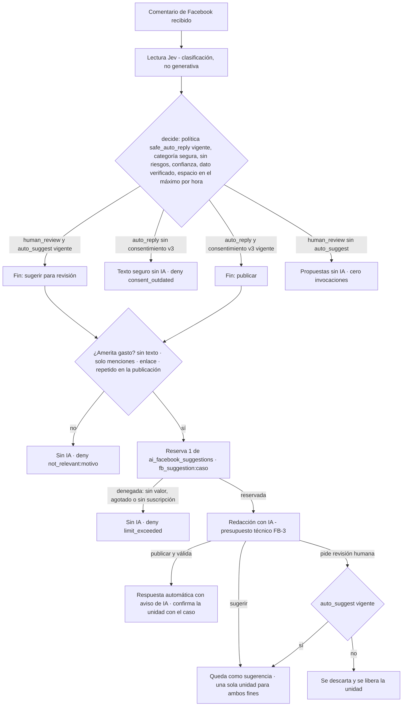

# Política de IA para comentarios de Facebook y costos (DEC-0078): modos de sugerencias, FB-2, medidor propio, FB-3 y TS-1

- Estado: **implementado en local** en la rama `feat/facebook-ai-policy-20261106`, apilada sobre
  `integrate/telegram-channels-notice-binding-20261106` → PR #19 (`122e74d`, handoff) → PR #18 (DEC-0077) → #17 → … → #13.
  **Producción: NO-GO** (§11 y [`evidence/facebook-ai-policy/README.md`](../../evidence/facebook-ai-policy/README.md)).
- Autoridad: **DEC-0078** (canon funcional 0.9.0: FR-0016, BR-0007, NFR-0006, FR-0010). Fuentes: **SRC-0018**, copia byte
  a byte de SRC-007 del repositorio documental (aprobación del propietario: «Ok para 2, 3, 4…» y «Adelante.»), y
  **SRC-0019**, directiva literal de la sesión. Contexto no canónico: `docs/handoffs/facebook-ai-policy-2026-11-06/` y la
  resolución en staging `RES-MSP-20261106-FB-AI-01`.
- No fija cantidades de créditos, precios, reposiciones, cuotas por plan, el valor de `lab_experiment` ni particiones por
  canal. Ningún valor comercial lo eligió el agente; los que aparecen en pruebas son fixtures.

## 1. Punto de partida verificado

| Elemento | Estado observado |
|---|---|
| Checkout principal | `feat/canonflow-implementation` en `2f91053`, con los commits locales ajenos `0cf90bf` y `2f91053` sin publicar. **No se tocó**: se integraron por cherry-pick con su autoría (§8) |
| Cadena de PR | #13 → #14 → #15 → #16 → #17 → #18 (`7bbea3d`, DEC-0077) → #19 (`122e74d`, solo documentos), todos abiertos |
| Línea base `122e74d` (PostgreSQL 16 desechable) | tsc 0 · unitarias 189/189 · integración 308/308 |

## 2. Decisión canónica

DEC-0078 (procedimiento P1, como DEC-0073…DEC-0077) formaliza R1 (FB-1), R2 (FB-2), R3 (FB-3), R4 (TS-1), R5 (contrato
del medidor de Facebook, activación comercial BLOCKED) y R6 (SEC-CONSENT-01 y SEC-TG-APPROVAL-01 aplicados a lo nuevo y a
los botones integrados). `SUPERSEDES` **parcial** de DEC-0077 solo en las frases que DEC-0078 vuelve falsas (el
presupuesto técnico como único control de Facebook; «el máximo por hora limita la publicación, no la redacción»; «la
política de medición propia de Facebook queda para el futuro»). DEC-0077 R4 (Facebook fuera de `ai_review_replies`), R8
y R9 siguen vigentes; DEC-0032, DEC-0068, DEC-0074 y DEC-0076 conservan sus valores. Precedencias completas:
`.canonflow/decision-records/DEC-0078.md`.

## 3. FB-1 — modo de sugerencias por negocio (nunca de publicación)

| Modo | Generación | Publicación | Consumo |
|---|---|---|---|
| `off` | Ninguna sugerencia con IA (ni automática ni a pedido) | Manual; la respuesta automática sigue su propia regla | 0 por sugerencias |
| `on_demand` (**predeterminado**, también para negocios existentes sin configuración) | Solo con «Sugerir con IA» | Aprobación humana | 1 al generarse; el costo se muestra antes de pedirla |
| `auto_suggest` (opt-in) | Una sugerencia por comentario que la amerite, sin pulsar nada, para **revisión** | **Nunca** publica por esta autorización | 1 por comentario aunque no se publique |

| Pieza | Implementación |
|---|---|
| Registro | Migración 0038: `engagement_suggestion_setting`, append-only y versionada (trigger: sin UPDATE; la huella debe ser sha256 del texto). `auto_suggest` y solo él guarda texto literal, versión y huella (`ai_suggestions.facebook_comment.v1`); sin fila rige `on_demand` |
| Activación | `PUT /api/backoffice/engagement/suggestions` (`engagement.policy.manage`): `auto_suggest` exige `consent: true` y la versión mostrada (400 sin ella, 409 si cambió) y un medidor definido en el plan (409 si falta o vale 0: no hay costo que aceptar). `off`/`on_demand` nunca se bloquean. Repetir el modo vigente no crea versión. Auditoría `engagement.suggestions.changed` en la misma transacción |
| A pedido | `POST /engagement/cases/:id/ai-draft` también para comentarios: con `off` 409; la propuesta va a `ai_draft` (aparte de las numeradas: los avisos de Telegram no cambian). Un comentario con sugerencia automática devuelve `already` sin redactar otra |
| Automática | En la clasificación (`EngagementService.classifyCase`): la sugerencia es la opción 1 de las propuestas (la del aviso) y queda también en `ai_draft` para que el panel la identifique |
| Carreras | El modo leído al clasificar se comprueba de nuevo, con el candado de `setSuggestionMode`, en la transacción que guarda el caso: si cambió, no se guarda nada, la unidad se libera y el caso se reclasifica. «Sugerir con IA» comprueba `off` con el mismo candado antes de guardar |
| Panel | Reglas › «Sugerencias con IA · Comentarios de Facebook»: tres modos, estado del medidor (usadas/límite/renovación o «tu plan todavía no incluye…»), hoja con el texto literal y el costo antes de activar las automáticas; caso: «Sugerencia con IA» con el costo antes de pedirla, o la explicación (desactivadas, agotadas, sin medidor) |

## 4. FB-2 — antes de gastar

- Sin espacio en la hora (`rate_limited`) **no se redacta para publicar**; con `auto_suggest` vigente sí hay sugerencia
  revisable, que nunca se publica sola.
- Los filtros de relevancia son deterministas (`src/engagement/suggestions.ts` `textRelevance`; duplicados por publicación
  con el texto normalizado en la BD) y solo frenan el gasto automático: una persona puede pedir la sugerencia. Enlace =
  esquema (`http(s)://`), `www.` o un dominio sin esquema con un dominio de primer nivel habitual (genéricos, de
  acortadores y perfiles, de la región; todo en minúsculas o todo en mayúsculas), con o sin ruta: `ganafacil.com`,
  `GANAFACIL.COM`, `wa.me`, `youtu.be/x`, `linktr.ee/x`. No cuentan un punto sin espacio seguido de mayúscula
  («servicio.Calidad», «atención.Me») o de una palabra que no es dominio («calidad/precio», «de verdad»), números ni el
  dominio de un correo. Es una heurística: un error solo cambia si la sugerencia se prepara sola o hay que pedirla.
- Respuestas automáticas de Facebook con consentimiento v1/v2: siguen publicando el texto seguro sin IA hasta que el
  negocio acepte `auto_reply.facebook_comment.v3` (`POST /engagement/policies/consent`, ahora por origen). Ninguna política
  existente se reescribe.

## 5. Medidor propio de Facebook (contrato; activación comercial BLOCKED)

| Regla | Implementación |
|---|---|
| Parámetro | `quota.ai_facebook_suggestions.max` (registro de planes v3), capacidad `ai_facebook_suggestions`, `periodic` por ciclo mensual de la suscripción (UTC, sin acumulación), sugerido **0**. Ninguna revisión publicada lo define |
| Unidad | 1 por comentario cuyo texto de IA se genera y se guarda (sugerencia automática, a pedido o respuesta automática), aunque no se publique; clave `fb_suggestion:<case_id>`: como máximo 1 por comentario entre todos los caminos, reintentos, reentregas y carreras |
| Liberación | Si la IA falla, el caso cambió, la reserva venció, el modo o la política cambiaron, o la redacción para publicar pide revisión sin `auto_suggest` |
| Sin valor | Deny explicado («El plan de este cliente no define “Sugerencias con IA para comentarios de Facebook”…»), sin invocar a la IA; nunca consumo ilimitado ni herencia de `ai_review_replies` |
| Activación | Publicar una revisión de plan con un valor > 0. **BLOCKED**: cantidades, precios, reposiciones, cuotas por plan y unidad de cobro son decisión económica del propietario (SRC-0018). Mientras tanto, en todos los planes reales la IA de pago de comentarios de Facebook queda denegada |

## 6. FB-3 — presupuestos técnicos

| Ámbito | Cuenta | Ventana | Fila |
|---|---|---|---|
| `lab_total` | Todo el gasto generativo de pago (operación y laboratorio): **techo global estricto** del entorno (DEC-0068, USD 25 acumulados) | Acumulada | Obligatoria |
| `platform_month` | Todo | Mes UTC | Opcional (sin valor) |
| `tenant_day` | Solo la operación del negocio (sin grant); fila propia o la por defecto (OPS-0001, USD 1) | Día UTC | Obligatoria en operación |
| `lab_experiment` | Solo gasto experimental: invocaciones bajo grant del laboratorio (de todos los negocios) y evaluaciones de rutas de pago (`ai_eval_run`) | Día UTC | Obligatoria para ese gasto; **sin valor sembrado** |

- Un mismo candado (`ai_budget_reservation`) para operación y laboratorio: reservas concurrentes nunca superan ningún techo.
- Sin la fila de un ámbito obligatorio, la reserva se deniega con ese ámbito (`budget_exhausted`). Hasta que un
  platform_admin fije `lab_experiment` (step-up, motivo, auditoría; nunca por encima de `lab_total`), ni el laboratorio
  ni las evaluaciones de pago gastan.
- Atribución: `ai_use_case.channel` (migración 0039; un canal por caso de uso: `facebook_comments`, `google_reviews`,
  `facebook_posts`, `website`, `assistant`, `campaigns`, `insights`, `editorial`, `owner_intent`) × propósito
  (`lab` ⇔ grant o evaluación) en `GET /api/platform/ai/spend` y la consola. Sin límites ni particiones por canal.
- «Sugerir con IA» denegado por un presupuesto técnico responde 429 con la explicación (diario del negocio o presupuesto
  de MainSpot) y sin descontar del plan; un fallo del proveedor sigue siendo 502.

## 7. TS-1 — reservas atómicas de TypeSafe/Jev

- Libro durable `typesafe_reservation` (migración 0040; sin `tenant_id`, el tope DEC-0032 es global), usado por las tres
  llamadas reales a TypeSafe: clasificación del AI Core (`AiDispatcher.invokeClassification`), pipeline del chat
  (`JevClassifier`) y evaluación sintética (`runJevEvaluation`). El proveedor simulado no reserva.
- Ciclo: `reserve` bajo `pg_advisory_xact_lock(hashtext('typesafe_budget'))` con barrido de vencidas → `dispatched` justo
  antes de la petición (solo con la reserva vigente) → `commit` con el costo informado o estimado y los intentos HTTP, o
  `failAfterDispatch` (costo desconocido: cuenta la reserva; un error del proveedor no se supone gratis), o `release` si
  nunca se envió. Caída: vencida sin enviar ⇒ `released`; vencida enviada ⇒ `expired` (cuenta la reserva); una
  confirmación tardía sustituye la estimación por la medición. Idempotencia por clave (`ai_invocation:<id>`,
  `evaluation:<run>:<caso>`); el pipeline usa una clave opaca de un solo uso (`pipeline:<uuid>`): el libro no tiene
  negocio y no debe guardar el request id de ninguno, para que la anonimización (DEC-0027) no encuentre rastros.
- Importe reservado: el `max_cost_usd` de la ruta TypeSafe (0.01, el valor ya sembrado), también en pipeline y evaluación.
- 0040 resume el gasto previo en una fila `legacy` por día UTC (una sola vez); desde ahí el libro es la única fuente del tope.
- **Consecuencia operativa**: `jev-classifier.ts` forma parte del código ligado al gate de Jev (DEC-0033,
  `decisionCodeSha256`: `05f7ada8…` en la base y en la evidencia del gate; `5a115a0d…` en esta rama). La evaluación aprobada
  (`evidence/ai-core/jev-gate-dev-2026-11-03.json`) deja de corresponder y el modo `primary` del chat queda cerrado:
  decide el clasificador determinista y TypeSafe sigue leyendo en sombra (con costo) hasta una evaluación nueva, que
  gasta TypeSafe real y requiere autorización del propietario; el agente no la ejecutó. Registrado en DEC-0078 como OPEN.

## 8. Integración de los commits locales `0cf90bf` y `2f91053`

Rama `integrate/telegram-channels-notice-binding-20261106` (base `122e74d`): cherry-picks con su autoría
(`ab6ff40`, `017f58d`) y un commit de adaptación (`3d00e3e`). Cada tarjeta de caso es un aviso con instantánea registrada
antes de enviarse; los botones llevan el **código del aviso** (`np|na:<código>:<N>`, `nb|nr:<código>`) y solo llaman a
`approveFromNotice`/`rejectFromNotice`; los botones antiguos con el id del caso, de otro chat, persona o negocio, usados u
obsoletos nunca publican y reenvían el aviso vigente. Las tarjetas de publicaciones de Facebook atan «Publicar/Programar» a
una huella de lo mostrado; elegir variante es idempotente por tarjeta. Ningún camino integrado activa respuestas
automáticas ni gasta IA sin el consentimiento vigente. Detalle: `docs/architecture/telegram-webhook-starlink.md`.

## 9. Migraciones y reversión

| Migración | Contenido | Reversión (orden 0040 → 0039 → 0038 → 0037) |
|---|---|---|
| 0032, 0033 (ajenas) | Columnas aditivas y CHECK ampliado de los commits integrados | Sin script (riesgo residual de G-MIG) |
| 0038 | Medidor de Facebook (registro 3) y `engagement_suggestion_setting` | `scripts/facebook-ai-suggestions-rollback.sql`: se niega con configuraciones, valores o reservas del medidor |
| 0039 | `lab_experiment` y `ai_use_case.channel` | `scripts/ai-budget-segregation-rollback.sql`: se niega con una fila `lab_experiment` |
| 0040 | `typesafe_reservation` + resumen legacy | `scripts/typesafe-reservation-rollback.sql`: se niega con reservas posteriores a 0040 |

Todas son aditivas, transaccionales y re-ejecutables; cada script usa el candado de migraciones, `ON_ERROR_STOP`, se niega
(55000) si hay migraciones posteriores registradas y tiene su prueba (`facebook-ai-policy-migration`,
`ai-budget-segregation-migration`, `typesafe-reservation-migration`). G-MIG sobre una copia restaurada: no ejecutado.

## 10. Matriz requisito → código → prueba → gate

| Requisito (handoff · canon) | Código | Pruebas | Estado / gate |
|---|---|---|---|
| AC-FB01 · AC-16012: `off` sin generación; recibir y responder a mano funcionan | `service.ts` `classifyCase`, `requestAiDraft`; `suggestions.ts` | `facebook-ai-suggestions` («AC-FB01…»); E2E `facebook-ai-policy-ui` checks 23–25 | IMPLEMENTADO (local) |
| AC-FB02 · AC-16013: `on_demand` predeterminado; llegar no redacta; la petición genera bajo permisos, medidor y presupuesto | `requestAiDraft`, `engagement-routes.ts`, panel | `facebook-ai-suggestions` («AC-FB02…»), `commercial-quota` («Fuera de la cuota…»); E2E checks 1–7 | IMPLEMENTADO (local) |
| AC-FB03 · AC-16014: `auto_suggest` con consentimiento previo, sugerencia para revisión, nunca publica | `setSuggestionMode`, `classifyCase`, 0038, `consent.ts` | `facebook-ai-suggestions` («AC-FB03…», «BD…»); E2E checks 8–17 | IMPLEMENTADO (local) |
| AC-FB04 · AC-7101/7102, AC-10013/10014: texto y costo antes del opt-in; desactivable; sin medidor o sin presupuesto ⇒ deny explicado | `consent.ts`, `registry.ts` v3, 0038, `requestAiDraft` (429 por presupuesto), panel | `facebook-ai-suggestions` («AC-FB04…»), `engagement-consent-terms` (unit), `ai-cost-bounds` (a) y (b); E2E checks 8–13, 21–22, 26–28 | Contrato IMPLEMENTADO (local) · activación comercial **BLOCKED** (decisión económica) |
| AC-FB05 · AC-16015: replays, concurrencia, duplicados, cambios de modo: sin doble cobro ni publicación ajena; aislamiento | clave `fb_suggestion:<caso>`, candado de modo, filtros | `facebook-ai-suggestions` (ambos flujos, replay/carrera/cambio de modo, aislamiento/RBAC, duplicados) | IMPLEMENTADO (local) |
| AC-FB06 · AC-16016 (AC-16011 ajustado): limitada por hora ⇒ sin redacción para publicar; `auto_suggest` sí sugiere; filtros de relevancia antes del gasto automático | `classifyCase` (`forPublication`/`forSuggestion`), `textRelevance` | `facebook-ai-suggestions` («AC-FB06…», «FB-2…»), `engagement-suggestions` (unit, ambos sentidos), `ai-cost-bounds` (c) | IMPLEMENTADO (local) |
| AC-FB07 · AC-6007 (AC-6006 acotado): techo global + negocio en concurrencia; atribución por canal; laboratorio y evaluaciones segregados bajo el techo | `governance.ts`, `dispatcher.ts` `begin`, `platform-routes.ts`, consola, 0039 | `ai-budget-segregation` (+migración; evaluaciones de pago = laboratorio), `ai-cost-bounds` (d)/(e), `ai-manual-lab` | IMPLEMENTADO (local) · valor de `lab_experiment` **OPEN** · particiones por canal **OPEN** |
| AC-TS01 · AC-6008: 2 libres y 4 en paralelo ⇒ máximo 2; confirmación, expiración y rollback ante fallo y caída; el libro no guarda identificadores de negocios | `typesafe-ledger.ts`, `dispatcher.ts` `invokeClassification`, `jev-classifier.ts`, `jev-evaluation.ts`, 0040 | `typesafe-ledger` (integración y unit), `typesafe-anonymization` (DEC-0027), `typesafe-reservation-migration`, `jev-classifier`, `ai-cost-bounds` | IMPLEMENTADO (local, simulado) · reapertura del gate de Jev **OPEN** (autorización del propietario) |
| AC-FB08 · AC-16017: el aviso de Telegram ata la aprobación al texto mostrado; commits ajenos adaptados antes de combinarlos | `telegram.ts`, `telegram-ui.ts`, `service.ts` (avisos) | `telegram-button-binding`, `telegram-approval-binding`, `engagement-agent`; E2E checks 14, 18–20 | IMPLEMENTADO (local) · botones ligados al aviso sin pulsar en Telegram real |
| AC-FB09: canon trazable, estados y GO/NO-GO separados | `.canonflow/**` (DEC-0078, delta 0.9.0) | validadores de `canonflow-keystone` (evidencia) | IMPLEMENTADO |
| Migraciones 0038–0040 y reversión | migraciones, scripts psql | `facebook-ai-policy-migration`, `ai-budget-segregation-migration`, `typesafe-reservation-migration` | IMPLEMENTADO (local) · **G-MIG** no ejecutado |

## 11. Riesgos residuales

1. **IA de Facebook sin medidor en los planes reales**: hasta que el propietario decida la activación comercial, ningún
   plan publicado define `quota.ai_facebook_suggestions.max` y toda IA de pago para comentarios se deniega (sugerencias y
   respuestas automáticas con IA). Las respuestas automáticas salen con el texto seguro.
2. **Negocios existentes**: pasan de recibir una propuesta de IA en cada comentario a `on_demand`. Es el predeterminado
   aprobado; el panel lo muestra como «(predeterminado)».
3. **Laboratorio y evaluaciones de pago bloqueados hasta configurar `lab_experiment`**: sin esa fila ninguna invocación con
   grant ni evaluación de una ruta de pago gasta.
4. **Gate de Jev (DEC-0033)**: `primary` queda cerrado (decide el clasificador determinista; TypeSafe sigue leyendo en
   sombra, con costo) hasta una evaluación nueva que solo puede autorizar el propietario (§7).
5. **0032/0033** (ajenas) sin script de reversión; 0038–0040 sin G-MIG sobre copia restaurada.
6. **Filtros de relevancia**: heurística; un comentario legítimo con un enlace o un dominio (`algo.com`) no recibe
   sugerencia automática (sí a pedido), un spam sin enlace sí la recibe, y un punto sin espacio seguido de una palabra que
   coincide con un dominio habitual cuenta como enlace («todo.me encantó», «lugar.es el mejor»). Calibrables con datos.
7. **Proveedores**: todo simulado; ni la facturación real de TypeSafe/Anthropic ni la entrega real de Telegram/Meta se
   verificaron. El importe reservado de TypeSafe es conservador (0.01 por llamada).
8. **Telegram real**: la entrega está verificada (2026-11-04), pero las decisiones con los botones ligados al aviso solo
   se probaron con el canal simulado.
9. **Reentregas del chat**: con la clave opaca, si Telegram reentrega un mensaje cuyo procesamiento falló, Jev puede
   clasificarlo (y cobrarse) otra vez, como antes de TS-1; lo acota el tope diario de DEC-0032. Una clave determinista sin
   identificadores (HMAC del request id con un secreto del servidor) lo evitaría y exige decidir ese secreto.
10. **Edición web con IA desde el chat** (commits integrados): si el proceso cae entre guardar la solicitud y crear el
    trabajo, la solicitud queda en «Estoy preparando…» (visto en el código por la revisión 2; no reproducido).

## 12. Revisión independiente

Pasada 1, sobre `d573cdf` (veredicto: NO-GO hasta corregir F-01):

| ID | Severidad | Hallazgo | Resolución |
|---|---|---|---|
| F-01 | HIGH | La clave `pipeline:<request_id>` dejaba un identificador del negocio en `typesafe_reservation` (sin negocio): la anonimización (DEC-0027) fallaba para quien conversó con Jev | Clave opaca de un solo uso `pipeline:<uuid>`; prueba `typesafe-anonymization` y unit `jev-classifier` |
| F-02 | MEDIUM | TS-1 cambia `jev-classifier.ts` (huella del gate DEC-0033): `primary` queda cerrado sin aviso | Declarado en DEC-0078 (OPEN, propietario), `implementation-state.yaml`, `ai-core.md`, §7 y riesgos; ninguna evaluación de pago ejecutada |
| F-03 | MEDIUM | Las evaluaciones de rutas de pago contaban como operación y gastaban sin `lab_experiment` | Propósito `lab` también para `ai_eval_run` (reserva, informe y consola); prueba en `ai-budget-segregation` |
| F-04 | LOW | Filtro de enlaces: falsos positivos («servicio.Calidad/precio») y spam con dominio sin barra | Esquema, `www.` o dominio de primer nivel habitual en minúsculas con límites; unit en ambos sentidos |
| F-05 | LOW | «Sugerir con IA» denegado por presupuesto respondía 502 genérico | 429 `limit_exceeded` con la explicación del presupuesto; `ai-cost-bounds` (b) |
| F-06 | LOW | El estado de Telegram citaba decisiones con botones anteriores a `3d00e3e` | Corregido en `docs/architecture/telegram-webhook-starlink.md` (rama de integración) |
| F-07 | NIT | 0038 remitía a un script de reversión inexistente | Ruta corregida (solo comentario) |
| F-08 | NIT | Los scripts de reversión de 0039/0040 pedían código anterior a 0038 | Nombran el código correcto (`2905d1d` para 0039, `3368a31` para 0040) |
| F-09 | NIT | `ai-core.md` describía la contabilidad de TypeSafe anterior a TS-1 | Actualizado |

Pasada 2, sobre `5e8edd7` (veredicto: GO de código local con reservas; F-01, F-03 y F-05 cerrados, F-04 parcial; tsc 0,
unit 208/208, integración 364/364 dos veces, smoke 5/5, 15/15 sondas propias):

| ID | Severidad | Hallazgo | Resolución |
|---|---|---|---|
| G-01 | LOW | La corrección de F-04 dejó de detectar acortadores (`youtu.be/…`, `linktr.ee/…`, `amzn.to/…`, `forms.gle/…`, `shorturl.at/…`, `lnkd.in/…`) y dominios en mayúsculas: con automáticas activas se gastaba en ellos | Lista ampliada de dominios de primer nivel, en minúsculas o en mayúsculas, con o sin ruta; unit con todos los ejemplos |
| G-02 | NIT | Falsos positivos con punto sin espacio y palabra que coincide con un dominio («todo.me encantó») | Aceptado y documentado (riesgo 6): solo evita la sugerencia automática, no gasta |
| G-03 | LOW | Si la redacción automática lanza una excepción, la unidad quedaba reservada hasta vencer y el reintento clasificaba sin IA (ya pasaba en Google desde `122e74d`) | Se libera al momento; prueba en `facebook-ai-suggestions` |
| G-04 | NIT | La clave opaca permite volver a cobrar Jev en una reentrega de Telegram tras un fallo | Documentado (riesgo 9); igual que antes de TS-1 y acotado por DEC-0032 |
| G-05 | NIT | La liberación por presupuesto agotado se auditaba como `ai_draft_not_saved` | Motivo real (`ai_budget_exhausted`, `ai_draft_failed`); `ai-cost-bounds` (b) |
| G-06 | NIT | Comentarios que decían que el laboratorio es «solo con grant» | Corregidos (`governance.ts`, `ai-core.md`) |
| G-07 | NIT | Edición web con IA desde el chat: caída entre la solicitud y el trabajo deja «Estoy preparando…» | Documentado (riesgo 10); código de los commits integrados, fuera del alcance de la adaptación |
