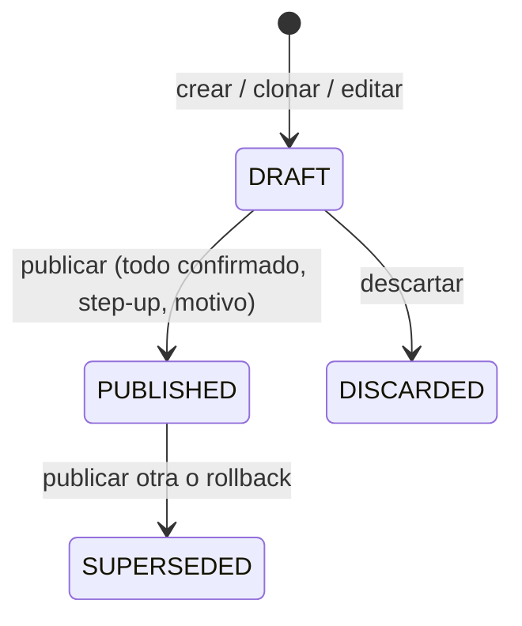

# Catálogo de planes versionado y política efectiva por plan

- Estado: **implementado en la rama `feat/plan-policy-catalog-impl-20261104`** (base `95f9436`). Autoridad: **DEC-0075**, derivada de la directiva explícita del propietario **SRC-0013** (2026-11-04). Canon afectado: BR-0007, FR-0010, FR-0018, FR-0019.
- Entradas: handoff `docs/handoffs/plan-policy-catalog-2026-11-04/HANDOFF.md` (rama `docs/handoff-plan-policy-catalog-20261104`, `585017b`), inventario verificado [`docs/research/plan-parameters-inventory.md`](../research/plan-parameters-inventory.md), DEC-0005, DEC-0007, DEC-0010, DEC-0018, DEC-0074.
- Este documento describe el diseño y su operación. No aprueba nombres, precios, paquetes ni cuotas comerciales (Q-004 sigue pospuesta, DEC-0010).
- **Delta DEC-0076 (2026-11-05, rama `feat/commercial-quota-semantics-20261105`).** Registro de parámetros 2 (migración `0036`): `quota.ai_review_replies.max` es la primera cuota **periódica** real (respuestas a reseñas redactadas con IA por ciclo mensual) y `quota.reviews_managed.max` queda sin enforcement (recibir reseñas no consume). Lo que sigue describe DEC-0075; el delta, su operación y su reversión están en [`commercial-quota.md`](commercial-quota.md). Donde este documento dice «6 capacidades acumuladas» o «ningún parámetro nuevo», vale para el registro 1.

## 1. Decisiones del propietario (SRC-0013 → DEC-0075)

| Tema | Decisión | Efecto en el sistema |
|---|---|---|
| Autoridad | Ingeniería con permisos explícitos | `plans.read` (platform_admin, ai_engineer, platform_support), `plans.edit` y `plans.publish` (platform_admin, ai_engineer). Asignar planes a negocios: solo platform_admin en `/plataforma` (`subscriptions.assign`). Salvaguarda de mínimo privilegio (BR-0007: el ai_engineer ve trazas saneadas, no clientes): las identidades de negocios en Planes solo se muestran con `tenants.read` (platform_admin, platform_support, el mismo alcance que `GET /tenants`); el ai_engineer ve recuentos por revisión. |
| Publicar | Configuración operativa | Publicar aplica los límites al enforcement; no es aprobación comercial. Cada plan se muestra «Sin aprobación comercial», sin precio ni cobro. |
| Revisiones | Suscripciones fijadas a su revisión | Publicar no cambia a clientes vigentes. Migrarlos es una acción explícita de Administration con vista previa, step-up y motivo. Los tenants existentes quedaron en la revisión 1. |
| Cuotas periódicas | Mecanismo sin activar | Ciclo mensual anclado al inicio de la suscripción (UTC) implementado y probado; ningún plan real lo usa hasta HDC-MSP-06. Las 6 capacidades siguen acumuladas. |
| Autoasignación | Retirada | `POST /api/backoffice/subscriptions/assign` responde 403 `permission_denied` auditado para todo rol. |
| Alcance | Ningún parámetro nuevo | El registro contiene solo las 6 capacidades existentes con sus valores vigentes. |
| Registro | SRC + DEC | `.canonflow/sources/SRC-0013-*.md`, `.canonflow/decision-records/DEC-0075.*`. |

Lo que **no** decide DEC-0075: precios, nombres comerciales y paquetes (Q-004); ciclo, rollover, excedentes y cambios de plan comerciales (HDC-MSP-06); la implementación del plan Trial (DEC-0018, pendiente); el enforcement de `agents` (DEC-0006/DEC-0017).

## 2. Modelo de datos (migración `0034_plan_policy_catalog.sql`, aditiva y transaccional)

| Tabla | Propósito | Invariantes (BD) |
|---|---|---|
| `plan_parameter_definition` | Espejo del registro tipado `src/plans/registry.ts` | Tipo, semántica, periodo y rango coherentes (CHECK). Si el registro y la BD difieren, las escrituras del catálogo responden 503 y el enforcement sigue con lo publicado. |
| `plan` (existente) | Identidad comercial, sin precio | `active` = asignable. Un plan habilitado siempre tiene una revisión PUBLISHED (trigger diferido). |
| `plan_revision` | Revisión de un plan | Nace DRAFT. Publicar exige todos los parámetros del registro con valor confirmado y `checksum = plan_revision_checksum()`. Una publicada solo puede pasar a SUPERSEDED. Nada se borra. Como máximo un DRAFT y una PUBLISHED por plan. |
| `plan_parameter_value` | Valor explícito por revisión y parámetro | Solo editable en DRAFT. Rango según la definición. Cambiar un valor borra su confirmación salvo que la misma escritura confirme de nuevo. No se borra. |
| `plan_catalog_event` | Auditoría detallada (motivo, diff) | Append-only. Va en la misma transacción que `platform_audit_event`. |
| `subscription.plan_revision_id` | Revisión fijada | NOT NULL. FK compuesta `(plan_id, plan_revision_id)`. Trigger: solo planes habilitados con revisión publicada; sin revisión explícita se fija la publicada vigente; una revisión explícita debe ser la publicada. |
| `subscription_history` | Historial de asignaciones | Trigger AFTER INSERT/UPDATE (cubre también SQL directo) con actor, motivo y request_id de la transacción. Append-only; solo se borra durante la anonimización de ese negocio. |
| `plan_limit_legacy_0009` | `plan_limit` original | Solo lectura. Existe para la reversión. |
| `quota_reservation.capability` | Libro de cuotas | FK a `plan_parameter_definition(capability)` (antes: CHECK con lista fija). |

**Backfill exacto (AC01).** Cada plan existente recibió la revisión 1 PUBLISHED con los valores de `plan_limit`. Las capacidades sin fila, que ya se denegaban por fail-closed, se guardaron como 0 explícito (`backfill_absent_deny`), con el mismo efecto. Las suscripciones quedaron fijadas a la revisión 1 de su plan, con historial `backfill`. Si `plan_limit` tuviera una capacidad desconocida, la migración aborta.

| Plan | website | social_posts | social_ads | reviews_managed | conversations | agents |
|---|---|---|---|---|---|---|
| plan_piloto_1 | 1 | 10 | 5 | 20 | 500 | 5 |
| plan_basico | 1 | 3 | 0 | 5 | 0 (sin fila) | 0 (sin fila) |
| plan_completo | 1 | 50 | 20 | 100 | 0 (sin fila) | 0 (sin fila) |

**Concurrencia en la BD.** Los guards no dependen de que la aplicación tome sus bloqueos:
- El trigger de valores lee la revisión con `FOR SHARE`: una escritura de valor y una publicación concurrentes se serializan, y la segunda se rechaza si ya no aplica.
- El trigger de suscripciones lee el plan con `FOR SHARE`: un alta o cambio de plan espera a la escritura del catálogo en curso sobre ese plan y se fija a la revisión que queda publicada.
- Las tablas append-only (`plan_revision`, `plan_parameter_value`, `plan_catalog_event`, `subscription_history`, `plan_limit_legacy_0009`) también rechazan `TRUNCATE` (42501), incluido el `TRUNCATE … CASCADE` desde `plan` o `client`.

**Re-ejecución.** El backfill de 0034 va dentro de un bloque que solo actúa si todavía existe `plan_limit`. Volver a aplicar 0034 sobre un esquema ya migrado no cambia esquema ni datos (prueba en `tests/integration/plan-catalog-migration.test.ts`).

## 3. Registro tipado de parámetros

Fuente única: `src/plans/registry.ts`. Cada definición tiene clave, capacidad, categoría, etiqueta, descripción, unidad, tipo, semántica, periodo, rango, techo de sistema con su motivo, sugerencia, enforcement y SQL de uso.

| Clave | Semántica | Techo de sistema | Sugerido (sin confirmar) | Enforcement |
|---|---|---|---|---|
| `quota.website.max` | acumulada | 1: `client_website.tenant_id` es UNIQUE | 1 | creación de la página |
| `quota.social_posts.max` | acumulada | 1 000 000 (límite de validación) | 10 | `createDraft` |
| `quota.social_ads.max` | acumulada | 1 000 000 | 5 | `createDraft` (sin gasto) |
| `quota.reviews_managed.max` | acumulada | 1 000 000 | 20 | **no se aplica** desde DEC-0076 (antes: `sync`, lote atómico) |
| `quota.ai_review_replies.max` | **periódica** (ciclo mensual) | 1 000 000 | 0 (sin cantidad aprobada) | redacción con IA de la respuesta a una reseña (DEC-0076) |
| `quota.conversations.max` | acumulada | 1 000 000 | 500 | `pipeline.ingest` |
| `quota.agents.max` | acumulada | 1 000 000 | 5 | **no se aplica** (DEC-0006/0017) |

Los sugeridos son los valores vigentes de `plan_piloto_1`: referencia operativa, no oferta comercial. El límite de validación 1 000 000 evita errores de captura; no existe «ilimitado» (fail-closed).

**Agregar un parámetro** exige un punto de enforcement real, la definición en el registro, una migración que la refleje y una revisión nueva por plan. Mientras tanto, un parámetro ausente en una revisión fijada deniega; nunca concede de forma implícita.

## 4. Ciclo de vida y confirmación

- Crear o clonar un plan lo deja **deshabilitado** con un borrador v1. Sus valores son sugeridos o copiados y **ninguno está confirmado**. Guardar nunca confirma.
- Cada valor se confirma de forma individual (actor y hora). Cambiar un valor quita su confirmación, tanto en la UI como en la BD.
- Editar una publicada crea un borrador nuevo con la copia sin confirmar. La publicada no cambia.
- Rollback: crea una revisión nueva PUBLISHED con los valores de una SUPERSEDED. El operador la confirma con esa acción (step-up y motivo). Exige que no haya borrador abierto.
- Concurrencia: toda escritura toma `plan FOR UPDATE` y exige el `lock_version` del borrador. Si no coincide, responde 409 `stale_version` y nada cambia.

## 5. Política efectiva y semánticas de cuota

`src/plans/policy.ts`: suscripción activa → revisión **fijada** → valor explícito → acotado al techo de sistema. Sin suscripción activa, o con una revisión inválida, responde 403 `subscription_required`. Un valor ausente deniega. Las lecturas (`loadPinnedPolicy`) no exigen suscripción activa; actuar (`resolveEffectivePolicy`) sí.

| Semántica | Uso contado | Cuándo consume | Devolución |
|---|---|---|---|
| acumulada (las 6 actuales) | filas de dominio de por vida + reservas vigentes | en la transacción que crea el recurso | ninguna |
| stock (mecanismo) | filas activas + reservas vigentes | al crear, bajo candado | archivar libera |
| periódica (mecanismo, sin activar) | unidades `committed` con `settled_at` en el ciclo `[ancla+n meses, ancla+n+1)` UTC + reservas vigentes | reserva → commit con el recurso | `release` si falla; vencida no cuenta |
| ventana móvil (mecanismo) | unidades `committed` en la ventana + reservas vigentes | igual | igual |
| elegibilidad (mecanismo) | — | comprobación antes de actuar | — |

- El ancla del ciclo es `subscription.started_at`. El día se acota al último del mes (31-ene → 28/29-feb → 31-mar), siempre desde el ancla original y sin deriva. UTC evita los efectos de DST. Cambiar de plan no mueve el ancla.
- Replay: la misma clave de idempotencia devuelve el recurso original sin volver a consumir. Concurrencia: `pg_advisory_xact_lock(tenant, capacidad)`.
- Downgrade o migración a una revisión menor: no se borra nada. El uso existente se conserva, las creaciones nuevas se bloquean y la reconciliación informa del exceso.
- Ninguna cuota comercial modifica seguridad, retención, consentimiento, aprobación humana, presupuestos de IA ni techos de proveedor (AC08).

## 6. Asignación y migración de suscripciones

`src/plans/assignment.ts`. La asignación la hace Administration (platform_admin) con step-up y motivo:

1. Bloquea el negocio (`client FOR SHARE`, así una baja en curso hace esperar y luego responde 409) y el plan (`FOR SHARE`, así una publicación concurrente del mismo plan espera).
2. Fija la revisión publicada vigente del plan.
3. Escribe, en la misma transacción:
   - el historial;
   - la auditoría del negocio (`subscription.plan_assigned`, visible para él), sin el motivo en `evidence_ref`;
   - la auditoría de plataforma, con el motivo y un `request_id` generado por el servidor (`X-Request-Id` se ignora).

Reglas:
- Solo se puede asignar a un negocio en estado activo o suspendido.
- Si el negocio ya tiene ese mismo plan activo en una revisión anterior, la asignación responde 409 y remite a la migración con vista previa.
- Reactivar una suscripción suspendida o cancelada del mismo plan conserva su revisión (UPDATE solo del estado).
- Una asignación sin cambios queda auditada como `noop`.

La migración a la revisión publicada parte de una vista previa: qué negocios siguen en revisiones anteriores y qué uso queda por encima del nuevo límite. Se ejecuta con `expected_count`: si la lista cambió desde la vista previa, responde 409 y nada cambia. Deja:
- una fila de auditoría de plataforma por negocio, con su `tenant_id` y el motivo;
- un resumen sin motivo ni ids;
- en `plan_catalog_event`, `reason` NULL y un diff solo con recuentos.

Así, ninguna fila inmutable sin `tenant_id` contiene datos de un negocio y la anonimización de cada negocio sigue siendo posible.

## 7. API de plataforma (`/api/platform`)

| Método y ruta | Permiso | Efecto |
|---|---|---|
| `GET /plan-catalog/parameters` | plans.read | Registro y estado del espejo |
| `GET /plan-catalog/plans` | plans.read | Planes, estado, publicada, borrador y suscripciones |
| `GET /plan-catalog/plans/:id` | plans.read | Revisiones con valores, `subscriptions_by_revision` (recuentos) y auditoría; la lista de negocios (`subscriptions`) solo con `tenants.read` |
| `GET /plan-catalog/revisions/:id/review` | plans.read | Validación, diff, impacto y huella |
| `GET /plan-catalog/plans/:id/migration-preview?to=` | plans.read + tenants.read | Vista previa de migración (negocios y uso por encima del nuevo límite) |
| `POST /plan-catalog/plans` | plans.edit + step-up | Crear o clonar (deshabilitado + borrador sin confirmar) |
| `PATCH /plan-catalog/plans/:id` | plans.publish + step-up | Nombre y descripción (los negocios los ven al instante: se trata como publicación) |
| `POST /plan-catalog/plans/:id/revisions` | plans.edit + step-up | Borrador nuevo desde la publicada |
| `PATCH /plan-catalog/revisions/:id` | plans.edit + step-up | `{lock_version, values:[{key, value?, confirmed?}], reason}` |
| `POST /plan-catalog/revisions/:id/discard` | plans.edit + step-up | Descartar |
| `POST /plan-catalog/revisions/:id/publish` | plans.publish + step-up | Publicar |
| `POST /plan-catalog/plans/:id/rollback` | plans.publish + step-up | Volver a una revisión anterior |
| `POST /plan-catalog/plans/:id/status` | plans.publish + step-up | Habilitar o deshabilitar |
| `POST /plan-catalog/plans/:id/migrate-subscriptions` | subscriptions.assign + step-up | Migrar a la publicada |
| `POST /tenants/:id/plan` | subscriptions.assign + step-up | Asignar plan (fija la revisión) |
| `GET /tenants/:id` | tenants.read | `plan_usage`: límite y uso efectivos por parámetro (sustituye a `usage_month`) |
| `GET /plans` | plans.read | Planes asignables con valores publicados |

Reglas comunes:
- Toda escritura exige un motivo de 10 a 500 caracteres reales (puntos de código), sin caracteres de control ni de formato.
- En el catálogo y en la migración, el motivo y el nombre rechazan además correos e ids `client_…` (400): quedan en un historial permanente sin `tenant_id`.
- El step-up admite 5 intentos fallidos por operador cada 15 minutos. Después responde 429 auditado, aunque el código sea válido (límite en memoria de cada proceso).
- Las denegaciones se auditan con el patrón de la ruta (`/tenants/:id/plan`), sin ids en `resource`.
- Las lecturas de identidades de negocios en Planes se auditan como `tenants.read`.
- `GET /me` y el login devuelven `session.permissions`.

## 8. Interfaces

- **Engineering Console `/ingenieria#/planes`** muestra el catálogo, los parámetros del registro y un formulario para crear o clonar un plan. Las pestañas dependen del rol: `platform_support` solo ve «Planes». En `#/plan/<id>` están:
  - el editor agrupado por categoría, con etiqueta, unidad, periodo, rango, techo, origen del valor, cambio frente a la publicada y casilla «Confirmo este valor» por parámetro;
  - la revisión con faltantes, diff, impacto y huella;
  - publicar, bloqueado en el cliente mientras haya cambios sin guardar (lo publicado es lo guardado);
  - el historial con rollback, que muestra antes de confirmar qué valores cambian;
  - los negocios afectados: recuentos por revisión para todos; nombres y vista previa con `tenants.read`; migración solo con `subscriptions.assign` (platform_admin);
  - la auditoría con acciones traducidas y el diff técnico plegado;
  - nombre y descripción, solo con `plans.publish` porque los negocios los ven al instante.

  Reglas del editor:
  - Los valores se escriben solo con dígitos (`inputmode="numeric"`, validación `^\d+$`). «1,000», «1.5» o «1e3» se rechazan en línea en vez de interpretarse.
  - Cambiar un valor desmarca su casilla.
  - Cada acción tiene su propio campo de motivo y se vacía tras el éxito, así un motivo nunca pasa a otra acción.
  - Descartar está separado de Guardar, con motivo propio y una casilla de confirmación. No se ofrece si el plan nunca se publicó.
  - Si otra persona guardó antes (409 `stale_version`), se cargan sus valores con un aviso que lista lo que esta persona intentaba guardar. Un redibujo nunca restaura un valor ni una confirmación cuyo valor del servidor cambió.
  - Hay una sola escritura en curso a la vez. Los errores quedan escritos en su formulario (`role="alert"`, foco en el campo). Tras cada acción, o al cerrar la verificación, el foco va al encabezado afectado o vuelve al control de origen.
  - El editor es responsive.
- **Administration `/plataforma#/negocio/<id>`** muestra:
  - el plan con su revisión fijada;
  - el uso frente a cada límite;
  - el formulario «Asignar plan», que solo lista planes habilitados, con un resumen de sus valores y la nota «Sin aprobación comercial»;
  - si el negocio sigue en una revisión anterior, un enlace a `/ingenieria#/plan/<id>` para la vista previa y la migración.
- **Panel del negocio** («Mi plan»): solo lectura. Muestra el uso frente al máximo con números en formato es-MX, el periodo y «No incluido en tu plan» cuando el valor es 0. Distingue «Completo» de «Por encima del límite»; en ese caso lo existente se conserva y solo se bloquean nuevas creaciones. Se actualiza al entrar en `#/negocio/plan` y no ofrece acciones administrativas.

## 9. Reversión

`scripts/plan-catalog-rollback.sql` (transaccional, impone `ON_ERROR_STOP`) restaura `plan_limit` con los valores de la revisión publicada vigente de cada plan. También quita lo que añadió 0034, restaura el CHECK de capacidades de `quota_reservation` y elimina la entrada de `schema_migrations`. Se pierden el historial de revisiones, el historial de asignaciones y la auditoría del catálogo, y requiere desplegar el código anterior.

Con DEC-0076 aplicada, el orden es **0036 → 0035 → 0034**: `scripts/commercial-quota-rollback.sql` primero (se niega si algún valor de revisión o reserva usa `ai_review_replies`), luego `scripts/plan-catalog-hardening-rollback.sql` y por último este script; cada uno se niega mientras haya migraciones posteriores registradas (prueba `tests/integration/commercial-quota-migration.test.ts`).

Tras confirmar que 0034 está aplicada, y antes de comprobar las fijaciones, bloquea en `ACCESS EXCLUSIVE` el catálogo, las suscripciones y el libro de cuotas (con `READ COMMITTED` explícito, para que la comprobación vea los datos posteriores al bloqueo). Si aún hubiera escritores (el procedimiento exige detenerlos), una publicación en curso termina antes y su resultado se comprueba, o una de las dos transacciones aborta con 40P01 o 55P03 sin dejar nada a medias. **Aborta sin cambiar nada** (SQLSTATE 55000) si alguna suscripción está fijada a una revisión que no es la publicada vigente de su plan: el esquema anterior no puede expresar esa fijación y revertir cambiaría sus límites en silencio. Migrar negocios solo para que la reversión pase es una decisión del propietario. También aborta si hay migraciones posteriores registradas: con PR #14, primero `scripts/plan-catalog-hardening-rollback.sql` (0035). Inventario previo de solo lectura: `scripts/plan-catalog-rollback-preflight.sql`, que sale con código distinto de 0 en las mismas condiciones. El servicio con el código nuevo ejecuta las migraciones al arrancar: debe quedar **deshabilitado** hasta desplegar el código anterior, o volvería a aplicar 0034/0035. La secuencia completa y la carrera con una publicación están probadas en `tests/integration/plan-catalog-migration.test.ts`; procedimiento en `docs/architecture/plan-catalog-gates-hardening.md`.

**Despliegue local.** `mainspot-local` ejecuta hoy el checkout principal, con trabajo de terceros y sin 0034. Si se aplica 0034 a la BD de desarrollo sin desplegar este código, el servidor anterior dejará de leer `plan_limit`. Hay que aplicar la migración y el código juntos.

## 10. Exclusiones y pendientes

Ningún candidato nuevo entró al registro, por la decisión de alcance de SRC-0013: biblioteca de medios, elegibilidad de IA, Trial y techo de autorrespuestas. La lista completa, con su motivo, está en el inventario.

Huecos de enforcement **preexistentes** que este incremento documenta pero no corrige, porque quedan fuera del alcance decidido:

- la biblioteca de medios cuenta fuera de la transacción (TOCTOU);
- varias rutas crean `conversation_request` sin cuota;
- `agents` no se aplica;
- el alta asistida asigna `plan_piloto_1` sin vencimiento (CF-16 frente a DEC-0018).

Detalle con `ruta:línea` en el inventario.
