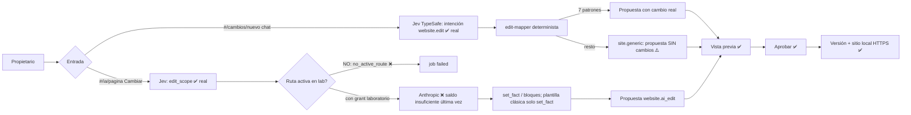

# MainSpot — Auditoría de operatividad real (runtime local)

- Fecha: 2026-11-03. Rama `feat/canonflow-implementation`, HEAD `95f9436`.
- Alcance: código, configuración efectiva del proceso, BD `mainspot_dev`, journal de servicios y recorrido del panel en `https://app.mainspot.local.io`. Auditoría **de solo lectura**: sin cambios de código, configuración, rutas ni proveedores; sin llamadas pagadas a modelos ni efectos externos.
- Un test PASS, un endpoint o una pantalla **no** cuentan como operatividad. «OPERATIVO REAL» exige recorrido observado en el runtime con su integración real (o, si la capacidad es puramente local, con su efecto local observable).

## 0. Runtime auditado

| Hecho | Evidencia |
|---|---|
| El proceso ejecuta el código de HEAD | `mainspot-local` (PID 3628270) arrancó 2026-11-03 05:37:46 EST; ningún archivo de `src/`, `scripts/` ni `migrations/` cambió después (commit 95f9436 a las 05:41:28 EST solo registró el árbol ya cargado). |
| Telegram simulado | Entorno del proceso: `MAINSPOT_DEV_TELEGRAM=simulated`, `CHANNEL_PRIMARY=simulated`, `TELEGRAM_BOT_TOKEN` vacío. `~/.config/mainspot/telegram-webhook.env` solo contiene `TELEGRAM_WEBHOOK_SECRET`. |
| Meta/Facebook simulado | `SOCIAL_PROVIDER=simulated`; no existen `META_APP_ID`, `META_APP_SECRET` ni `CONNECTOR_TOKEN_KEY` en ningún archivo de entorno. |
| Google simulado | `REPUTATION_PROVIDER=simulated`; no existen `GOOGLE_OAUTH_CLIENT_ID/SECRET`. |
| Dominios, pagos y correo | `DOMAIN_PROVIDER=simulated`, `PAYMENT_PROVIDER=simulated`, sin variables `MAIL_*`/`SMTP_*`/`RESEND_*`. |
| IA | `AI_ENVIRONMENT=lab`, `AI_REAL_PROVIDERS=on`, claves Anthropic/OpenAI/TypeSafe presentes; Jev `primary`, `typesafe`, `jev-1.14.0`, presupuesto USD 1/día. |
| **Rutas generativas inactivas** | `ai_rollout` entorno `lab`: `active_route_id` NULL para todos los casos generativos (`website.*`, `social.*`, `conversation.owner.assistant`, `marketing.*`, `editorial.*`, `engagement.*.reply`, `business.insights.generate`); los casos de imagen no tienen fila `lab`. Solo los 3 clasificadores Jev tienen ruta ACTIVE (`ts:jev-1.14.0`). Las candidatas Anthropic/OpenAI están en DRAFT. |
| Dispatcher sin ruta | `src/ai/dispatcher.ts:227-228` devuelve `no_active_route` sin invocar proveedor. En el panel: 503 «Esta función de IA todavía no está activa en tu cuenta» (`src/ai/business.ts:51-59`) o job `failed/no_active_route` (`views-ai.js:98`). |
| **Proveedores generativos sin saldo** | `ai_invocation`: anthropic 0 éxitos / 33 fallos (32 `provider_unavailable` 06:11–06:12 UTC, 1 `provider_auth` 06:19 UTC); openai 0 / 53 (`provider_auth`). `evidence/ai-core/direct-verification-2026-11-03.json:28-29`: Anthropic «HTTP 400 low credit balance; authenticated model catalog accepted», OpenAI «HTTP 429 insufficient_quota». No hay invocaciones Anthropic posteriores a 06:19 UTC: el saldo actual es desconocido. |
| Jev/TypeSafe real | typesafe 144 invocaciones `succeeded` (última 17:09:21 UTC). `jev_evaluation_run jer_8321eea1`: 240 casos, 236 correctos, gate abierto. |

## A. Resumen ejecutivo

| Estado | Capacidades |
|---|---|
| OPERATIVO REAL | 16 |
| IMPLEMENTADO / NO PROBADO | 2 |
| BLOQUEADO POR CONFIGURACIÓN | 16 |
| PARCIAL | 7 |
| SIMULADO | 12 |
| NO IMPLEMENTADO | 6 |
| DESCONOCIDO | 1 |
| **Total revisadas** | **60** |

- Lo operativo real es el **núcleo local**: invitación, login, alta del negocio, marca manual, biblioteca (subida), propuestas con vista previa, aprobación, versiones y publicación al sitio local HTTPS, planes/cuotas, consola de Ingeniería y la **clasificación de intención Jev**.
- **Ninguna** capacidad de los tres P0 funciona hoy contra el servicio externo real:
  - Telegram: sin bot (token vacío); nunca ha entrado un Update real (`telegram_update` = 0 filas); conversar con el agente desde Telegram **no existe en código**.
  - Facebook: no hay login a MainSpot con Facebook; el conector OAuth está escrito pero desactivado (sin app Meta ni credenciales) y nunca se ejecutó; las 8 publicaciones existentes son `sim:`.
  - Edición web por lenguaje natural: Jev reconoce la intención (real), pero el chat usa un **mapeador determinista por expresiones regulares**; lo que no reconoce produce una propuesta **sin cambios**. La ruta con IA (Anthropic) nunca se ejecuta: no hay ruta activa en `lab` y la última respuesta de Anthropic fue «saldo insuficiente».
- Prueba real del propietario de hoy (tenant `client_taqueria_faro_sol_7a98a8`):
  - 17:07:20 UTC, chat: «Agrega una imagen de panadería francesa en el Hero». Jev la clasificó `website.edit` con `jev_confident`. El mapeador la convirtió en `site.generic` («Actualizar la información de la página web.»). El `after` de la propuesta es idéntico a la página publicada (solo añade `design: null`). Estado `preview_ready`, con «Publicar este cambio» habilitado.
  - 17:09 UTC, `#/ia/pagina`: jobs `website.design` y `website.edit` `failed/no_active_route`. El de edición sí pasó por Jev (`edit_scope=content_simple`) y se detuvo antes de Anthropic. Había un grant de laboratorio vigente (16:48–17:48 UTC), pero los jobs se crearon **sin** él (`ai_job.lab_grant_id` NULL): el grant no se seleccionó en `#/ia/laboratorio`.

## B. Matriz de operatividad

Abreviaturas: FE = frontend (ruta hash en `src/web/panel/assets/js/`), BE = backend.

### B.1 Telegram (P0-A)

| # | Funcionalidad | Estado | Frontend | Backend | Integración externa | Bloqueo exacto | Evidencia |
|---|---|---|---|---|---|---|---|
| 1 | Bot real configurado | BLOQUEADO POR CONFIGURACIÓN | — (`views-app.js:291` dice «Abre el bot…» sin nombre ni enlace) | `src/channels/registry.ts:14-20` (real solo con `channelPrimary=telegram` y token), `src/shared/config.ts:266` | Bot API ausente | Sin `TELEGRAM_BOT_TOKEN` ni `MAINSPOT_DEV_TELEGRAM=real` en el archivo protegido | Entorno del proceso; log de arranque «Telegram simulated»; `docs/architecture/telegram-webhook-starlink.md:6,18` (`TELEGRAM_WEBHOOK_REAL_VERIFIED: BLOCKED_EXTERNAL`) |
| 2 | Registro/alta iniciado desde Telegram | NO IMPLEMENTADO | `#/activar/telegram` es un paso opcional posterior al alta (`views-onboarding.js:137`) | `src/engagement/telegram.ts:163-180`: solo `/start <código>`, `/aprobar`, `/rechazar` | — | No existe deep link `t.me/<bot>?start=` ni creación de cuenta desde Telegram | grep `t\.me/|bot_username` en `src/` = 0 |
| 3 | Vinculación identidad Telegram ↔ cuenta | SIMULADO | `#/telegram` (`views-app.js:267-299`), `assistant.js:210-255` | `POST /api/backoffice/telegram/link-code`, `GET/DELETE …/telegram/link` (`engagement-routes.ts:142-159`); `TelegramLinkService` (`telegram.ts:72-99,221-252`); tablas `telegram_link_code`, `telegram_link` | Solo chat simulado | Depende de #1 | `telegram_link`: 3 filas activas, todas `chat_id` `sim-…`; captura del panel: el chat simulado responde a `/start CÓDIGO` |
| 4 | Webhook público `tg.mainspot.io` → KVM → WireGuard → proxy → Express | PARCIAL | — | `POST /api/telegram/webhook` (`engagement-routes.ts:280-299`, secreto obligatorio, dedupe `telegram_update`) | Túnel vivo (`ping 10.77.0.1` 3/3); proxy activo en `10.77.0.2:8080`; sin `setWebhook` | Tramo KVM → Express sin verificar (SSH al KVM no autorizado); sin bot no hay webhook registrado | POST sin secreto al dominio → 401; `tg.mainspot.io` desde origen no-Telegram → 403 (filtro esperado); journal: ningún POST al webhook desde el arranque |
| 5 | Recepción y procesamiento de mensajes reales | SIMULADO | `#/chat` = chat Telegram **simulado** | Real: webhook → `handleUpdate` → `dispatch` → `TelegramAdapter.sendMessage` (síncrono, sin cola ni Jev). Simulado: `POST /api/backoffice/dev/simulator/telegram` (`engagement-routes.ts:258-269`) | Ausente | Depende de #1 y #4 | `telegram_update` = 0 filas; journal: `POST /dev/simulator/telegram` hoy |
| 6 | Conversación con el agente desde Telegram (texto libre, estado conversacional) | NO IMPLEMENTADO | — | El webhook responde texto fijo de ayuda a todo lo que no es comando (`telegram.ts:173-178`); el pipeline del agente solo se alcanza desde el panel (`POST /conversation/messages`) | — | No hay puente webhook → `ConversationPipeline`; sin estado por chat | Código citado. Defecto latente: `conversation-routes.ts:125` envía la respuesta del panel a `session.user_id` como si fuera `chat_id` |
| 7 | Avisos de casos y `/aprobar`/`/rechazar` desde Telegram (RBAC) | SIMULADO | `#/atencion`, `#/caso/:id` | `telegram.ts:181-211` (exige `engagement.approve`, solo rol `administration`, `src/rbac/matrix.ts:94`); `EngagementService.approve/reject` | Ausente | Depende de #1 y #4 | `audit_event` `engagement.responded` con resultado `telegram:simulated` ×5 y `engagement.notified` con `telegram:simulated` ×10 (30-oct) |

### B.2 Facebook / Meta (P0-B)

| # | Funcionalidad | Estado | Frontend | Backend | Integración externa | Bloqueo exacto | Evidencia |
|---|---|---|---|---|---|---|---|
| 8 | Login a MainSpot con Facebook | NO IMPLEMENTADO | `#/entrar` solo correo + contraseña (`views-onboarding.js:148-164`) | `POST /api/auth/login` (`src/api/routes.ts:62-142`) | — | No previsto en código | grep `facebook|oauth` en auth/onboarding = 0 |
| 9 | Autorización OAuth del conector Meta | BLOQUEADO POR CONFIGURACIÓN | `#/facebook`, tarjeta «Conexión con Facebook»: botón deshabilitado si `!enabled || !oauth_configured` (`views-channels.js:199-218`) | `POST /api/backoffice/connections/meta/start`, `GET /api/connections/meta/callback` (`meta-connection-routes.ts:130-139,259-312`): state de un solo uso, code → token largo, cifrado AES-256-GCM (`src/connectors/secret-box.ts`) | Graph `v26.0`, nunca ejecutado | `SOCIAL_PROVIDER=simulated` ⇒ `meta=null` ⇒ 409; faltan `META_APP_ID`, `META_APP_SECRET`, `CONNECTOR_TOKEN_KEY` y una app Meta | GET al callback → 303 `#/facebook/conectar?conexion=no_habilitado`; `provider_oauth_state` = 0; **0 tests** de estas rutas |
| 10 | Selección/vinculación de Página | BLOQUEADO POR CONFIGURACIÓN | «Elegir página» → «Usar esta página» (`main.js:371-377`) | `GET /connections/meta/pages`, `POST /select` (`meta-connection-routes.ts:142-203`), `debug_token`, token de página cifrado | Nunca ejecutado | Depende de #9 | `provider_connection` = 0 filas |
| 11 | Lectura de datos reales de la Página | PARCIAL | — | Solo `id,name`, permisos, read-back de posts y comentarios (`meta-graph.ts`) | Nunca ejecutado | No hay insights, feed histórico ni foto de perfil (`profile_picture_url: ''`, `meta-graph.ts:250`) | grep `client.get(` en `src/social` |
| 12 | Publicación de posts (texto) en Facebook | SIMULADO | `#/facebook/nueva`, `#/facebook/post/:id` | `SocialPublisher` → `scheduled_post` → `MetaPagesAdapter.publishPost` (`POST /{page-id}/feed` + read-back, `meta-graph.ts:267-298`) | `SimulatedMeta` | Depende de #9/#10 | `social_post`: 8 `published`, todas `external_ref` `sim:` |
| 13 | Imagen generada → publicada en Facebook | PARCIAL | `#/ia/publicar`, casilla «Proponer también una ilustración» | `business.ts:98-169` guarda `media_asset_id`; **nada** lo traduce a subida a Graph; no existe `POST /{page-id}/photos` | — | Defecto de código (además de rutas IA inactivas y OpenAI sin cuota) | grep `/photos|media_asset_id` en `src/social` = 0; `media_asset` con `source=ai_generated` = 0 |
| 14 | Recepción de comentarios de Facebook | SIMULADO | `#/atencion` | `EngagementWorker.ingestFacebook` (`worker.ts:166-211`) → `MetaCommentSource` (polling; sin webhooks Meta) o `SimulatedCommentSource` | Simulado | Depende de #9/#10 | `sim_provider_event facebook_comment` = 14; `engagement_case` de Facebook = 16, todos de laboratorio |
| 15 | Respuesta a comentarios de Facebook | SIMULADO | `#/caso/:id` | `MetaCommentReplier` + `provider_reply_ledger` (`meta-engagement.ts:108-164`) solo si Meta real; hoy `SimulatedReplier` | Simulado | Depende de #9/#10 | `provider_reply_ledger` = 0 filas |
| 16 | Programación de publicaciones (scheduler) | IMPLEMENTADO / NO PROBADO | «Programar publicación» en `#/facebook/nueva` | `SocialScheduler` (`scheduler.ts`, lease, reintentos, reconciliación), tick 15 s | Destino simulado | Nunca procesó una fila en este runtime | Log `social.scheduler.started provider simulated`; `scheduled_post` = 0 filas |

### B.3 Página web por lenguaje natural (P0-C)

| # | Funcionalidad | Estado | Frontend | Backend | Integración externa | Bloqueo exacto | Evidencia |
|---|---|---|---|---|---|---|---|
| 17 | Reconocimiento de intención con Jev/TypeSafe | OPERATIVO REAL | `#/inicio` composer, `#/cambios/nuevo` (`assistant.js:87`) | `ConversationPipeline` + `JevClassifier` primary con gate (`jev-classifier.ts:503-538`) | TypeSafe `jev-1.14.0` real | — | Journal `jev.recorded` 17:07:20Z `website.edit` `jev_confident` 365 ms; `ai_invocation` typesafe 144 `succeeded` |
| 18 | Edición NL desde el chat (`#/cambios/nuevo`) | PARCIAL | `#/cambios/nuevo` → `POST /api/backoffice/conversation/messages` | `pipeline.ts:240-286` → `editWebsiteByInstruction` (`src/website/edit-mapper.ts:49-158`), **determinista y sin modelo** | Ninguna (solo Jev para la intención) | Solo reconoce teléfono, horario (`HH:MM a HH:MM`), «agrega servicio», «agrega sección», nombre, dirección y giro. Todo lo demás cae en `site.generic`, que **no modifica nada** pero crea una propuesta publicable | Propuesta del 17:07 UTC: `fields=site.generic`, `after` = contenido publicado; captura `27-vista-previa`: «Actualizar la información de la página web.» sin imagen |
| 19 | Edición NL con IA (`#/ia/pagina` «Cambiar») | BLOQUEADO POR CONFIGURACIÓN | `#/ia/pagina` (`views-ai.js`) → `POST /api/backoffice/ai/website/edit` (job) | `AiSiteService.runEdit` (`src/website/ai-site.ts:173-208`): Jev `edit_scope` → `website.edit.simple` (Haiku) / `.complex` (Sonnet) → `applyEdit` → propuesta `website.ai_edit` | Anthropic, no alcanzado | (1) sin ruta activa en `lab`; (2) Anthropic sin saldo en la última observación; (3) la plantilla clásica solo admite `set_fact` (`design-edit.ts:60,131`) | `ai_job website.edit` 17:09:20Z `failed/no_active_route`, progreso `{"step":"edit","scope":"content_simple","semantic_source":"jev"}` |
| 20 | Creación del sitio por conversación / diseño IA (`#/ia/pagina` «Diseñar») | BLOQUEADO POR CONFIGURACIÓN | `#/ia/pagina`; el chat responde «Créala primero en Mi página…» (`pipeline.ts:257-258`) | `AiSiteService.runDesign` (`ai-site.ts:105-169`) `website.initial.design` (Sonnet) + `website.image.generate` (gpt-image-2) | Anthropic/OpenAI, no alcanzados | Sin ruta activa; sin saldo/cuota en proveedores | `ai_job website.design` 17:09:08Z `failed/no_active_route`. Los 6 diseños `website.ai_design` publicados son del 30-oct vía OpenRouter (hoy retirado) |
| 21 | Generación de texto con Anthropic (todos los casos de uso) | BLOQUEADO POR CONFIGURACIÓN | Todas las pantallas `#/ia/*` muestran «Todavía no está activa» | `dispatcher.ts`, `src/ai/providers/anthropic.ts` | Anthropic directo | Rutas DRAFT sin rollout `lab`; última respuesta del proveedor: HTTP 400 `credit_balance_too_low` | `ai_invocation` anthropic 0/33; `evidence/ai-core/direct-provider-access-2026-11-03.json:9` |
| 22 | Contrato del adaptador Anthropic (salida estructurada / herramientas) | DESCONOCIDO | — | `anthropic.ts:11-16,40,70-73,223-234`; `src/ai/schema.ts:97-125` | Ninguna petición superó el control de saldo | Comprobado sin red: `site-design/v1` tiene 7 uniones (estructurada nativa); `site-edit/v1` tiene **17 uniones > 16** ⇒ herramienta no estricta. Haiku usa `tool_choice` forzado; Sonnet 5.5 usa `auto` + instrucción. Riesgo de `invalid_output` en ediciones complejas `[INFERENCE]` | `node` local con `countUnionParams`/`withinStructuredOutputLimits`: `site-edit/v1 union=17 native=false`, `rejectsForced sonnet=true` |
| 23 | Vista previa antes de publicar | OPERATIVO REAL | `#/vista-previa/:id` con Antes/Después; enlace público `/preview/:token` | `preview-routes.ts:50,89`, `state-machine.ts` | Local | — | `action_proposal` con `preview_id`; captura `27-vista-previa` |
| 24 | Aceptar / descartar / pedir otro cambio | OPERATIVO REAL | Botones «Descartar», «Pedir otro cambio», «Publicar este cambio» | `POST /conversation/proposals/:id/{confirm,approve,reject}` (`conversation-routes.ts:215`) | Local | Falta impedir la publicación de propuestas sin cambios (ver #18) | Propuestas `website.edit` publicadas (v2/v3) y `rejected` en BD |
| 25 | Persistencia, versiones y restauración | OPERATIVO REAL | `#/pagina` «Versiones publicadas», «Restaurar esta versión» | `website_content` versionado con `data`; `POST /website/versions/:v/restore` (`conversation-routes.ts:430`) | Local | — | `website.restore` publicado ×4; 100 % de versiones con `data` |
| 26 | Publicación al sitio local HTTPS | OPERATIVO REAL | `#/pagina`, `#/sitio` | `WebsitePublisher` (`src/publishing/website.ts:51-123`) → `localSiteMiddleware` (`src/website/local-site.ts:80-126`) | Local (hosts + CA mkcert del host) | Solo resuelve en esta máquina | `https://taqueria-faro-sol.mainspot.local.io/` → 200, TLS válido |
| 27 | Dominio público / publicación en Internet | SIMULADO | `#/sitio` | `DomainService` (`src/domain/service.ts`) con `DOMAIN_PROVIDER=simulated` | Hostinger sin token | Credencial y decisión del propietario | `client_domain` 10 filas `*.sim.mainspot.local` `simulated` |

### B.4 Resto del producto

| # | Funcionalidad | Estado | Frontend | Backend | Integración externa | Bloqueo exacto | Evidencia |
|---|---|---|---|---|---|---|---|
| 28 | Registro de cuenta por invitación | OPERATIVO REAL | `/invitacion#<token>` → `#/activar/contrasena` | `OnboardingService` (`src/identity/onboarding.ts:51-113`); CLI `scripts/dev-panel.sh invite` | Ninguna (el enlace se entrega a mano) | — | `owner_invitation` 14 `used`; cadena auditada completa hoy (tenant `cafe_brisa_lab_420fbf`) |
| 29 | Autoregistro público | NO IMPLEMENTADO | — | `authRouter` solo expone login, invitación y logout (`routes.ts:62,197,211,227`) | — | No existe | Código |
| 30 | Inicio/cierre de sesión | OPERATIVO REAL | `#/entrar` | `routes.ts:62-193`, JWT 60 min, `session_context`, rate limit en memoria | — | — | `audit_event auth.login success` hoy |
| 31 | Recuperación de contraseña por correo | BLOQUEADO POR CONFIGURACIÓN | `#/recuperar`, `/restablecer#token` | `PasswordResetService`, `DisabledMailer` (`src/mail/mailer.ts:44`) | Sin transporte | Faltan `MAIL_TRANSPORT`, `MAIL_FROM`, `SMTP_*`/`RESEND_API_KEY` | `password_reset_token` = 0; `docs/architecture/password-reset.md:30` |
| 32 | Alta y configuración del negocio | OPERATIVO REAL | `#/activar/negocio`, `#/pagina/crear`, `#/negocio` | `POST /website`, `POST /website/first-publication` | Local | No hay edición directa de datos del negocio (pasa por chat o Brand Studio) | `client_website` 14 (12 publicados) |
| 33 | Configuración de marca (Brand Studio, manual) | OPERATIVO REAL | `#/ia/marca` | `GET/PUT /ai/brand` (`ai-routes.ts:197-227`), `BrandService` | Ninguna (no usa IA) | — | `brand_fact` 128 confirmados |
| 34 | Biblioteca de medios (subida manual) | OPERATIVO REAL | `#/ia/biblioteca` | `POST /ai/media`, `MediaService.store` (sharp → WebP) | Local | — | `media_asset` 7 `uploaded`; `/media/<id>/w640.webp` → 200 |
| 35 | Generación de imágenes con IA (gpt-image-2) | BLOQUEADO POR CONFIGURACIÓN | `#/ia/laboratorio` (imagen independiente), `#/ia/publicar` | `dispatcher.invokeImage` | OpenAI | Sin fila `lab` en el rollout; OpenAI `insufficient_quota` | `ai_invocation` openai 0/53 |
| 36 | Laboratorio IA del propietario (DEC-0074) | BLOQUEADO POR CONFIGURACIÓN | `#/ia/laboratorio` «Usar rutas de laboratorio» (cabecera `X-AI-Lab-Grant`, `api.js:67-68`) | `src/ai/lab.ts`; grants desde `/ingenieria` | Anthropic/OpenAI | Proveedores sin saldo; hoy no hay grant vigente (el de faro_sol venció 17:48 UTC) | 0 invocaciones con grant; `ai_manual_review` = 0 |
| 37 | Agente del propietario en el panel | PARCIAL | `#/inicio`, `#/cambios/nuevo`, `#/cambios` | Pipeline Jev + respuestas de texto fijo (`pipeline.ts:66,203,217,258,269`) | TypeSafe real | Respuestas no generativas; ediciones limitadas por #18 | `conversation.classified … source=jev` hoy |
| 38 | Asistente generativo «Pregúntale a MainSpot» | BLOQUEADO POR CONFIGURACIÓN | `#/ia` | `POST /ai/assistant` → `conversation.owner.assistant` | Anthropic | Sin ruta activa; sin saldo | 503 por diseño (`business.ts:51-59`) |
| 39 | Atención a clientes finales (agente de atención) | SIMULADO | `#/atencion`, `#/caso/:id`, `#/atencion/reglas` | `EngagementWorker` cada 3 s, Jev clasifica (real), `RoutedReplier` → `SimulatedReplier` | Entrada y salida simuladas | Sin conectores Meta/Google | `engagement_case` 30 (16 `responded` `simulated`) |
| 40 | WhatsApp / web-chat para clientes finales | NO IMPLEMENTADO | — | — | — | No existe | grep |
| 41 | Redacción de publicaciones con IA | BLOQUEADO POR CONFIGURACIÓN | `#/ia/publicar` | `POST /ai/social/compose` (job) | Anthropic | Sin ruta activa; sin saldo | 6 `social.compose` exitosos solo el 30-oct vía OpenRouter |
| 42 | Calendario editorial (ideas IA) | BLOQUEADO POR CONFIGURACIÓN | `#/ia/calendario` | `POST /ai/editorial` (`business.ts:366-397`) | Anthropic | Sin ruta activa | `editorial_suggestion` 30 del 30-oct (OpenRouter) |
| 43 | Campañas de marketing (plan y creativos IA) | BLOQUEADO POR CONFIGURACIÓN | `#/ia/campanas` | `business.ts:317-362` | Anthropic | Sin ruta activa | `marketing_campaign` 4 del 30-oct |
| 44 | Gasto publicitario / Ads | NO IMPLEMENTADO | — | `decideCampaign` ⇒ `spend: BLOCKED_EXTERNAL`; segmentación 403 (`social-routes.ts:205-208`) | — | Por diseño | Código |
| 45 | Google Business Profile: conexión OAuth | BLOQUEADO POR CONFIGURACIÓN | `#/google` «Conectar» | `GoogleConnectionService.start` (`src/google/connection.ts:88-106`) → 409 «falta: GOOGLE_OAUTH_CLIENT_ID…» | Google APIs | Faltan credenciales OAuth, `CONNECTOR_TOKEN_KEY` y `MAINSPOT_DEV_GOOGLE=real` | `provider_connection` = 0 |
| 46 | Google Business Profile: ficha del negocio | SIMULADO | `#/google` | `GbpProfileService` modo `simulated` | Simulado | Depende de #45 | `gbp_profile` 2 `simulated_synced` |
| 47 | Recepción y gestión de reseñas | SIMULADO | Reseñas como casos en `#/atencion`; `/reputation/*` sin pantalla | `ReputationEngine` + `SimulatedReviews` | Simulado | Depende de #45 | `review` 16, ninguna sincronizada con Google |
| 48 | Respuestas automáticas a comentarios y reseñas (políticas) | SIMULADO | `#/atencion/reglas` | Auto-respuesta solo `gratitude`/`basic_info` con `safe_auto_reply` (`classifier.ts:92-133`); el resto requiere aprobación | Publicación simulada | Depende de conectores | `response_ledger` 5 `sent` simulados |
| 49 | Redacción IA de respuestas propuestas | BLOQUEADO POR CONFIGURACIÓN | `#/caso/:id` | `AiEngagementSemantics.reply` devuelve `null` sin ruta ⇒ plantillas (`ai-semantics.ts:83-95`) | Anthropic | Sin ruta activa | `ai_rollout lab engagement.*.reply` NULL |
| 50 | Dashboard `#/inicio` | OPERATIVO REAL | `#/inicio` (`views-app.js:86-196`) | `/me`, `/website`, `/conversation/*`, `/engagement/cases` | Local | — | Lecturas auditadas hoy |
| 51 | Insights IA `#/ia/resumen` | BLOQUEADO POR CONFIGURACIÓN | `#/ia/resumen` | `business.ts:296-298` se abstiene con menos de 7 días de actividad; si no, ruta inactiva | Anthropic | Sin ruta activa | `ai_insight` 4 `abstained` |
| 52 | Analítica y exportación de métricas | IMPLEMENTADO / NO PROBADO | Ninguna vista la usa | `GET /analytics/{summary,export,retention}` (`analytics-routes.ts:58-142`) | Local | Sin interfaz | `analytics_daily_summary` = 0 |
| 53 | Avisos `#/avisos` | OPERATIVO REAL | `#/avisos` (derivados en el cliente, `store.js:290-307`) | — | — | Sin push ni correo | Código y panel |
| 54 | Teléfonos de contacto | OPERATIVO REAL | `phones.js` | `contact-routes.ts:43-67` (sincronización con Google/Facebook simulada) | Local | La sincronización externa depende de los conectores | `contact.phone.updated` hoy |
| 55 | Planes, suscripciones y límites | OPERATIVO REAL | `#/negocio/plan` | `EntitlementService`, `QuotaLedger` | Local | Sin cambio de plan desde el panel | 19 suscripciones `plan_piloto_1` activas; cuotas consumidas |
| 56 | Cobro / pagos | SIMULADO | — | `SimulatedPaymentProvider`; facturación 403 `prohibited` | — | Sin plan con precio | `plan.price` NULL en los 3 planes |
| 57 | Equipo (alta de usuarios) | OPERATIVO REAL | `#/negocio` «Tu equipo» | `POST /users` (`routes.ts:435`) | Local | Sin baja/edición ni cambio de contraseña propio | `user.manage success` hoy |
| 58 | Exportación de datos y baja del negocio | PARCIAL | Sin pantalla | Retención diaria real (`retention_run` 1-3 nov); exportación por API sin interfaz; baja solo por CLI `scripts/tenant-exit.ts` | Local | Falta interfaz; nunca se ejecutó una baja | `tenant_exit` = 0 |
| 59 | Consola de Administración `/plataforma` | PARCIAL | `src/web/platform/assets/console.js` | Login contraseña + TOTP, step-up (`src/platform/auth.ts`) | Local | `GET /api/platform/health` → 500 «column reference "created_at" is ambiguous» (`platform-routes.ts:217-221`); es la pestaña por defecto de `ai_engineer` | Journal `http.error` 16:42 y 16:46 UTC |
| 60 | Engineering Console `/ingenieria` (registro, rollout, laboratorio) | OPERATIVO REAL | `console.js` | `platform-routes.ts:253-422` | Local (las evaluaciones reales dependen de #21) | — | `platform_audit_event`: `platform.login mfa_ok`, `ai.route.approve` ×15, `ai.rollout.activate` ×14, `ai.lab.grant` ×2 |

## C. Diagnóstico profundo de los tres P0

### C.1 Telegram — registro, vinculación y comunicación real

- **Flujo esperado:**
  1. El propietario se registra o vincula desde Telegram.
  2. Conversa con su agente MainSpot en texto libre.
  3. Recibe avisos.
  4. Ejecuta operaciones autorizadas (aprobar cambios y respuestas).
- **Flujo implementado:**
  - Alta por invitación en el panel.
  - `#/telegram` «Conectar Telegram» genera un código de 10 minutos; en el bot, `/start CÓDIGO` vincula el `chat_id` con usuario y tenant.
  - El bot solo envía avisos de casos de atención y acepta `/aprobar <caso> <1-3>` y `/rechazar <caso>`, con RBAC `engagement.approve`.
  - Todo lo demás recibe un texto fijo de ayuda.
- **Último paso que funciona:** la misma cadena completa contra el **chat simulado** del panel (`#/chat`): código, `/start`, vínculo persistido (`chat_id` `sim-…`) y aprobación de casos.
- **Primer punto de corte:** no existe bot. `TELEGRAM_BOT_TOKEN` está vacío y `MAINSPOT_DEV_TELEGRAM=simulated`, así que `createChannelAdapter` devuelve `SimulatedChannel` (`src/channels/registry.ts:14-20`).
- **Cortes siguientes:**
  1. Tramo KVM → `10.77.0.2:8080` → Express sin verificar (`telegram-webhook-starlink.md:16`).
  2. Webhook sin registrar.
  3. La conversación con el agente por Telegram no existe en código.
- **Causa técnica:**
  - Configuración (token, modo) e infraestructura (verificación KVM).
  - **Código ausente** para conversar: el webhook nunca llama a `ConversationPipeline`.
  - Defecto latente: `src/api/conversation-routes.ts:125` usa `session.user_id` como `chat_id`; en modo real cada mensaje del panel provocaría un `sendMessage` fallido.
- **Dependencias faltantes:**
  - Bot de @BotFather y su token.
  - `MAINSPOT_DEV_TELEGRAM=real` y reinicio de `mainspot-local` con sudo.
  - Acceso SSH al KVM o sonda ejecutada por el propietario.
  - Registro del webhook (`scripts/telegram-webhook.ts register`).
  - Puente de conversación (código).
- **Archivos y servicios:** `src/engagement/telegram.ts`, `src/api/engagement-routes.ts:142-299`, `src/channels/{registry,telegram,simulated}.ts`, `src/api/conversation-routes.ts:125`, `src/conversation/pipeline.ts`, `scripts/telegram-webhook.ts`, `scripts/dev-panel.sh:44-75`, `mainspot-local`, `mainspot-telegram-proxy`, `wg-quick@wg-telegram`, KVM `89.116.170.99`.
- **Esfuerzo:**
  - Vincular y aprobar desde el teléfono: unas 2–3 h, casi todas del propietario (bot, reinicio, sonda KVM, registro); el código ya existe.
  - Conversar con el agente desde Telegram: 12–16 h de código.
- **Prueba manual que demostraría funcionamiento real:**
  1. `https://app.mainspot.local.io/panel#/telegram` → «Conectar Telegram». Esperado: código y `channel_mode` real.
  2. En el teléfono, abrir el bot y enviar `/start CÓDIGO`. Esperado: «Listo: este chat recibirá los avisos de MainSpot…». En la BD, `telegram_link.chat_id` numérico y una fila `telegram_update` `done`.
  3. Enviar «hola». Esperado hoy: lista de comandos. Tras el puente: respuesta del agente.
  4. Crear un caso desde `#/atencion` (simulador de reseña). Esperado: aviso en el teléfono. Responder `/aprobar <caso> 1`. Esperado: caso con `resolution_channel='telegram'`.

### C.2 Facebook — login e integración real

- **Distinción:**
  - **Facebook Login para entrar en MainSpot:** no existe.
  - **Conector Meta** (OAuth code flow para obtener un token de Página): existe completo en código, desactivado en runtime y sin tests de rutas.
- **Flujo esperado:**
  1. «Conectar Facebook» → diálogo de Meta → callback.
  2. «Elegir página» → estado `connected`.
  3. Las publicaciones aprobadas salen a `/{page-id}/feed`.
  4. Los comentarios entran por polling cada 60 s y se responden con libro idempotente.
- **Flujo implementado:** el descrito, más cifrado AES-256-GCM, `appsecret_proof`, `debug_token`, read-back obligatorio y reconciliación. Las imágenes **no** se suben a Graph.
- **Último paso que funciona:**
  - Flujo completo contra `SimulatedMeta` (crear, aprobar, publicar `sim:`; comentarios inyectados; respuestas simuladas).
  - El callback público responde y redirige con `conexion=no_habilitado`.
- **Primer punto de corte:** configuración. `SOCIAL_PROVIDER=simulated` ⇒ botón deshabilitado y 409 en `/connections/meta/start`.
- **Causa técnica por tipo de bloqueo:**

| Tipo | Bloqueo |
|---|---|
| Configuración | Faltan `MAINSPOT_DEV_META=real`, `CONNECTOR_TOKEN_KEY` (32 bytes base64), `META_APP_ID` y `META_APP_SECRET`. `scripts/dev-panel.sh` no tiene archivo protegido para conectores: solo carga `.env`, `telegram-webhook.env` y `ai-core.env`. |
| Externo (Meta) | Crear la app con producto Facebook Login. Redirect URI fija: `https://app.mainspot.local.io/api/connections/meta/callback`. Dar al propietario rol admin/tester y tener una Página administrada. |
| Infraestructura (hipótesis) | Meta podría no aceptar `local.io` como dominio de la app o como redirect. La redirección ocurre en el navegador, que resuelve por `/etc/hosts`, así que podría funcionar `[INFERENCE]`. Se verifica en 15 minutos en el panel de Meta. |
| Permisos y App Review | Se piden `pages_show_list`, `pages_read_engagement`, `pages_manage_posts`, `pages_read_user_content`, `pages_manage_engagement` (+`ads_read` con `META_ADS_CHECK=on`). Con roles de la app funcionan sin revisión; para dueños sin rol hace falta App Review y Business Verification `[INFERENCE]` (política pública de Meta). |
| Código | Falta publicar la imagen en Facebook (`POST /{page-id}/photos`). La lectura de datos de la Página es mínima. |

- **Archivos:** `src/api/meta-connection-routes.ts`, `src/social/{meta-graph,meta-engagement,meta,publisher,scheduler,service}.ts`, `src/connectors/{repository,secret-box}.ts`, `src/shared/config.ts:284-307`, `views-channels.js:199-268`, `main.js:368-405`, `scripts/dev-panel.sh:116-125`, `scripts/meta-provision-page-token.ts`.
- **Esfuerzo:**
  - Primera conexión y post de texto: 0,5 h de script + 1–2 h del propietario en Meta, con riesgo de dominio.
  - Imagen en Facebook: 6–8 h de código.
  - Tests OAuth: 4 h.
  - App Review: semanas.
- **Prueba manual que demostraría funcionamiento real:**
  1. `https://app.mainspot.local.io/panel#/facebook`. Esperado: «Conectar Facebook» habilitado.
  2. Pulsarlo y autorizar en Meta. Esperado: vuelta a `#/facebook/conectar?conexion=elegir_pagina`.
  3. «Elegir página» → «Usar esta página». Esperado: `connected` y `provider_connection` con `status=connected`.
  4. `#/facebook/nueva` → texto → «Publicar» → aprobar. Esperado: `scheduled_post` `published`, `social_post.external_ref` sin prefijo `sim:` y el post visible en la Página.
  5. Comentar el post desde otra cuenta. Esperado en un minuto o menos: caso en `#/atencion` con origen `facebook_comment`.

### C.3 Página web — creación y edición por lenguaje natural

- **Respuestas a las 12 preguntas:**
  1. *¿Crear página por conversación?* No. El chat responde «Créala primero en Mi página». La creación es un formulario (`#/pagina/crear`) con plantilla clásica, y eso sí funciona. El diseño IA desde un brief (`#/ia/pagina` «Diseñar») está bloqueado: sin ruta activa y sin saldo.
  2. *¿Cambios por lenguaje natural?* Solo los 7 patrones del mapeador: teléfono (si no lo gestiona «Teléfonos de contacto»), horario `HH:MM a HH:MM`, agregar servicio, agregar sección, nombre, dirección y giro. Lo demás no cambia nada.
  3. *¿Jev reconoce la intención?* Sí, de forma real: `website.edit`, `jev_confident`, 365 ms (17:07:20Z); `edit_scope=content_simple` en el job de 17:09.
  4. *¿Llega a Anthropic?* No. El chat nunca invoca un modelo generativo. El módulo IA se detiene en `no_active_route` antes del proveedor. La última llamada directa a Anthropic (06:19Z) devolvió saldo insuficiente.
  5. *¿Edición estructurada?* Chat: sí, `patches` deterministas. IA: contrato `site-edit/v1` (operaciones `set_fact`, `set_theme`, `set_block_field`, `add_block`, `remove_block`, `move_block`, `set_items`) validado por `design-edit.ts`, nunca ejecutado con un proveedor vigente.
  6. *¿Modifica contenido real o solo propone?* Siempre propone (`action_proposal.detail.after`). El contenido cambia solo al aprobar.
  7. *¿Vista previa antes de publicar?* Sí (`#/vista-previa/:id`, Antes/Después y enlace `/preview/:token`).
  8. *¿Aceptar, rechazar o corregir?* Sí: «Descartar», «Pedir otro cambio» y «Publicar este cambio». Defecto: una propuesta sin cambios también se puede publicar.
  9. *¿Persisten los cambios?* Sí: `website_content` versionado con `data` y restauración.
  10. *¿Se actualiza la página publicada?* Sí, en el sitio local `https://<slug>.mainspot.local.io/` (200 con TLS válido). No hay dominio público (`DOMAIN_PROVIDER=simulated`).
  11. *¿Problemas de esquemas o contratos del adaptador?*
      - No hay defecto demostrado y ninguna petición superó el control de saldo.
      - Riesgo comprobado sin red: `site-edit/v1` tiene 17 parámetros con unión (límite 16), así que va como herramienta no estricta. Con Sonnet 5.5 (`website.edit.complex`) el `tool_choice` forzado no se admite y va `auto` + instrucción. Posible `invalid_output`.
      - En la plantilla clásica (Faro Sol no tiene `design`) solo se admite `set_fact`. Cualquier petición de imagen o sección acabaría en `invalid_output` hasta hacer un rediseño.
  12. *¿Qué se puede probar hoy desde el panel?* Las ediciones deterministas por chat → vista previa → publicación → sitio local, y la restauración de versiones. Con IA, nada hasta que haya saldo en Anthropic y un grant de laboratorio seleccionado (ver D).
- **Último paso que funciona:** mensaje real → Jev → propuesta → vista previa. En el caso del Hero, la propuesta está vacía.
- **Primer punto de corte:**
  - Chat: `edit-mapper.ts:155-157` (`site.generic` sin cambio).
  - IA: `dispatcher.ts:227-228` (`no_active_route`); después, saldo de Anthropic.
- **Dependencias faltantes:**
  - Saldo Anthropic (propietario).
  - Ruta de laboratorio: grant seleccionado o rollout `lab` activado (propietario/Ingeniería, DEC-0074).
  - Puente chat → job IA (código).
  - Rediseño previo para editar bloques e imágenes.
- **Archivos:** `src/conversation/pipeline.ts:240-286`, `src/website/edit-mapper.ts`, `src/website/ai-site.ts`, `src/website/design-edit.ts`, `src/website/site-proposals.ts`, `src/ai/{dispatcher,registry,lab,schema,contracts}.ts`, `src/ai/providers/anthropic.ts`, `src/api/{conversation-routes,ai-routes,preview-routes}.ts`, `src/publishing/website.ts`, `src/website/local-site.ts`, `views-ai.js`, `assistant.js`, `api.js:67-68`.
- **Esfuerzo:**
  - Primera edición real con Anthropic: 0 h de código; unos 30 min del propietario (saldo + grant).
  - Integrar el chat con IA y bloquear propuestas vacías: 6–8 h.
  - Imagen en el Hero: rediseño previo + 4–8 h `[INFERENCE]`.
- **Prueba manual que demostraría funcionamiento real:**
  1. `/ingenieria` → Laboratorio → emitir grant para Faro Sol con `website.edit.simple`, `website.edit.complex` y `website.initial.design`.
  2. Panel `#/ia/laboratorio` → «Usar rutas de laboratorio».
  3. `#/ia/pagina` → «Cambiar» con «Cambia el lema a "Tacos al pastor desde 1998"». Esperado:
     - `ai_job website.edit` `succeeded` con `lab_grant_id`.
     - `ai_invocation` anthropic `succeeded`.
     - Propuesta `website.ai_edit` con el lema nuevo en la vista previa.
  4. «Publicar este cambio». Esperado: `https://taqueria-faro-sol.mainspot.local.io/` muestra el lema nuevo y `client_website.published_version` aumenta.

## D. Plan mínimo para pruebas reales

Orden: primero lo que no requiere código, después el código que desbloquea el recorrido y por último lo que depende de terceros lentos. «Prop.» = requiere intervención del propietario.

| ID | P | Cambio concreto | Archivos / servicios | Dependencia externa | Prop. | Criterio de aceptación observable | Esfuerzo | Estado |
|---|---|---|---|---|---|---|---|---|
| W1 | P0 | Recargar y confirmar saldo de la cuenta Anthropic usada por `ANTHROPIC_API_KEY` | `~/.config/mainspot/ai-core.env` (sin cambios) | Consola de Anthropic | Sí | La primera invocación de W3 termina `succeeded` (sin `insufficient_credit`) | 0,25 h + pago | Bloqueada (propietario) |
| W2 | P0 | Emitir grant de laboratorio para Faro Sol (rutas `website.edit.simple/complex`, `website.initial.design`) y seleccionarlo en el panel | `/ingenieria` → Laboratorio; panel `#/ia/laboratorio` | — | Sí (step-up) | `ai_job.lab_grant_id` no nulo en el siguiente job | 0,25 h | Iniciable tras W1 |
| W3 | P0 | Primera edición IA real con un dato de la plantilla clásica (prueba C.3) | Runtime existente | Anthropic | Sí (llamada pagada) | `ai_invocation` anthropic `succeeded`; propuesta `website.ai_edit`; sitio local actualizado | 0,5 h | Bloqueada por W1–W2 |
| W4 | P0 | En el chat, no crear propuestas sin cambio: si el mapeador devuelve solo `site.generic`, encolar `AiSiteService.requestEdit` (job `website.edit`) y mostrar su progreso, o responder que lo pida en «IA → Mi página». Rechazar en `prepareProposal` cualquier propuesta con `after` = contenido publicado | `src/conversation/pipeline.ts:240-286`, `src/website/edit-mapper.ts:155-157`, `src/website/ai-site.ts:91-101`, `assistant.js` | — | No | «Agrega una imagen … en el Hero» ya no produce «Actualizar la información de la página web.» con contenido idéntico; prueba con proveedor falso | 6–8 h | Iniciable ya |
| T1 | P0 | Crear el bot en @BotFather; escribir `TELEGRAM_BOT_TOKEN` y `MAINSPOT_DEV_TELEGRAM=real` en `~/.config/mainspot/telegram-webhook.env` (0600); `sudo systemctl restart mainspot-local` | Archivo protegido, `mainspot-local` | Telegram | Sí | Log de arranque «Telegram real»; `POST /telegram/link-code` devuelve `channel_mode` real | 0,5 h | Bloqueada (propietario) |
| T2 | P0 | Sonda KVM → `10.77.0.2:8080` → Express (procedimiento en `telegram-webhook-starlink.md:110-140`) | KVM, WireGuard, `mainspot-telegram-proxy` | SSH al KVM | Sí | Desde el peer: 401 sin secreto y 200 `ignored` con secreto | 1–2 h | Bloqueada (SSH) |
| T3 | P0 | `node scripts/telegram-webhook.ts status` y `register --confirm-bot <bot> --ready-for-webhook-registration` | `scripts/telegram-webhook.ts` | Bot API | Sí | `getWebhookInfo.url` = `https://tg.mainspot.io/telegram/webhook`, sin `last_error_message` | 0,5 h | Bloqueada por T1–T2 |
| T4 | P0 | Corregir el envío del panel: usar el `chat_id` activo de `telegram_link` del usuario (u omitir el envío si no hay vínculo) en lugar de `session.user_id` | `src/api/conversation-routes.ts:125`, `src/engagement/telegram.ts` | — | No | En modo real, `channel_sent:true` y mensaje recibido en el chat vinculado; sin vínculo, ningún `sendMessage` | 1–2 h | Iniciable ya (aplicar antes de T1) |
| T5 | P0 | Puente de conversación: texto libre de un chat vinculado → `ConversationPipeline.ingest` (actor, rol, cuota y Jev desde `telegram_link`); respuesta con `responseText` y, si hay propuesta, el enlace seguro `/preview/:token` para aprobarla desde el móvil | `src/engagement/telegram.ts:163-211`, `src/conversation/pipeline.ts`, `src/api/preview-routes.ts`, RBAC `conversation.send` | Jev (≈ USD 0,00005 por mensaje) | Sí (decidir si se permiten cambios desde Telegram) | Desde el teléfono: «Cambia el horario a 9:00 a 18:00» crea `conversation_request` con `channel=telegram` y llega un enlace de vista previa que publica al aprobar | 12–16 h | Iniciable ya (tests con canal falso) |
| F1 | P0 | Crear la app Meta (Facebook Login); redirect `https://app.mainspot.local.io/api/connections/meta/callback`; propietario como admin/tester; Página administrada. Verificar si Meta acepta `local.io`; si no, decidir un subdominio de `mainspot.io` con proxy | developers.facebook.com | Meta | Sí | El diálogo abre y vuelve al callback con `code` | 1–2 h (+ decisión de dominio si se rechaza) | Bloqueada (propietario) |
| F2 | P0 | Añadir a `scripts/dev-panel.sh` la carga de un archivo protegido `~/.config/mainspot/connectors.env` (0600), igual que `ai-core.env`, con `CONNECTOR_TOKEN_KEY`, `META_APP_ID`, `META_APP_SECRET` y `MAINSPOT_DEV_META=real`; reiniciar | `scripts/dev-panel.sh:77-125`, `mainspot-local` | — | Sí (secretos y reinicio) | `GET /api/backoffice/connections/meta` → `enabled:true, oauth_configured:true`; botón habilitado | 0,5 h + 0,25 h | Script iniciable ya; valores tras F1 |
| F3 | P0 | Primera conexión y post de texto real (prueba C.2, pasos 1–4) | Runtime | Meta Graph | Sí | `provider_connection` `connected`; `external_ref` sin `sim:`; post visible en la Página | 1 h | Bloqueada por F1–F2 |
| W5 | P1 | Reducir `site-edit/v1` a 16 o menos parámetros con unión para usar salida estructurada nativa (también con Sonnet) | `src/ai/contracts.ts`, `src/ai/schema.ts` | — | No | `withinStructuredOutputLimits(toModelSchema(site-edit/v1))` = true; tests del despachador en verde | 2–3 h | Iniciable ya |
| W6 | P1 | Paso de laboratorio a ruta activa en `lab`: evidencia manual DRAFT→TESTED → aprobar → activar por caso de uso (sin grant cada hora) | `/ingenieria` (DEC-0074) | Anthropic | Sí | `GET /api/backoffice/ai/status` con `active:true` para `website.edit.simple` | 1 h | Tras W3 |
| W7 | P1 | Imagen en el Hero: rediseño IA previo (`website.initial.design`) o soporte de imagen de biblioteca en plantilla clásica | `src/website/{ai-site,design-edit,design}.ts` | Anthropic (+ OpenAI si se genera la imagen) | Sí | La petición del Hero termina con la imagen de la biblioteca visible en el sitio local | 4–8 h `[INFERENCE]` | Tras W3 |
| T6 | P1 | Mostrar el enlace `https://t.me/<bot>?start=<código>` y el nombre del bot en `#/telegram` y `#/activar/telegram` (`TELEGRAM_BOT_USERNAME` o `getMe` en caché). Corregir la etiqueta «Telegram: conectado» cuando el canal es simulado | `src/shared/config.ts`, `engagement-routes.ts:146-154`, `views-app.js:291`, `views-onboarding.js:140-142` | — | No | En modo real, un toque abre el bot con el código precargado | 2–3 h | Iniciable ya |
| F4 | P1 | Tests de las rutas OAuth Meta (`start`, `callback`, `pages`, `select`, `verify`, `disconnect`) con fetch falso; mensajes legibles para `conexion=` | `tests/integration/meta-connector.test.ts`, `views-channels.js:206` | — | No | Cobertura de state caducado/reutilizado, rol no admin y permisos faltantes | 5 h | Iniciable ya |
| F5 | P1 | Publicar la ilustración en Facebook: `POST /{page-id}/photos` con los bytes de `media_asset` (subida binaria; la URL `/media/...` no es pública) | `src/social/{meta-graph,publisher,scheduler}.ts`, `src/ai/business.ts` | Meta | No | Post con `media_asset_id` ⇒ foto en la Página y read-back con id | 6–8 h | Iniciable ya |
| P2a | P2 | Corregir `GET /api/platform/health` (calificar `created_at` en el JOIN) | `src/api/platform-routes.ts:217-221` | — | No | 200 y sin `http.error` en el journal | 1 h | Iniciable ya |
| P2b | P2 | Correo de recuperación (`MAIL_TRANSPORT`, `MAIL_FROM`, SMTP/Resend) | `src/mail/config.ts`, archivo protegido | Proveedor de correo y dominio verificado | Sí | Correo recibido; el restablecimiento revoca sesiones | 3 h | Bloqueada |
| P2c | P2 | Conector Google (`GOOGLE_OAUTH_CLIENT_ID/SECRET`, `MAINSPOT_DEV_GOOGLE=real`) | `src/google/*` | Proyecto GCP con acceso a la API de GBP | Sí | `connections/google` `connected`; reseña con `google_synced_at` | 4 h + espera de Google | Bloqueada |
| P2d | P2 | OpenAI con cuota para `gpt-image-2` y rollout `lab` de imagen | `ai-core.env`, `/ingenieria` | OpenAI | Sí | `media_asset` con `source=ai_generated` | 1 h + pago | Bloqueada |
| P2e | P2 | Interfaz de exportación y baja; dominio público (Hostinger); App Review de Meta | Varios | Hostinger, Meta | Sí | Según cada tarea | 3–6 h c/u; semanas para App Review | Bloqueadas o iniciables según el caso |

Ruta crítica a las tres primeras pruebas reales:
- **Web:** W1 → W2 → W3 (sin código). W4 en paralelo para que el chat deje de generar propuestas vacías.
- **Telegram:** T4 → T1 → T2 → T3 → prueba C.1 pasos 1–4 (vincular, avisos, `/aprobar`). T5 para conversar.
- **Facebook:** F2 (script) ‖ F1 → F3.

## E. Pruebas manuales disponibles ahora mismo

- Panel: `https://app.mainspot.local.io/panel`.
- Credenciales (no se reproducen aquí):
  - Dueña de prueba de Taquería Faro Sol: `~/.config/mainspot/panel-faro-sol.txt`.
  - Consolas: `~/.config/mainspot/platform-lab-admin.txt` (Administración) y `~/.config/mainspot/platform-lab-ingenieria.txt` (Ingeniería), con contraseña + TOTP.

| # | Qué se prueba | Pasos | Resultado esperado | Carácter |
|---|---|---|---|---|
| E1 | Acceso | `/panel#/entrar` con las credenciales de la dueña | `#/inicio` de «Taquería Faro Sol» | Real (local) |
| E2 | Edición NL determinista | `#/cambios/nuevo` → «Cambia el horario a 9:00 a 18:00» → confirmar → vista previa → «Publicar este cambio» | Diff «Cambiar el horario a 9:00 a 18:00.»; v4 publicada; `https://taqueria-faro-sol.mainspot.local.io/` muestra el horario nuevo | Real: Jev ≈ USD 0,00005 + local |
| E3 | Corte de la edición libre | `#/cambios` → abrir la propuesta del Hero (17:07 UTC) | «Actualizar la información de la página web.» y página idéntica. Pulsar **«Descartar»**: publicarla solo crearía una versión sin cambios | Demuestra el defecto #18 |
| E4 | Restaurar versión | `#/pagina` → «Restaurar esta versión» → aprobar | Vista previa con diff y nueva versión publicada en el sitio local | Real (local) |
| E5 | Biblioteca | `#/ia/biblioteca` → subir JPG/PNG de 8 MB o menos, con texto alternativo y derechos confirmados | Tarjeta en borrador; `/media/<id>/w640.webp` visible | Real (local) |
| E6 | Marca | `#/ia/marca` → editar un dato → guardar | «Guardado como versión N» | Real (local) |
| E7 | Telegram simulado | `#/telegram` → «Conectar Telegram» → `#/chat` → enviar `/start CÓDIGO` | «Listo: este chat recibirá los avisos…»; vínculo `sim-…` | SIMULADO |
| E8 | Atención | `#/atencion` → simulador «Reseña de 5★» → «Procesar ahora» | Caso clasificado por Jev; respuesta simulada o 3 borradores | Clasificación real; canal simulado |
| E9 | Facebook simulado | `#/facebook/nueva` → texto → «Publicar» | «Publicada (simulación)», `external_ref sim:` | SIMULADO |
| E10 | Bloqueos visibles | `#/facebook` (botón «Conectar Facebook» deshabilitado con aviso de variables); `#/google` «Conectar» (409 con variables faltantes); `#/ia/pagina`, `#/ia/publicar`, `#/ia/calendario`, `#/ia/campanas` («Todavía no está activa») | Confirman los bloqueos #9, #45, #19–21 | Diagnóstico |
| E11 | Consolas | `/ingenieria` → login + TOTP → Modelos/rutas, Laboratorio, Jobs y Trazas. `/plataforma` → «Salud» | Ingeniería navegable; «Salud» falla con 500 (#59) | Real (local) |
| E12 | Recuperación de contraseña | `#/recuperar` con el correo de la dueña | Mensaje neutro; ningún correo llega; journal `mail.transport_disabled` | Demuestra el bloqueo #31 |

## F. Estado tras la implementación de los P0 (2026-11-03, desplegado en `mainspot-local`)

Código, migraciones (`0032`, `0033`) y panel están desplegados; regresión local sin red: 178 unitarias, 182 de integración y 4 E2E (incluido el navegador por `https://app.mainspot.local.io`) en verde. 2026-11-04: el propietario probó desde Telegram real con su autorización de laboratorio; evidencia en BD y en el sitio publicado.

| P0 | Implementado | Estado | Falta (externo) |
|---|---|---|---|
| Edición web conversacional | El chat delega en IA (job Jev → parche `site-edit/v2` → imágenes → propuesta en la misma solicitud) lo que el editor determinista no resuelve con exactitud; clásica → bloques al editar secciones/imágenes; `set_image` (biblioteca o generada, sin sustituto si falla); `site-edit/v2` con 9 uniones (salida estructurada nativa); propuestas y publicaciones sin cambio visible rechazadas (`no_visible_change`); el chat y la vista previa nombran la ruta DRAFT de laboratorio; el grant viaja también en el chat. Prompts v2 y nuevas candidatas DRAFT (las v1 semilla quedaron RETIRED). 2026-11-04, desde Telegram: «Cambia la imagen principal…» → Jev → `claude-haiku-5-5` → `gpt-image-2` (rutas DRAFT del laboratorio) → vista previa → publicado v10 con la ilustración en la portada. | OPERATIVO REAL (laboratorio, vía Telegram) | El mismo flujo desde el chat del panel no se ha observado con proveedores reales (mismo pipeline). Solo con autorización de laboratorio: no hay rutas activas. |
| Telegram | Conversación en lenguaje natural por el chat vinculado; todas las decisiones con botones en línea (cambios web: ver cómo queda → publicar/descartar; casos: elegir respuesta → publicar, no responder; pendientes; laboratorio), aviso al terminar un job de IA, envío al `chat_id` vinculado, avisos simulados rotulados. 2026-11-04: bot `@MainSpotPilotoBot`, sonda KVM → Express (200/401), webhook con `message` + `callback_query`; 23 entregas auténticas sin errores, vínculo y aviso. Horario v9 publicado con el flujo anterior por texto; con botones reales: caso respondido (elegir → publicar respuesta), laboratorio activado y propuesta de IA publicada (v10). | REAL VERIFICADO (entrega y decisiones) | Reinicio del host (`INFRASTRUCTURE_READY`) y pulsar en Telegram real «Ver cómo queda», «Cancelar», «Descartar», «No responder» y «Elegir otra». |
| Facebook (Page) | `connectors.env` protegido, tarjeta «Página de Facebook» (solo con configuración completa; resultados del callback en lenguaje claro), publicación de foto de la biblioteca por `/{page}/photos` con acuse, imagen opcional en «Nueva publicación», regresión OAuth+foto con Graph falsa. Facebook Login para entrar a MainSpot sigue NO IMPLEMENTADO (no se pidió). | BLOQUEADO POR CONFIGURACIÓN | App de Meta, redirect registrada, `META_APP_ID/SECRET`, `CONNECTOR_TOKEN_KEY`, `MAINSPOT_DEV_META=real`. |

Efecto colateral de la prueba de humo: aprobar la propuesta del 17:07 de Faro Sol publicó la versión 4, porque el teléfono efectivo de «Teléfonos de contacto» difería del publicado (cambio visible real, solo en el sitio local).

## G. Límites de esta auditoría

- Sin llamadas pagadas: no se demostró el contrato real de Anthropic ni el saldo actual. La última evidencia (06:19 UTC) es «saldo insuficiente».
- Sin acceso a `/etc/mainspot/telegram-proxy/nginx.conf` ni a `wg show` (permisos). La ACL del proxy se infiere del template versionado y de `nginx -t` en el arranque.
- Aceptación de `local.io` por Meta y requisitos de App Review: `[INFERENCE]`, sin verificar con Meta.
- Capturas de pantalla del recorrido del panel (efímeras, fuera del repo): `/tmp/mainspot-audit-screens/`.
