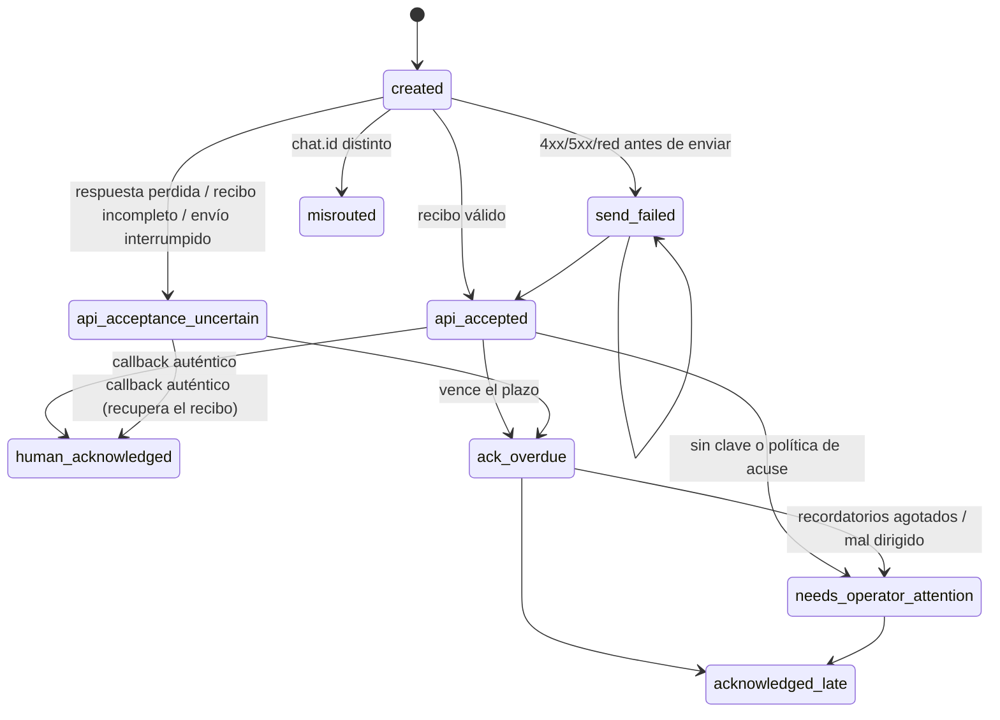

# F-01 · Informe de remediación: avisos del productor con acuse humano verificable

Rama: `feat/f01-telegram-acknowledged-alerts`, sin fusionar.

Mandato: issue `hachxaan/mainspot-platform#1`. Definición inicial: `f01-telegram-ack-design.md` @ `4817ef1`.

Alcance ejecutado: diseño canónico, implementación y pruebas **offline**. No hubo:
- mensajes reales a Telegram;
- despliegue, ni temporizadores o servicios;
- acceso a Garage o S3 real;
- cambios en credenciales ni en el contrato 1.2.0;
- uso de la condición 7 del HDC.

## Veredicto técnico

| Ámbito | Veredicto |
|---|---|
| Implementación y pruebas offline | **PASS**: 149/149 en `tests/ops/backup-remote` |
| Solicitar autorización para la prueba real de acuse (`f01-ack-mini-bootstrap.md`) | **GO técnico condicionado**: antes de ejecutarla hace falta la auditoría independiente (§6) |
| Fusionar con `master` o activar en producción | **NO-GO**: gates humanos G-FUN, G-TEC, G-PLAN y G-AUD pendientes; auditoría independiente pendiente; cadencia del consumidor y de `--check-overdue` sin definir ni autorizar |
| F-01 | **ABIERTO**. Recepción humana DEC-0065 del evento `ac931611…`: **FAIL**, sin reinterpretar. Solo se cierra con una prueba real autorizada, acuse por el botón (`human_acknowledged`) y la confirmación nueva del propietario |

## 1. Commits

| Commit | Contenido |
|---|---|
| `7677cdf353dae44a4b23e800e2100bb3fb92c23c` | Bucle 1: parche funcional 0.2.0-staging (RUN-0017) |
| `b3c78c737e9d0ff6b031e134f4e4830cf71221d4` | Bucle 2: parche técnico 0.2.0-staging (RUN-0018) |
| `6b66999d2627c195daa7a3bd67e64287b0cbeb52` | Bucle 3: adaptador, productor y pruebas (INC-0008) |
| `bd47f8c6e259eb864dd6c0a886c655e2d0a9cd2b` | README del adaptador y mini-bootstrap preparado |
| (este commit) | Informe, estado de la remediación en el informe del simulacro, revisión adversarial (RUN-0019), estado de implementación |

Hashes de los artefactos en `6b66999`:

| Archivo | sha256 |
|---|---|
| `remote-alert-telegram.py` | `6b358161a56836fa32088cc16a8430ece55e407699ab9a3162bb354c9269cc0a` |
| `db-backup-remote.py` | `de9524073f7816dfd6eaefd37f3f71f3768bfd48a068620068fed6b8c19c78ad` |

El adaptador instalado en `~/.local/libexec/mainspot/` **no se ha cambiado**: sigue siendo `d42fe40b…`.

## 2. Canon (staging, no aprobado)

- **Funcional:**
  - DECIDED: FR-0012, BR-0007, BR-0008, NFR-0006 (DEC-0061/0063/0064/0065).
  - PROPOSED: FR-0013, FR-0014, FR-0015, NFR-0007 (SRC-0011/0012/0013).
- **Técnico, todo PROPOSED:**
  - API-0005 recibo, API-0006 acuse, API-0007 registro, API-0008 vencimiento, API-0009 productor;
  - ADR-0001 … ADR-0004;
  - TR-0001 … TR-0007.
- **Limitación normativa declarada:** la skill implementation-planner exige canon APPROVED. El desarrollo se hizo bajo el mandato explícito del propietario (SRC-0011), en una rama aislada y sin efectos fuera del equipo. Las aprobaciones G-FUN, G-TEC y G-PLAN no se pidieron, para no crear decisiones humanas nuevas durante el desarrollo (lo pide el issue #1), y son requisito para fusionar.

## 3. Comportamiento implementado

**Invariantes comprobados por las pruebas:**
- `api_accepted` ≠ `human_acknowledged`;
- `send_failed` nunca pasa a `ack_overdue`;
- un acuse inválido no muta el registro (el registro JSON del evento queda idéntico);
- el acuse se persiste antes de avanzar el cursor;
- un evento ya aceptado nunca se reenvía;
- la aceptación incierta o mal dirigida nunca se reenvía automáticamente;
- ninguna salida, registro ni archivo de estado contiene el token, el chat, el usuario ni la clave de acuse.

## 4. Pruebas (offline)

`PYTHONPYCACHEPREFIX=/tmp/omp-pyc python3 -m pytest -p no:cacheprovider -v tests/ops/backup-remote`: **149 passed** en 716,85 s, 0 fallos. La salida completa queda fuera de Git, con sha256 `68e3fb55…96efe4`.

| Archivo | PASS |
|---|---|
| `test_alert_telegram.py` | 80 |
| `test_remote_producer.py` (laboratorio Garage local en Docker) | 40 |
| `test_adversarial.py` | 29 |

**Casos exigidos por el issue #1:**

| Caso | Prueba(s) |
|---|---|
| Correcto | `test_delivery_ok_plain_text_over_https`, `test_valid_ack_is_persisted_audited_and_confirmed` |
| Otro chat | `test_invalid_receipt_is_never_api_accepted_nor_resent[other-chat]`, `test_invalid_acks_never_change_state[other-chat]` |
| Campos ausentes o no enteros | `test_invalid_receipt_…[no-chat, no-message-id, str-message-id, bool-message-id, zero-message-id, no-date, bad-date, future-date, bad-json]` |
| Replays, doble clic, redelivery | `test_double_click_replay_and_redelivery_are_idempotent` |
| Actores ajenos | `test_invalid_acks_…[foreign-actor, bot-actor]` |
| Callback manipulado | `test_invalid_acks_…[tampered-tag, swapped-event, token-as-key, unknown-event, malformed-data, long-data, wrong-message, wrong-date, no-ack-event, no-message, inline-message]` |
| Caída y reinicio | `test_crash_during_send_is_uncertain_not_resent` (`kill -9` durante el envío), redelivery con el cursor reprocesado |
| Vencimiento con reloj simulado | `test_f01_case_…`, `test_bounded_reminders_then_operator_attention_then_late_ack`, `test_late_ack_without_overdue_check_keeps_the_violation` |
| Idempotencia | `test_retry_after_send_failed_delivers_once_and_is_idempotent`, reenvío en `test_invalid_receipt_…` |
| Sin secretos | `no_secrets(...)` sobre stdout, stderr, textos, registro de estado y logs del productor |
| 429 / 5xx | `test_rate_limit_…`, `test_provider_not_ok_retries_once_then_unavailable` |
| Permisos inseguros | `test_insecure_or_invalid_ack_setup_fails_closed_before_sending` (9 casos), `test_missing_insecure_or_invalid_configuration` |
| Varios consumidores, webhook ajeno, 409 | `test_single_consumer_webhook_and_conflict` |
| Caducidad de updates o cursor | `test_expired_updates_lose_the_ack_and_the_alert_goes_overdue` |
| Caso F-01 (api_accepted sin callback) | `test_f01_case_api_accepted_without_callback_is_not_acknowledged_and_goes_overdue` |
| Entrega incierta | `test_lost_response_after_send_is_uncertain_and_bounded`, `test_uncertain_acceptance_is_recovered_by_authentic_callback` |
| Productor | `test_uncertain_or_misrouted_delivery_is_not_success_nor_resent[3]` y el resto de flujos del productor; regresiones del laboratorio (40 + 29) |

## 5. Revisión adversarial propia (RUN-0019, no independiente)

**Hallazgos corregidos antes del commit:**
- el recibo de un envío fallido decía `ack=pending`; ahora dice `not_applicable`;
- un error de E/S durante `--ack-poll` salía como traza; ahora termina con la salida 13 sin avanzar el cursor;
- con umask 002, los directorios intermedios del registro se creaban escribibles por el grupo; ahora se crean con 0700 explícito.

**Riesgos residuales (TR-0001 … TR-0007 y otros):**

| # | Riesgo |
|---|---|
| R1 | Un 5xx después de que Telegram procese el mensaje produce un duplicado (el mismo `event_id`). El botón del mensaje huérfano se rechaza con `message_not_bound` (TR-0004). |
| R2 | Telegram descarta los updates no consumidos a las 24 h (TR-0001). Sin consumidor activo, el acuse no existe: el evento vence y `--status` marca `stale` (TR-0006). |
| R3 | Rotar la clave de acuse invalida los botones pendientes (`bad_signature`). La rotación debe hacerse sin avisos pendientes. |
| R4 | `audit.jsonl` crece sin rotación (volumen bajo: solo eventos y callbacks del chat del propietario). |
| R5 | `MAINSPOT_ALERT_LAB_NOW` se acepta en el binario. Solo lo controla el operador; el productor no la propaga. |
| R6 | `failed-timeout` del productor no se reintenta para evitar duplicados. Si el adaptador colgara antes de enviar, el aviso queda en `remote-alerts-failed/` con atención del operador. |
| R7 | Los recordatorios usan el mismo bot: no son redundancia (TR-0002). No hay canal alternativo aprobado. |
| R8 | El escaneo de secretos del diff también se comparó en memoria con la configuración real local, sin imprimir valores: ningún valor real aparece en el diff ni en los commits. |

## 6. Pendiente

1. Auditoría independiente: otra ejecución, que no haya construido el cambio, revisa el canon (G-DER) y el código. Esta sesión no pudo hacerla porque el mandato excluye subagentes.
2. Gates humanos G-FUN, G-TEC, G-PLAN y G-AUD.
3. Permiso del propietario para la prueba real (mini-bootstrap, variante A o B). Después, confirmación humana nueva y cierre de F-01.
4. Decisión sobre la cadencia del consumidor y de `--check-overdue` antes de la activación (condición 7, aparte).
5. Verificación independiente de E4 en el KVM (issue #2), sin cambios.
