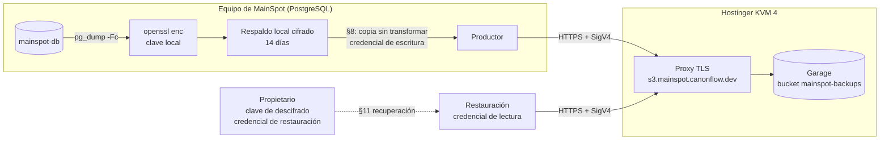

# Contrato de integración MainSpot ↔ almacenamiento de objetos S3 para respaldos (v1)

| Campo | Valor |
|---|---|
| Identificador | `mainspot-backup-object-storage` |
| Versión | `1.0.0` |
| Fecha | 2026-10-22 |
| Estado del documento | Publicado. **Aprobación parcial**: ver §2. La transferencia remota **no está activada** y no se activa sola (§2.3) |
| Productor (cliente) | MainSpot: trabajo de respaldo que corre en el equipo que ejecuta PostgreSQL |
| Servicio | Garage (S3 compatible) autoalojado en un VPS Hostinger KVM 4, repositorio del servicio `hachxaan/mainspot-s3-backups` |
| Endpoint | `https://s3.mainspot.canonflow.dev` |
| Bucket | `mainspot-backups` |
| Archivos del contrato | este documento, `manifest.schema.json`, `examples/manifest.example.json`, `reference/manifest_tool.py`, `conformance/check_s3_backup_contract.py`, `VERIFICATION.md` (todos en `docs/contracts/backup-object-storage/v1/`) |

Términos normativos: **DEBE / NO DEBE** (obligatorio), **DEBERÍA / NO DEBERÍA**
(recomendado; desviarse exige justificarlo por escrito), **PUEDE** (opcional), en el
sentido de RFC 2119. Los identificadores técnicos (cabeceras, operaciones S3, campos
JSON) se escriben en inglés y son literales.

Este documento es autocontenido: quien implemente el servicio no necesita conocer
conversaciones ni otros documentos de MainSpot. Las referencias a decisiones
(`DEC-…`, `QS-…`) solo indican de dónde sale cada requisito.

## 1. Resumen

MainSpot ya genera cada día un respaldo cifrado de su base PostgreSQL y lo guarda
en el mismo equipo (§4). Este contrato define cómo se copiará ese mismo archivo
cifrado, sin descifrarlo ni transformarlo, a un servicio S3 independiente, y cómo se
verifica, se expira y se recupera.

- El cifrado ocurre en MainSpot **antes** de la transferencia. El servicio solo
  guarda bytes cifrados y **nunca** recibe la clave de descifrado.
- Cada respaldo remoto son dos objetos: el archivo cifrado (`….dump.enc`) y su
  manifiesto (`….manifest.json`, §5). El manifiesto se escribe al final y marca el
  respaldo como completo.
- La expiración a los 14 días la aplica el propio servicio con una regla de ciclo de
  vida (§9). MainSpot no borra objetos.
- La prueba mensual de restauración (§10.2) y el procedimiento de recuperación (§11)
  usan una credencial de solo lectura.

Qué debe construir ahora el operador del servicio (KVM 4): §15 (obligaciones S-01…S-15)
y ejecutar la prueba de conformidad de §14 contra el endpoint real. Qué no debe hacer:
activar ni simular transferencias de respaldos reales, ni pedir o guardar la clave de
descifrado.

## 2. Estado de aprobación

### 2.1 Fuentes

| Marca | Significado |
|---|---|
| **APROBADO** | Decidido por el propietario en el HDC de CanonFlow (registro `DEC-…`). |
| **IMPLEMENTADO** | Comportamiento del mecanismo de respaldo local que ya funciona; este contrato lo describe y no lo cambia. Los archivos de MainSpot que se citan (`scripts/ops/backup/…`, `scripts/retention-run.ts`) están en la rama de trabajo de MainSpot y no forman parte de esta publicación: el contrato describe su comportamiento completo. |
| **PROPIETARIO** | Indicado por el propietario el 2026-10-22 al encargar este contrato; pendiente de registro en el HDC (§2.2). |
| **PROPUESTO** | Decisión técnica de este contrato; vale para construir y probar el servicio, pero puede cambiar antes de activar. |
| **PENDIENTE** | Requiere una respuesta del propietario en el HDC; hasta entonces no se promueve. |

### 2.2 Estado de cada elemento

| Elemento | Estado | Fuente |
|---|---|---|
| Respaldo diario, cifrado, conservado 14 días, con prueba de restauración mensual | APROBADO | DEC-0026 |
| Los respaldos cumplen su propia expiración y no reintroducen datos de negocios dados de baja | APROBADO | DEC-0027 |
| Formato del artefacto: `pg_dump -Fc` cifrado con `openssl enc` AES-256-CBC + PBKDF2 (§4) | IMPLEMENTADO | `scripts/ops/backup/db-backup.sh` |
| Nombre `mainspot-db-<UTC>.dump.enc`, verificación previa, retención local de 14 días | IMPLEMENTADO | `scripts/ops/backup/db-backup.sh` |
| Destino fuera del equipo: Garage en Hostinger KVM 4, `https://s3.mainspot.canonflow.dev`, bucket `mainspot-backups`, S3 compatible, HTTPS, SigV4 | PROPIETARIO → PENDIENTE | QS-0010 `Q-BACKUP-DESTINATION` (sin responder) y QS-0011 `Q-S3-DESTINATION` |
| Cifrado en MainSpot antes de transferir; la clave de descifrado nunca reside en Garage ni en el KVM 4 | PROPIETARIO → PENDIENTE | QS-0011 `Q-S3-DESTINATION` |
| Destino independiente del servidor que ejecuta PostgreSQL | PROPIETARIO → PENDIENTE | QS-0011 `Q-S3-DESTINATION` |
| Custodia de la clave de descifrado y de la credencial de restauración | PENDIENTE | QS-0010 `Q-BACKUP-KEY` |
| Expiración aplicada por el servicio (regla de ciclo de vida) y no por MainSpot | PENDIENTE (recomendado en §9) | QS-0011 `Q-S3-RETENTION-ENFORCEMENT` |
| Riesgo: la credencial de escritura puede borrar, sobrescribir y cambiar el ciclo de vida (§17 R1) | PENDIENTE | QS-0011 `Q-S3-DELETE-RISK` |
| Riesgo: Garage de un solo nodo (§17 R2) | PENDIENTE | QS-0011 `Q-S3-SINGLE-NODE` |
| Manifiesto, MAC de autenticidad, `key_id`, rutas, identificadores, operaciones, verificación, reintentos, errores, conformidad (§5–§14) | PROPUESTO | este contrato |
| Valor `deployment_id = mainspot-pilot` y región `garage` | PROPUESTO | este contrato |

### 2.3 Puerta de activación

La transferencia remota está **desactivada**: el productor de §8 no está
implementado en MainSpot y el respaldo local sigue funcionando como hoy. Se activa
solo cuando se cumplen todas estas condiciones, en este orden:

1. QS-0010 y QS-0011 respondidas por el propietario e ingeridas, con respuestas
   compatibles con este contrato o con el contrato ajustado a ellas (nueva versión).
2. Informe de §14 contra `https://s3.mainspot.canonflow.dev` con `"conformant": true`,
   publicado sin secretos.
3. Productor implementado y probado contra un Garage de laboratorio y contra el
   servicio real con datos de prueba.
4. Aprobación explícita de la activación por el propietario en el HDC.

Ninguna de estas condiciones activa nada por sí sola.

## 3. Partes y responsabilidades



| Parte | Hace | Nunca hace |
|---|---|---|
| Productor (MainSpot) | Genera y cifra el respaldo (ya existe); en el futuro, lo copia y verifica según §8 y comprueba la frescura y la expiración (§10) | Enviar texto en claro o la clave; borrar objetos; cambiar la configuración del bucket |
| Servicio (KVM 4) | Opera Garage, TLS, credenciales, ciclo de vida y monitoreo (§15); ejecuta la conformidad (§14) | Pedir, guardar o usar la clave de descifrado; abrir el bucket al público |
| Propietario | Decide en el HDC (§2); custodia la clave de descifrado y la credencial de restauración; recibe las credenciales del servicio por un canal privado | — |

## 4. Artefacto de respaldo (IMPLEMENTADO)

Este apartado describe el mecanismo existente con el detalle necesario para
verificarlo y descifrarlo de forma independiente. El contrato no lo modifica.

### 4.1 Contenido

- Volcado de la base `mainspot` con `pg_dump -Fc` (formato «custom» de PostgreSQL,
  comprimido). Servidor y `pg_dump` 16.15 a la fecha; el archivo descifrado empieza
  por los bytes `PGDMP` y, con esta versión, por la versión de archivo `1.15.0`.
- El volcado en claro nunca se escribe en disco: se cifra en el mismo flujo.
- Tamaño actual de un respaldo cifrado: unos 120 KB (120 912 bytes el 2026-10-22).

### 4.2 Cifrado

Comando exacto del productor:

```sh
pg_dump -Fc --no-password -d mainspot \
  | openssl enc -e -aes-256-cbc -pbkdf2 -iter 600000 -md sha256 -salt -pass file:KEYFILE
```

Formato del archivo resultante (byte a byte):

| Desplazamiento | Longitud | Contenido |
|---|---|---|
| 0 | 8 | ASCII `Salted__` |
| 8 | 8 | sal aleatoria |
| 16 | resto | AES-256-CBC del volcado con relleno PKCS#7 |

Clave e IV: `PBKDF2-HMAC-SHA256(contraseña, sal, 600000 iteraciones)` produce 48
bytes; los 32 primeros son la clave AES y los 16 siguientes el IV. La contraseña son
los bytes de la **primera línea** de `KEYFILE`, sin el `\n` final; un `\r` anterior
se conserva (así lo lee `openssl -pass file:`).

`KEYFILE` lo genera el productor con `openssl rand -base64 48` (64 caracteres
base64, 384 bits aleatorios), permisos `0600`, fuera del repositorio. La contraseña
DEBE ser aleatoria con al menos 256 bits de entropía, también al rotarla: el
`key_id` y el MAC (§7.4) se derivan de ella sin el coste de PBKDF2. Hoy existe una
sola clave; su custodia está PENDIENTE (§2.2).

Descifrado de referencia (se verificó también con una implementación independiente,
ver `VERIFICATION.md`):

```sh
openssl enc -d -aes-256-cbc -pbkdf2 -iter 600000 -md sha256 -pass file:KEYFILE < BACKUP.dump.enc > BACKUP.dump
pg_restore --list BACKUP.dump   # o pg_restore directo desde la tubería, sin escribir el claro
```

Este cifrado no autentica (CBC sin MAC). Por eso la integridad y la autenticidad de
cada respaldo remoto se comprueban con el SHA-256 del archivo cifrado y el MAC del
manifiesto (§7.4) **antes** de descifrar.

### 4.3 Verificación y publicación local

Antes de dejar el archivo en su nombre final, el productor lo descifra en memoria y
exige que `pg_restore --list` liste al menos una entrada del índice. Esta
comprobación solo se hace si `pg_restore` está instalado en el equipo (hoy lo está);
si no, el respaldo se publica sin ella y el registro dice `toc_entries=n/a`. Después
escribe de forma atómica:

- `mainspot-db-<YYYYMMDDTHHMMSSZ>.dump.enc` (UTC; ver §7.1), permisos `0600`;
- `mainspot-db-<…>.dump.enc.sha256`, formato `sha256sum`: `<64 hex><dos espacios><nombre>\n`.

### 4.4 Programación y retención local

- Respaldo diario a las 08:15 UTC (03:15 hora local del equipo). Prueba de
  restauración el primer domingo de cada mes a las 09:00 UTC (04:00 local).
- La retención local borra los respaldos con más de 14 días, solo después de un
  respaldo correcto. La copia remota no cambia esta retención.
- La prueba mensual actual restaura el respaldo local más reciente en un
  PostgreSQL 16 desechable y vuelve a anonimizar los negocios dados de baja (§11.3).

## 5. Manifiesto (PROPUESTO)

### 5.1 Función

Cada respaldo remoto tiene un manifiesto JSON (UTF-8, `Content-Type:
application/json`) que describe el objeto cifrado, prueba su autenticidad sin
revelar la clave y marca el respaldo como completo. Esquema normativo:
`manifest.schema.json` (JSON Schema 2020-12). Ejemplo válido:
`examples/manifest.example.json` (generado con el vector de prueba de §7.5).

### 5.2 Campos

| Campo | Obligatorio | Contenido |
|---|---|---|
| `schema` | sí | `mainspot-backup-manifest/v1` |
| `contract_version` | sí | versión de este contrato usada por el productor, `1.x.y` |
| `backup_id` | sí | §7.1 |
| `deployment_id` | sí | §7.2 |
| `created_at` | sí | instante UTC del `backup_id`, formato `YYYY-MM-DDTHH:MM:SSZ` |
| `source.engine` / `source.database` / `source.dump_format` | si existe `source` | `postgresql` / §7.2 / `pg_dump-custom` |
| `source.server_version`, `source.dump_archive_version`, `source.toc_entries` | no | informativos |
| `encryption.scheme` | sí | `openssl-enc-aes-256-cbc-pbkdf2-sha256-600000/v1` (§4.2) |
| `encryption.key_id` | sí | §7.4 |
| `object.key` | sí | clave S3 del objeto cifrado (§7.3) |
| `object.size_bytes` | sí | tamaño exacto del objeto cifrado |
| `object.sha256` | sí | SHA-256 del objeto cifrado, 64 hex en minúsculas |
| `retention.days` / `retention.policy` | no | `14` / `DEC-0026`, informativos |
| `producer.name` / `producer.version` | no | identificación del productor |
| `authenticity.alg` / `kdf` / `input` / `mac` | sí | `HMAC-SHA256` / `HKDF-SHA256` / `mainspot-backup-manifest-mac/v1` / 64 hex (§7.4) |

### 5.3 Reglas entre campos

Un manifiesto es válido solo si cumple el esquema y además:

1. `created_at` es exactamente el instante codificado en `backup_id`.
2. `object.key` es exactamente la clave que §7.3 deriva de `deployment_id`,
   `source.database` (por defecto `mainspot`) y `backup_id`.
3. Con la clave de descifrado disponible: `encryption.key_id` coincide con el de esa
   clave y `authenticity.mac` coincide con el MAC recalculado (§7.4).
4. Con el objeto disponible: su tamaño y su SHA-256 coinciden con `object.size_bytes`
   y `object.sha256`, y empieza por `Salted__`.
5. El manifiesto se leyó exactamente de la clave que §7.3 deriva de `object.key`
   (misma ruta, sufijo `.manifest.json`) y el objeto, de `object.key`. Si no, se
   descarta: así no se puede mover un respaldo antiguo y su manifiesto a la ruta de
   uno nuevo (E-RESTORE-MAC).

Un respaldo remoto está **completo** cuando su manifiesto es válido (reglas 1, 2 y 5;
también 3 si se dispone de la clave) y `HeadObject` del objeto da `Content-Length` =
`object.size_bytes` y, en subidas de una parte, `x-amz-checksum-sha256` = `object.sha256`.

`reference/manifest_tool.py verify` aplica estas reglas (la 5, con `--manifest-key`).

## 6. Transporte y autenticación

### 6.1 Endpoint y TLS

- El servicio DEBE atender la API S3 solo en `https://s3.mainspot.canonflow.dev`
  (puerto 443) con un certificado de confianza pública válido para ese nombre, TLS
  1.2 o 1.3.
- HTTP en claro (puerto 80) NO DEBE servir la API: puerto cerrado o redirección a
  HTTPS sin procesar la petición.
- El productor DEBE validar el certificado (sin `--no-verify-ssl` ni equivalentes) y
  NO DEBE fijar una IP.
- Estado observado el 2026-10-22: el endpoint resolvía, pero presentaba un
  certificado autofirmado que no correspondía a ese nombre. **No conforme** hasta
  corregirlo (comprobación C-01).

### 6.2 Direccionamiento y región

- Direccionamiento por ruta (path-style): `https://s3.mainspot.canonflow.dev/mainspot-backups/<clave>`.
  No se usa direccionamiento por subdominio (virtual-hosted) ni DNS comodín.
- Región SigV4: `garage` (PROPUESTO; es el valor por defecto de Garage, `s3_region`).
  Si el servicio usa otro valor, DEBE declararlo en su informe de conformidad y el
  contrato se corrige (versión PATCH).

### 6.3 Firma

- Todas las peticiones van firmadas con AWS Signature Version 4. No hay acceso
  anónimo, URL prefirmadas ni SigV2.
- Cada reintento se firma de nuevo.
- El productor DEBERÍA firmar el cuerpo (`x-amz-content-sha256` con el SHA-256 del
  cuerpo) en subidas de una sola parte. No DEBE depender de cargas «streaming» con
  trailer (`STREAMING-*-TRAILER`): Garage no las garantiza en su documentación.
  Con SDK de AWS recientes: `request_checksum_calculation = when_required` y
  `response_checksum_validation = when_required` (en AWS CLI:
  `AWS_REQUEST_CHECKSUM_CALCULATION=when_required` y
  `AWS_RESPONSE_CHECKSUM_VALIDATION=when_required`).

### 6.4 Credenciales

Tres claves de acceso de Garage, cada una limitada al bucket `mainspot-backups`
(permisos exactos en §8.1):

| Nombre | Permisos Garage | Dónde vive |
|---|---|---|
| `mainspot-backup-writer` | read + write | equipo de MainSpot, archivo `0600` fuera del repositorio |
| `mainspot-backup-restore` | read | custodia del propietario (con la clave de descifrado; PENDIENTE QS-0010 `Q-BACKUP-KEY`); en el equipo de MainSpot solo para la prueba mensual |
| `mainspot-backup-operator` | read + write | solo en el KVM 4, para aplicar y vigilar el ciclo de vida (§9) |

- Ninguna clave de MainSpot tiene el permiso `owner`.
- Los secretos se entregan al propietario por un canal privado. NO DEBEN aparecer en
  Git, registros, tickets, chats, informes ni argumentos de línea de comandos.
- El operador PUEDE conservar copias `0600` de `mainspot-backup-writer` y
  `mainspot-backup-restore` solo para ejecutar la conformidad (§14): en el KVM 4 y en
  el equipo externo desde el que la ejecuta; en ningún otro sitio.
- Formato de archivo de credenciales usado por la conformidad y DEBERÍA usarlo el
  productor: dos líneas `AWS_ACCESS_KEY_ID=…` y `AWS_SECRET_ACCESS_KEY=…`, permisos
  `0600` o más restrictivos.
- Rotación: crear la clave nueva y darle los mismos permisos; instalarla; comprobar
  C-03/C-04; revocar la anterior (`garage key delete`). Garage no rota el secreto de
  una clave existente.

### 6.5 Reloj

Ambos equipos DEBEN sincronizar la hora (NTP). Diferencia máxima tolerada: 300 s
(la conformidad falla por encima y avisa por encima de 30 s). Garage no aplica esa
tolerancia: solo rechaza peticiones con fecha de más de 24 h (`400 InvalidRequest`).
Por eso el productor DEBE medir la diferencia con la cabecera `Date` de la primera
respuesta de cada ejecución (como C-02) y detenerse con E-AUTH-SKEW si supera 300 s.

## 7. Identificadores y rutas lógicas

### 7.1 `backup_id` (IMPLEMENTADO)

`mainspot-db-<YYYYMMDDTHHMMSSZ>`: instante UTC, con segundos, de inicio del respaldo
(`date -u +%Y%m%dT%H%M%SZ`). Expresión regular:
`^mainspot-db-[0-9]{8}T[0-9]{6}Z$`. El candado del productor serializa las
ejecuciones, pero no impide dos respaldos en el mismo segundo (el segundo
sustituiría al primero en el equipo local). Si un `backup_id` ya tiene una copia
remota completa con otro contenido, es E-REMOTE-CONFLICT (§13) y no se sobrescribe.

### 7.2 `deployment_id` y base de datos (PROPUESTO)

- `deployment_id` identifica la instalación de MainSpot: `^[a-z0-9](?:[a-z0-9-]{0,38}[a-z0-9])?$`.
  Valor de la instalación piloto actual: `mainspot-pilot`.
- Base de datos: `mainspot` (`^[a-z_][a-z0-9_]{0,62}$`).

### 7.3 Claves de objeto

```text
v1/<deployment_id>/postgres/<database>/<YYYY>/<MM>/<DD>/<backup_id>.dump.enc
v1/<deployment_id>/postgres/<database>/<YYYY>/<MM>/<DD>/<backup_id>.manifest.json
```

- `<YYYY>/<MM>/<DD>` es la fecha UTC del `backup_id`.
- `v1/` es la versión mayor de este contrato; un cambio incompatible usará `v2/`.
- El orden lexicográfico de las claves es el orden cronológico dentro de una
  instalación y una base.
- Prefijo reservado `_conformance/`: solo para la comprobación de §14; se borra al
  terminar y expira en 1 día (§9).
- Ningún otro prefijo se usa en el bucket. El bucket es exclusivo de estos respaldos.

Ejemplo: `v1/mainspot-pilot/postgres/mainspot/2026/10/22/mainspot-db-20261022T061958Z.dump.enc`.

### 7.4 `key_id` y MAC de autenticidad (PROPUESTO)

Sea `P` la contraseña de §4.2 (primera línea de `KEYFILE`, sin el `\n` final) y
`HKDF` la de RFC 5869 con SHA-256, sal `mainspot-backup/v1` (ASCII):

- `key_id = "msbk1-" + hex(HKDF(P, info="key-id", L=32))[0:16]`
  (identifica la clave sin revelarla; cambia si se rota la clave).
- `K_mac = HKDF(P, info="manifest-mac", L=32)`.
- `mac = hex(HMAC-SHA256(K_mac, M))`, donde `M` son estas nueve líneas en UTF-8,
  cada una terminada en `\n` (LF), sin espacios añadidos:

```text
mainspot-backup-manifest-mac/v1
<backup_id>
<deployment_id>
<created_at>
<object.key>
<object.size_bytes en decimal>
<object.sha256>
<encryption.scheme>
<encryption.key_id>
```

El MAC impide que quien controle el bucket cambie un respaldo por otro (por
ejemplo, uno más antiguo con el nombre de uno nuevo) o altere el manifiesto sin que
se note: sin la clave no puede calcularlo. Los campos opcionales (`source.*`,
`retention`, `producer`) no entran en el MAC y son solo informativos.

### 7.5 Vector de prueba

Contraseña **pública y solo de prueba** (64 bytes ASCII):
`TEST-VECTOR-ONLY-not-a-real-key-0123456789abcdefghijklmnopqrstuv`.
Objeto: `Salted__` seguido de los bytes `00 01 02 … 07` y 48 bytes `00` (64 bytes).

| Valor | Resultado esperado |
|---|---|
| `object.sha256` | `85b2bdc9efc9003ea6adc81f662a7d1570166c68dc347a17cc0b18608526812a` |
| `backup_id` / `deployment_id` / `database` | `mainspot-db-20261022T061958Z` / `mainspot-pilot` / `mainspot` |
| `key_id` | `msbk1-4bf859a355f2abcf` |
| `mac` | `dd6e517b7a3714c5801655fd0f458c6feae92eb16bf84763bf74a15d4f3e065a` |

`python3 reference/manifest_tool.py selftest` comprueba estos valores (se
recalcularon con una implementación independiente; ver `VERIFICATION.md`).

## 8. Operaciones y permisos

### 8.1 Matriz de permisos de Garage (verificada en Garage v1.2.0 y v2.4.1)

| Operación S3 | read | write | owner |
|---|---|---|---|
| `HeadBucket`, `ListObjectsV2`, `HeadObject`, `GetObject`, `GetBucketLifecycleConfiguration`, `ListMultipartUploads` | sí | sí | no |
| `PutObject`, `CreateMultipartUpload`, `UploadPart`, `CompleteMultipartUpload`, `AbortMultipartUpload` | no | sí | no |
| `DeleteObject`, `DeleteObjects` | no | sí | no |
| `PutBucketLifecycleConfiguration`, `DeleteBucketLifecycle` | no | sí | no |
| `PutBucketCors`, `PutBucketWebsite` y su borrado | no | no | sí |
| `PutBucketVersioning`, `PutObjectLockConfiguration` | `501 NotImplemented` (no existen en Garage) |

Consecuencia: en Garage no existe una credencial que pueda subir sin poder borrar,
sobrescribir o cambiar el ciclo de vida. Es el riesgo R1 de §17.

### 8.2 Procedimiento de subida del productor (una vez activado)

En cada ejecución, para cada respaldo local con `.sha256` cuyo `backup_id` tenga
**menos de 24 h** y que no tenga copia remota completa (§5.3), del más nuevo al más
antiguo. Un respaldo más antiguo sin copia remota no se sube: su contenido superaría
la cota de 16 días de §9 antes de expirar en el servicio. Ese hueco se registra y se
avisa con E-UPLOAD-WINDOW. El productor se ejecuta justo después de cada respaldo
local y DEBE volver a intentarlo al menos cada hora mientras un respaldo de menos de
24 h no tenga copia remota completa.

1. Comprobar el `.sha256` local contra el archivo. Si no coincide: E-LOCAL-INTEGRITY,
   no subir ese respaldo.
2. `GetObject` del manifiesto en su clave (§7.3). Si responde 404, ir al paso 4.
3. Si el manifiesto existe: el respaldo está completo si cumple §5.3 frente al archivo
   local y `HeadObject` del objeto coincide; entonces no hacer nada. Si el manifiesto
   no corresponde al archivo local, o el objeto falta o difiere: E-REMOTE-CONFLICT, no
   sobrescribir nada.
4. Subir el objeto cifrado a su clave (§7.3) con `PutObject` (o multiparte, §8.5)
   y estas cabeceras:
   - `Content-Type: application/octet-stream`
   - `Content-MD5` (base64 del MD5 binario)
   - `x-amz-checksum-sha256` (base64 del SHA-256 binario)
   - `x-amz-meta-sha256` (SHA-256 en hex) y `x-amz-meta-backup-id`
5. Verificar (§8.3). Si falla, no escribir el manifiesto: el objeto queda incompleto
   y el siguiente intento PUEDE sobrescribirlo.
6. Subir el manifiesto (`Content-Type: application/json`, `Content-MD5`,
   `x-amz-checksum-sha256`) y comprobarlo con `HeadObject`.
7. Registrar una línea de resultado (§16.3).

Un respaldo **completo** NO DEBE sobrescribirse ni borrarse por el productor. Garage
ignora `If-None-Match: *` en `PutObject` (verificado), así que el productor
comprueba antes de subir; el candado exclusivo del productor evita carreras.

### 8.3 Verificación tras subir

1. `HeadObject` con `x-amz-checksum-mode: ENABLED`: `Content-Length` = tamaño local
   y `x-amz-checksum-sha256` = SHA-256 local.
2. `GetObject` completo y SHA-256 del cuerpo = SHA-256 local. Obligatorio en v1
   (los respaldos son pequeños); si un respaldo supera 1 GiB, una versión MINOR
   PUEDE sustituirlo por la prueba mensual.

### 8.4 Integridad en tránsito

- `Content-MD5` y `x-amz-checksum-sha256` se calculan sobre los bytes exactos que se
  envían. Garage rechaza ambos si no coinciden (`400 InvalidDigest`, verificado) y
  no guarda el objeto.
- El SHA-256 que guarda el servicio se puede leer con `HeadObject` y
  `x-amz-checksum-mode: ENABLED` (verificado en v1.2.0 y v2.4.1).
- La `ETag` es opaca: no se usa como MD5 ni para verificar.
- Sin trailers de checksum (§6.3).

### 8.5 Subidas multiparte

- Una sola parte hasta 256 MiB (incluido).
- Más de 256 MiB: multiparte con partes de 64 MiB (múltiplo del `block_size` de 1 MiB
  de Garage), la última más pequeña; `Content-MD5` en cada parte. Las cabeceras
  `x-amz-meta-*` van en `CreateMultipartUpload`.
- Si la subida no se puede completar: `AbortMultipartUpload`. Las subidas
  abandonadas expiran en 1 día (§9).
- La verificación de §8.3 se hace igual sobre el objeto completo (el checksum
  SHA-256 de objeto completo no aplica a multiparte; vale el `GetObject`).

### 8.6 Operaciones que el productor no usa

`DeleteObject`, `DeleteObjects`, `CopyObject`, `PutBucketLifecycleConfiguration`,
`DeleteBucketLifecycle`, configuración de CORS o sitio web, URL prefirmadas y acceso
anónimo. El servicio no puede impedir algunas de ellas (§8.1), así que su uso se
detecta (§10.1, §15 S-08) y se trata como incidente de seguridad.

## 9. Retención y expiración

- APROBADO (DEC-0026): cada respaldo remoto se conserva 14 días.
- APROBADO (DEC-0027): los respaldos expiran y no reintroducen datos de negocios
  dados de baja. MainSpot borra el registro de negocios anonimizados a los 30 días;
  por eso ningún respaldo remoto DEBE superar 16 días de antigüedad.
- Mecanismo (PENDIENTE QS-0011 `Q-S3-RETENTION-ENFORCEMENT`; recomendado):
  configuración de ciclo de vida del bucket, aplicada por el operador del servicio
  con `mainspot-backup-operator`:

```json
{"Rules": [
  {"ID": "mainspot-backups-v1-retention-14d", "Status": "Enabled",
   "Filter": {"Prefix": "v1/"}, "Expiration": {"Days": 14},
   "AbortIncompleteMultipartUpload": {"DaysAfterInitiation": 1}},
  {"ID": "mainspot-backups-conformance-1d", "Status": "Enabled",
   "Filter": {"Prefix": "_conformance/"}, "Expiration": {"Days": 1},
   "AbortIncompleteMultipartUpload": {"DaysAfterInitiation": 1}}
]}
```

- Garage ejecuta el ciclo de vida una vez al día (medianoche UTC por defecto). Según
  su código fuente (v2.4.1), un objeto expira en la primera ejecución a partir de las
  00:00 UTC del día (fecha de subida + 15 días): vive entre 14 y 15 días desde que
  se sube. Con la ventana de subida de 24 h (§8.2), el contenido de un respaldo
  remoto nunca supera 16 días.
- La edad de un respaldo se mide siempre desde su `created_at` (el instante del
  `backup_id` en la clave), no desde `LastModified`. La cota de 16 días se comprueba
  cada día (§10.1).
- Garage admite solo `Expiration` y `AbortIncompleteMultipartUpload`, con el prefijo
  dentro de `Filter`. No hay versiones ni bloqueo de objetos: un objeto borrado no
  se recupera desde Garage.
- MainSpot NO DEBE borrar objetos remotos en v1. Si el propietario elige que la
  expiración la aplique MainSpot, el contrato cambia en una versión nueva.

## 10. Verificación continua

### 10.1 Comprobación diaria (una vez activado)

Productor, después de cada ejecución, con `ListObjectsV2` sobre
`v1/<deployment_id>/postgres/<database>/`:

| Comprobación | Umbral | Error |
|---|---|---|
| Respaldo completo más reciente (edad desde `created_at`) | menos de 26 h | E-FRESHNESS |
| Respaldo más antiguo bajo `v1/` (edad desde `created_at`) | no más de 16 días | E-RETENTION-VIOLATION |
| Respaldos completos | entre 13 y 16 | aviso si fuera de rango |
| Objetos `.dump.enc` sin manifiesto con más de 24 h | ninguno | aviso |
| Configuración de ciclo de vida (`GetBucketLifecycleConfiguration`) | exactamente las reglas de §9 (mismos `ID`, `Status`, `Filter.Prefix`, `Expiration.Days` y `DaysAfterInitiation`) y ninguna más | E-RETENTION-VIOLATION |

El servicio hace por su lado la misma comprobación del ciclo de vida y del
inventario (§15 S-08).

### 10.2 Prueba mensual de restauración

APROBADO (DEC-0026): una prueba de restauración al mes. Una vez activada la copia
remota (PROPUESTO), la prueba mensual DEBE restaurar desde el servicio con
`mainspot-backup-restore`, siguiendo §11.2 en una base desechable:

1. Elegir el respaldo completo más reciente.
2. Validar el manifiesto con la clave y la clave de almacenamiento (§5.3, reglas 1 a 5) y el SHA-256 del objeto descargado.
3. Descifrar en tubería hacia `pg_restore` en un PostgreSQL 16 desechable.
4. Comprobaciones de sanidad (migraciones y conteo de filas por tabla).
5. Volver a anonimizar las bajas (§11.3).
6. Guardar un informe fechado sin secretos.

La prueba local actual (§4.4) se mantiene.

## 11. Recuperación

### 11.1 Elección del respaldo

Se usa el respaldo **completo** más reciente cuyo manifiesto sea válido. Si uno
falla (MAC, SHA-256, descifrado o `pg_restore`), se descarta, se registra y se prueba
el anterior. Nunca se restaura un objeto sin manifiesto.

### 11.2 Procedimiento (pérdida del equipo de MainSpot)

1. Obtener de la custodia del propietario la clave de descifrado y la credencial
   `mainspot-backup-restore`.
2. Listar `v1/<deployment_id>/postgres/mainspot/` y tomar el manifiesto más reciente
   por su clave.
3. Descargar el manifiesto y el objeto de `object.key`; validar con
   `reference/manifest_tool.py verify --manifest M --manifest-key <clave listada> --object O --key KEYFILE`.
4. Descifrar (§4.2) y restaurar con `pg_restore` en la base nueva.
5. Aplicar las migraciones pendientes de MainSpot (`npm run migrate`).
6. Re-aplicar las bajas (§11.3) **antes** de abrir el tráfico.

### 11.3 No reintroducción de bajas (DEC-0027)

Cada base de MainSpot guarda la huella SHA-256 de los negocios anonimizados durante
30 días. Después de restaurar:

- si el respaldo restaurado es el más reciente disponible:
  `node scripts/retention-run.ts --reapply-exits`;
- si es más antiguo: exportar antes el registro de la fuente más reciente
  (`node scripts/retention-run.ts --export-registry > registry.json`, desde la base
  viva o desde una copia restaurada del respaldo más reciente) y ejecutar
  `--reapply-exits --registry=registry.json`.

Como ningún respaldo supera 16 días (§9) y el registro dura 30 días, toda baja
anonimizada después de un respaldo sigue registrada mientras ese respaldo existe.

## 12. Reintentos y tiempos

| Parámetro | Valor (PROPUESTO) |
|---|---|
| Intentos por petición | 5 como máximo (1 + 4 reintentos) |
| Espera antes del reintento *n* (n = 1…4) | aleatoria uniforme entre 0 y `min(60 s, 2 s × 2^n)` |
| Tiempo de conexión | 10 s |
| Tiempo de lectura por petición | 120 s (subidas: 600 s por parte) |
| Plazo total de una ejecución del productor | 30 min; lo pendiente pasa a la siguiente ejecución |
| Se reintenta | errores de red, tiempos agotados, HTTP 500, 502, 503, 504, 429, `SlowDown`, `InternalError`, `ServiceUnavailable`, `RequestTimeout` |
| No se reintenta | 403 `AccessDenied` (en Garage también clave inexistente o firma inválida), 400 `AuthorizationHeaderMalformed` (región incorrecta), 400 `InvalidRequest`, otros 4xx no listados, 404 `NoSuchBucket`, 501, errores de TLS/certificado, diferencia de reloj > 300 s (§6.5) |
| `400 InvalidDigest` / `BadDigest` | un solo reintento tras volver a leer y comprobar el archivo local; después, E-INTEGRITY-UPLOAD |
| Multiparte | reintento por parte; si se agotan, `AbortMultipartUpload` |

Un fallo remoto no cambia el resultado del respaldo local ni su retención. Los
reintentos horarios (§8.2) suben lo que falte mientras siga dentro de la ventana de 24 h.

## 13. Errores

| Código | Causa | Reintento | Acción del productor | Aviso |
|---|---|---|---|---|
| E-TLS | certificado inválido, nombre que no coincide o TLS < 1.2 | no | detener | sí |
| E-NETWORK | DNS, conexión o tiempo agotado, `RequestTimeout` | sí (§12) | siguiente ejecución si persiste | si dura más de 26 h (E-FRESHNESS) |
| E-SERVER | 500/502/503/504, `InternalError`, `ServiceUnavailable` | sí | idem | idem |
| E-THROTTLE | 429, `SlowDown` | sí | idem | idem |
| E-AUTH-SKEW | diferencia con la cabecera `Date` > 300 s (§6.5), o 400 `InvalidRequest` por fecha antigua | no | detener; corregir NTP | sí |
| E-AUTH-SIGNATURE | 400 `AuthorizationHeaderMalformed` (región) o `SignatureDoesNotMatch` (otros servicios S3) | no | revisar región, endpoint o proxy | sí |
| E-AUTH-DENIED | 403 `AccessDenied`; en Garage también clave inexistente, revocada o firma inválida (`InvalidAccessKeyId` en otros servicios S3) | no | revisar credencial y permisos | sí |
| E-BUCKET | 404 `NoSuchBucket` | no | configuración | sí |
| E-NOT-IMPLEMENTED | 501 | no | servicio no conforme | sí |
| E-REQUEST | cualquier otro 4xx no listado (salvo el 404 `NoSuchKey` esperado en el paso 2 de §8.2) | no | detener | sí |
| E-UPLOAD-WINDOW | un respaldo local sale de la ventana de 24 h sin copia remota completa | no | registrar `SKIPPED` | sí |
| E-INTEGRITY-UPLOAD | `InvalidDigest` / `BadDigest` repetido | 1 | no escribir manifiesto | sí |
| E-INTEGRITY-VERIFY | §8.3 no coincide | siguiente ejecución | no escribir manifiesto | sí |
| E-LOCAL-INTEGRITY | el `.sha256` local no coincide | no | no subir ese respaldo | sí |
| E-REMOTE-CONFLICT | ya existe un manifiesto que no corresponde al archivo local, o su objeto falta o difiere | no | no tocar; investigar | sí (seguridad) |
| E-DEADLINE | plazo total agotado | siguiente ejecución | — | si persiste |
| E-FRESHNESS | sin respaldo remoto completo de menos de 26 h | — | — | sí |
| E-RETENTION-VIOLATION | respaldo de más de 16 días o ciclo de vida distinto de §9 | — | — | sí (seguridad) |
| E-RESTORE-MAC | `key_id` o MAC no coinciden, o manifiesto leído de otra clave (§5.3 regla 5) | — | descartar ese respaldo; probar el anterior | sí (seguridad) |
| E-RESTORE-DECRYPT | fallo de descifrado o de `pg_restore` | — | descartar; probar el anterior | sí |

Los avisos los recibe el propietario. Ningún mensaje de error incluye secretos,
cabeceras `Authorization` ni el contenido de los respaldos.

## 14. Conformidad del servicio

`conformance/check_s3_backup_contract.py` (Python 3.10+ y `boto3` ≥ 1.36) comprueba el
servicio con las credenciales `mainspot-backup-writer` y `mainspot-backup-restore`.
Se ejecuta **desde fuera del KVM 4** (necesita salida a los puertos 80, 443, 3901,
3902 y 3903 del endpoint). Solo escribe en `_conformance/<ejecución>/`, borra lo que
crea y no imprime secretos. No cambia la configuración del bucket, salvo un caso: si
la clave de restauración tuviera escritura indebida, C-14 reescribiría las mismas
reglas de §9 (C-15 se comprueba antes, así que una configuración previa distinta no
queda oculta).

```sh
python3 check_s3_backup_contract.py \
  --writer-credentials /ruta/privada/backup-writer.env \
  --restore-credentials /ruta/privada/backup-restore.env \
  --report conformance-report.json
```

| Id | Comprueba |
|---|---|
| C-01 | TLS 1.2+ con certificado de confianza pública válido para el nombre |
| C-02 | diferencia de reloj ≤ 300 s (aviso > 30 s) |
| C-03 / C-04 | `HeadBucket` firmado SigV4, región y path-style con ambas claves |
| C-05 | `PutObject` con `Content-MD5` |
| C-06 | `Content-MD5` incorrecto rechazado con 400 y nada guardado |
| C-19 | `x-amz-checksum-sha256` verificado al subir y devuelto por `HeadObject` |
| C-07 / C-08 | tamaño, `x-amz-meta-sha256` y bytes idénticos al leer con la clave de restauración |
| C-09 | `ListObjectsV2` con prefijo, `MaxKeys` y `ContinuationToken` |
| C-10 / C-11 | multiparte completa e idéntica; `AbortMultipartUpload` limpia |
| C-12 / C-13 / C-14 | la clave de restauración no puede subir, borrar ni cambiar el ciclo de vida (el intento usa las mismas reglas de §9, para que un fallo de permisos no las altere) |
| C-15 | ciclo de vida exactamente igual a §9 (mismas reglas, ninguna más) |
| C-16 | limpieza de `_conformance/` |
| C-17 | acceso anónimo denegado |
| C-18 | HTTP en claro no sirve la API |
| C-20 | puertos internos de Garage (3901, 3902, 3903) inaccesibles desde fuera |

El servicio es **conforme** cuando el informe dice `"conformant": true` (todas las
comprobaciones obligatorias en PASS o WARN). `--lab-allow-http` existe solo para
laboratorios y nunca da conformidad. El informe JSON no contiene secretos y se
publica en el repositorio del servicio.

## 15. Obligaciones del servicio (KVM 4)

| Id | Obligación |
|---|---|
| S-01 | Garage v1.2.0 o posterior (verificado con v1.2.0 y v2.4.1; recomendado v2.4.1). Cualquier cambio de versión vuelve a ejecutar §14. |
| S-02 | API S3 solo por HTTPS en el endpoint, con certificado de confianza pública renovado automáticamente (§6.1). |
| S-03 | Path-style y región declarada (`garage`, §6.2). |
| S-04 | Proxy inverso: conserva `Host`, ruta y consulta sin reescribir; admite cuerpos de al menos 300 MiB (o sin límite); no acumula la petición en disco si puede evitarse; tiempos de espera ≥ 600 s. |
| S-05 | Puertos internos de Garage (RPC 3901, web 3902, administración y métricas 3903) no accesibles desde Internet; el token de administración solo en el KVM 4. |
| S-06 | Bucket `mainspot-backups` exclusivo de estos respaldos: sin sitio web, sin CORS, sin acceso anónimo, sin alias adicionales. |
| S-07 | Claves de §6.4 limitadas a este bucket; ninguna clave de MainSpot con `owner`. Secretos entregados solo al propietario por un canal privado. |
| S-08 | Ciclo de vida de §9 aplicado y comprobado cada día: configuración exacta e inventario (ningún respaldo con más de 16 días desde su `created_at`); aviso al propietario si difiere. |
| S-09 | El servicio nunca recibe, pide ni guarda la clave de descifrado y no intenta descifrar respaldos. |
| S-10 | Hora sincronizada por NTP (§6.5). |
| S-11 | `consistency_mode = "consistent"`; `metadata_auto_snapshot_interval` configurado (por ejemplo `6h`); limpieza (`scrub`) habilitada; alerta de disco al 80 %. Con un solo nodo, `replication_factor = 1` (riesgo R2, PENDIENTE). |
| S-12 | Los registros de acceso PUEDEN guardar claves de objeto y códigos de estado; NO DEBEN guardar cabeceras `Authorization`, firmas ni cuerpos. |
| S-13 | Capacidad libre para al menos 2 × 16 respaldos del tamaño máximo observado. |
| S-14 | Cualquier cambio de endpoint, región, bucket, credenciales o ciclo de vida se avisa al propietario antes de aplicarlo; si cambia el comportamiento, se publica una versión nueva del contrato. |
| S-15 | Informe de §14 tras la puesta en marcha y tras cada cambio de versión o de configuración, publicado sin secretos, con una declaración del operador sobre S-04, S-06, S-11 y S-13 (que la conformidad no puede medir). |

## 16. Seguridad y datos

### 16.1 Qué nunca sale del equipo de MainSpot

El volcado en claro, la clave de descifrado (`KEYFILE`) y su contraseña. Al servicio
solo llegan bytes cifrados, el manifiesto (sin secretos) y peticiones firmadas.

### 16.2 Clasificación

Los respaldos contienen datos personales de los negocios y de sus clientes
(cifrados). Hoy solo existen negocios sintéticos. El servicio trata datos cifrados
que no puede leer.

### 16.3 Registro del productor

Una línea por respaldo, sin secretos:

```text
<UTC ISO-8601> db-backup-remote status=OK|FAIL|SKIPPED backup_id=<…> object_key=<…> size_bytes=<n> sha256=<hex> attempts=<n> duration_s=<n> [error=<código §13>]
```

## 17. Riesgos residuales

| Id | Riesgo | Mitigación en v1 | Decisión |
|---|---|---|---|
| R1 | Quien obtenga la credencial de escritura puede borrar o sobrescribir respaldos y quitar el ciclo de vida: Garage no separa esos permisos y no tiene versiones ni bloqueo de objetos (§8.1). | Copias locales de 14 días en otro equipo; comprobación diaria de inventario y ciclo de vida por ambas partes; el MAC impide sustituciones silenciosas. | PENDIENTE QS-0011 `Q-S3-DELETE-RISK` |
| R2 | Garage de un solo nodo: perder el KVM 4 o su disco pierde la copia remota. | La copia local sigue existiendo (dos copias independientes); `scrub` detecta corrupción pero no la repara con un solo nodo. | PENDIENTE QS-0011 `Q-S3-SINGLE-NODE` |
| R3 | El cifrado no autentica (CBC sin MAC). | MAC del manifiesto y SHA-256 comprobados antes de descifrar (§5.3, §11). | PROPUESTO |
| R4 | El certificado del endpoint no era válido al publicar este contrato. | C-01 lo bloquea hasta corregirlo. | — |
| R5 | La documentación de Garage no fija el cálculo de la edad del ciclo de vida; este contrato se apoya en el código de v2.4.1 (§9). | Cota de 16 días comprobada a diario; repetir §14 y revisar §9 al cambiar de versión. | — |
| R6 | Garage ignora las escrituras condicionales. | Comprobación del manifiesto y del objeto antes de subir (§8.2) y candado exclusivo del productor. | — |
| R7 | Si se pierden la clave de descifrado y su copia, todos los respaldos quedan ilegibles. | Custodia por el propietario. | PENDIENTE QS-0010 `Q-BACKUP-KEY` |

## 18. Versionado y cambios

- Versión semántica `MAYOR.MENOR.PARCHE`:
  - PARCHE: aclaraciones o valores declarados (por ejemplo, la región real);
  - MENOR: añadidos compatibles (campos opcionales, nuevas comprobaciones);
  - MAYOR: cambios incompatibles de formato, rutas o cifrado, con prefijo `v2/` y
    esquema `mainspot-backup-manifest/v2`; los objetos `v1/` expiran solos.
- Cada versión se publica en Git en la ruta `docs/contracts/backup-object-storage/v<MAYOR>/`
  y se cita por **commit**, no por rama.
- Cuando el HDC resuelva un elemento PENDIENTE o PROPIETARIO, §2.2 se actualiza con
  el `DEC-…` correspondiente en una versión nueva.

## 19. Verificación de este contrato

`VERIFICATION.md` reúne lo comprobado al redactarlo:

- formato de cifrado descifrado con una implementación independiente;
- vector de prueba recalculado por separado;
- conformidad contra Garage v1.2.0 y v2.4.1 en laboratorio;
- matriz de permisos y comportamientos de Garage observados;
- flujo completo de subida, verificación, restauración y rechazo de manipulaciones contra un Garage de laboratorio.

## 20. Referencias

- Decisiones de MainSpot: DEC-0026 (respaldos), DEC-0027 (baja, anonimización y
  respaldos); sesiones HDC QS-0010 y QS-0011 (pendientes).
- Garage, compatibilidad S3: https://garagehq.deuxfleurs.fr/documentation/reference-manual/s3-compatibility/
- Garage, configuración (`s3_region`, `replication_factor`, `consistency_mode`,
  `metadata_auto_snapshot_interval`, ciclo de vida diario): https://garagehq.deuxfleurs.fr/documentation/reference-manual/configuration/
- Garage, proxy inverso: https://garagehq.deuxfleurs.fr/documentation/cookbook/reverse-proxy/
- Garage, durabilidad y reparaciones: https://garagehq.deuxfleurs.fr/documentation/operations/durability-repairs/
- Versiones: https://git.deuxfleurs.fr/Deuxfleurs/garage/releases/tag/v2.4.1 y https://git.deuxfleurs.fr/Deuxfleurs/garage/releases/tag/v1.2.0
- RFC 2119 (términos normativos), RFC 5869 (HKDF), RFC 2104 (HMAC), RFC 8018 (PBKDF2).
