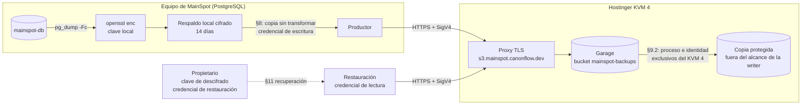

# Contrato de integración MainSpot ↔ almacenamiento de objetos S3 para respaldos (v1)

| Campo | Valor |
|---|---|
| Identificador | `mainspot-backup-object-storage` |
| Versión | `1.1.0` (cambios respecto a `1.0.0`: `CHANGELOG.md`) |
| Fecha | 2026-10-22 |
| Estado del documento | Publicado. **Aprobado con condiciones** por el propietario (DEC-0045…DEC-0054; ver §2). La transferencia remota **no está activada** y no se activa sola: puerta de activación en §2.3 |
| Productor (cliente) | MainSpot: trabajo de respaldo que corre en el equipo que ejecuta PostgreSQL |
| Servicio | Garage (S3 compatible) autoalojado en un VPS Hostinger KVM 4, repositorio del servicio `hachxaan/mainspot-s3-backups` |
| Endpoint | `https://s3.mainspot.canonflow.dev` |
| Bucket | `mainspot-backups` |
| Archivos del contrato | este documento, `CHANGELOG.md`, `manifest.schema.json`, `examples/manifest.example.json`, `reference/manifest_tool.py`, `conformance/check_s3_backup_contract.py`, `VERIFICATION.md`, `infra-reconciliation-ab046d24.md` (informe no normativo) (todos en `docs/contracts/backup-object-storage/v1/`) |

Términos normativos: **DEBE / NO DEBE** (obligatorio), **DEBERÍA / NO DEBERÍA**
(recomendado; desviarse exige justificarlo por escrito), **PUEDE** (opcional), en el
sentido de RFC 2119. Los identificadores técnicos (cabeceras, operaciones S3, campos
JSON) se escriben en inglés y son literales.

Este documento es autocontenido: quien implemente el servicio no necesita conocer
conversaciones ni otros documentos de MainSpot. Las referencias a decisiones
(`DEC-…`, `QS-…`) solo indican de dónde sale cada requisito.

## 1. Resumen

MainSpot ya genera cada día un respaldo cifrado de su base PostgreSQL y lo guarda
en el mismo equipo (§4). Este contrato define cómo se copiará ese mismo archivo
cifrado, sin descifrarlo ni transformarlo, a un servicio S3 independiente, y cómo se
verifica, se expira y se recupera.

- El cifrado ocurre en MainSpot **antes** de la transferencia. El servicio solo
  guarda bytes cifrados y **nunca** recibe la clave de descifrado.
- Cada respaldo remoto son dos objetos: el archivo cifrado (`….dump.enc`) y su
  manifiesto (`….manifest.json`, §5). El manifiesto se escribe al final y marca el
  respaldo como completo.
- La expiración a los 14 días la aplica el propio servicio con la **regla de ciclo de
  vida del bucket** (§9.1, DEC-0046). MainSpot no borra objetos; el servicio PUEDE
  vigilar y auditar, pero ningún proceso del servicio borra objetos de
  `mainspot-backups` ni los retiene más de 16 días.
- Antes de activar la transferencia, el servicio mantiene una **copia protegida** de
  cada respaldo completo fuera del alcance de las credenciales de MainSpot (§9.2,
  DEC-0047): la credencial de escritura puede borrar en Garage, y esa copia es lo que
  lo hace recuperable.
- La prueba mensual de restauración (§10.2) y el procedimiento de recuperación (§11)
  usan una credencial de solo lectura; ambos incluyen la restauración desde la copia
  protegida con los originales ausentes.

Qué debe construir ahora el operador del servicio (KVM 4): §15 (obligaciones S-01…S-16),
los cambios que detalla `infra-reconciliation-ab046d24.md` §10 y ejecutar la prueba de
conformidad de §14 (C-01…C-22) contra el endpoint real. Qué no debe hacer: activar ni
simular transferencias de respaldos reales, ni pedir o guardar la clave de descifrado.

## 2. Estado de aprobación

### 2.1 Fuentes

| Marca | Significado |
|---|---|
| **APROBADO** | Decidido por el propietario en el HDC de CanonFlow (registro `DEC-…`). Las notas literales del propietario están en DEC-0049 (QS-0011) y DEC-0054 (QS-0010); donde este contrato las cita, lo hace textualmente. |
| **IMPLEMENTADO** | Comportamiento del mecanismo de respaldo local que ya funciona; este contrato lo describe y no lo cambia. Los archivos de MainSpot que se citan (`scripts/ops/backup/…`, `scripts/retention-run.ts`) están en la rama de trabajo de MainSpot y no forman parte de esta publicación: el contrato describe su comportamiento completo. |
| **PROPUESTO** | Decisión técnica de este contrato; vale para construir y probar el servicio, pero puede cambiar antes de activar. |
| **LECTURA** | Lectura técnica, hecha por los agentes al reconciliar el contrato con la infraestructura, de una decisión ya APROBADA (§9.1 y §9.2). Se mueve dentro de lo decidido y se registra aquí para que el propietario pueda objetarla en el HDC; si lo hace, el contrato cambia en una versión nueva. |

En `1.1.0` ningún elemento queda en estado PROPIETARIO ni PENDIENTE: QS-0010 y QS-0011
están respondidas e ingeridas (DEC-0045…DEC-0054).

### 2.2 Estado de cada elemento

| Elemento | Estado | Fuente |
|---|---|---|
| Respaldo diario, cifrado, conservado 14 días, con prueba de restauración mensual | APROBADO | DEC-0026 |
| Los respaldos cumplen su propia expiración y no reintroducen datos de negocios dados de baja | APROBADO | DEC-0027 |
| Formato del artefacto: `pg_dump -Fc` cifrado con `openssl enc` AES-256-CBC + PBKDF2 (§4) | IMPLEMENTADO | `scripts/ops/backup/db-backup.sh` |
| Nombre `mainspot-db-<UTC>.dump.enc`, verificación previa, retención local de 14 días | IMPLEMENTADO | `scripts/ops/backup/db-backup.sh` |
| Copia de los respaldos fuera del equipo: copia cifrada diaria en almacenamiento de objetos compatible con S3 | APROBADO | DEC-0052 (QS-0010 `Q-BACKUP-DESTINATION`); el proveedor lo fija DEC-0045 |
| Destino: Garage en Hostinger KVM 4, `https://s3.mainspot.canonflow.dev`, bucket `mainspot-backups`, S3 compatible, HTTPS, SigV4 | APROBADO | DEC-0045 (QS-0011 `Q-S3-DESTINATION`), DEC-0054 §2 |
| Cifrado en MainSpot antes de transferir; la clave de descifrado nunca reside en Garage ni en el KVM 4 | APROBADO | DEC-0045, DEC-0049 §1 y §4, DEC-0054 §3 |
| Destino independiente del servidor que ejecuta PostgreSQL | APROBADO | DEC-0049 §5, DEC-0054 §2 |
| Custodia de la clave de descifrado: el propietario guarda una copia fuera del equipo de MainSpot y fuera del KVM 4; toda rotación conserva la capacidad de recuperar los respaldos vigentes | APROBADO | DEC-0053 (QS-0010 `Q-BACKUP-KEY`), DEC-0054 §3 |
| Expiración remota a los 14 días aplicada por el servicio con la regla de ciclo de vida del bucket; MainSpot no borra (§9.1) | APROBADO | DEC-0046 (QS-0011 `Q-S3-RETENTION-ENFORCEMENT`), DEC-0049 §2 |
| Lectura de DEC-0046: la regla del bucket es el único mecanismo que borra; el vigilante del servicio no borra ni retiene más de 16 días (§9.1) | LECTURA | `infra-reconciliation-ab046d24.md` §5.4 y §11 P-1 |
| Riesgo de la credencial de escritura (§17 R1): copia protegida en el KVM 4 **antes** de activar la transferencia (§9.2) | APROBADO | DEC-0047 (QS-0011 `Q-S3-DELETE-RISK`), DEC-0049 §3 y §4 |
| Forma de la copia protegida: requisitos verificables, opciones B o A/A', comprobaciones C-21/C-22 y obligación S-16 (§9.2) | LECTURA | `infra-reconciliation-ab046d24.md` §7.3 y §11 P-2 |
| Garage de un solo nodo (§17 R2) aceptado para la etapa inicial, con el riesgo registrado | APROBADO | DEC-0048 (QS-0011 `Q-S3-SINGLE-NODE`), DEC-0049 §5 |
| Puerta de activación de siete condiciones y autorización explícita en el HDC (§2.3) | APROBADO | DEC-0049 §7, DEC-0054 §4 |
| Manifiesto, MAC de autenticidad, `key_id`, rutas, identificadores, operaciones, verificación, reintentos, errores, conformidad (§5–§14) | PROPUESTO | este contrato |
| Valor `deployment_id = mainspot-pilot` y región `garage` | PROPUESTO (región confirmada: `<Region>garage</Region>` observado el 2026-10-22) | este contrato |
| Canal de aviso al propietario desde el KVM 4 (§10.1, S-08) | PROPUESTO; el canal concreto se pregunta al propietario en la sesión de la puerta de activación (P-3) | `infra-reconciliation-ab046d24.md` §11 P-3 |

### 2.3 Puerta de activación

La transferencia remota está **desactivada**: el productor de §8 se implementa en
MainSpot desactivado por defecto y sin temporizador habilitado (DEC-0047, DEC-0049 §7),
y el respaldo local sigue funcionando como hoy. DEC-0049 §7 fija la puerta, literalmente:

> No activar respaldos remotos de MainSpot hasta disponer de:
>
> 1. Certificado HTTPS público válido, verificado externamente.
> 2. Informe de conformidad del endpoint real con `"conformant": true`.
> 3. Copia protegida implementada, aislada y probada.
> 4. Contrato actualizado, versionado y reconciliado entre ambos agentes.
> 5. Productor MainSpot implementado y probado con datos sintéticos.
> 6. Restauración integral demostrada desde el almacenamiento remoto y desde la copia protegida.
> 7. Autorización explícita del propietario en HDC.
>
> Se autoriza continuar el desarrollo, las pruebas sintéticas y la documentación en paralelo. No se autoriza activar el productor ni afirmar recuperación productiva antes de superar este gate.

Cómo se acredita cada condición en este contrato:

| Condición | Se acredita con |
|---|---|
| 1 | C-01 en PASS contra el endpoint real (§6.1 recoge lo observado el 2026-10-22) |
| 2 | Informe de §14 ejecutado desde fuera del KVM 4 contra `https://s3.mainspot.canonflow.dev`, con `"conformant": true`, publicado sin secretos, que **cita el commit** del repositorio del servicio contra el que se ejecutó (S-15). Las comprobaciones en MANUAL (C-21 y C-22 con la opción B; C-22 sin A' o sin nada que comparar) se acreditan con la evidencia publicada de §9.2.5 |
| 3 | S-16 cumplida: copia protegida según §9.2, con C-21 y C-22 en PASS o, cuando quedan en MANUAL, acreditadas por la evidencia de §9.2.5, y la prueba sintética de §9.2.6 publicada |
| 4 | Esta versión (`1.1.0`) o una posterior, citada por commit por ambos agentes (§18) |
| 5 | Productor de §8 probado con datos sintéticos contra un Garage de laboratorio y contra el servicio real (datos de prueba, borrados al terminar) |
| 6 | §10.2 ejecutada una vez desde `mainspot-backups` y una vez desde la copia protegida con los originales ausentes (§11.4), con informes sin secretos |
| 7 | Registro `DEC-…` de la autorización |

Además, antes de pedir la condición 7, el propietario responde en el HDC qué **canal
de aviso** fuera del KVM 4 autoriza para S-08 (P-3): hasta entonces los avisos del
servicio solo llegan a su journal y S-08 no se cumple.

Ninguna de estas condiciones activa nada por sí sola. Una prueba de laboratorio no es
conformidad productiva (DEC-0049 §6).

## 3. Partes y responsabilidades



| Parte | Hace | Nunca hace |
|---|---|---|
| Productor (MainSpot) | Genera y cifra el respaldo (ya existe); una vez activado, lo copia y verifica según §8 y comprueba la frescura y la expiración (§10) | Enviar texto en claro o la clave; borrar objetos; cambiar la configuración del bucket |
| Servicio (KVM 4) | Opera Garage, TLS, credenciales, ciclo de vida, copia protegida (§9.2) y monitoreo (§15); ejecuta la conformidad (§14) y publica su evidencia | Pedir, guardar o usar la clave de descifrado; abrir el bucket al público; borrar objetos de `mainspot-backups` con un proceso propio (§9.1) |
| Propietario | Decide en el HDC (§2); custodia la clave de descifrado y la credencial de restauración; recibe las credenciales del servicio por un canal privado | — |

## 4. Artefacto de respaldo (IMPLEMENTADO)

Este apartado describe el mecanismo existente con el detalle necesario para
verificarlo y descifrarlo de forma independiente. El contrato no lo modifica.

### 4.1 Contenido

- Volcado de la base `mainspot` con `pg_dump -Fc` (formato «custom» de PostgreSQL,
  comprimido). Servidor y `pg_dump` 16.15 a la fecha; el archivo descifrado empieza
  por los bytes `PGDMP` y, con esta versión, por la versión de archivo `1.15.0`.
- El volcado en claro nunca se escribe en disco: se cifra en el mismo flujo.
- Tamaño actual de un respaldo cifrado: unos 120 KB (120 912 bytes el 2026-10-22).

### 4.2 Cifrado

Comando exacto del productor:

```sh
pg_dump -Fc --no-password -d mainspot \
  | openssl enc -e -aes-256-cbc -pbkdf2 -iter 600000 -md sha256 -salt -pass file:KEYFILE
```

Formato del archivo resultante (byte a byte):

| Desplazamiento | Longitud | Contenido |
|---|---|---|
| 0 | 8 | ASCII `Salted__` |
| 8 | 8 | sal aleatoria |
| 16 | resto | AES-256-CBC del volcado con relleno PKCS#7 |

Clave e IV: `PBKDF2-HMAC-SHA256(contraseña, sal, 600000 iteraciones)` produce 48
bytes; los 32 primeros son la clave AES y los 16 siguientes el IV. La contraseña son
los bytes de la **primera línea** de `KEYFILE`, sin el `\n` final; un `\r` anterior
se conserva (así lo lee `openssl -pass file:`).

`KEYFILE` lo genera el productor con `openssl rand -base64 48` (64 caracteres
base64, 384 bits aleatorios), permisos `0600`, fuera del repositorio. La contraseña
DEBE ser aleatoria con al menos 256 bits de entropía, también al rotarla: el
`key_id` y el MAC (§7.4) se derivan de ella sin el coste de PBKDF2. Hoy existe una
sola clave; su custodia está APROBADA (DEC-0053, §2.2): el propietario guarda una copia
fuera del equipo de MainSpot y fuera del KVM 4.

Descifrado de referencia (se verificó también con una implementación independiente,
ver `VERIFICATION.md`):

```sh
openssl enc -d -aes-256-cbc -pbkdf2 -iter 600000 -md sha256 -pass file:KEYFILE < BACKUP.dump.enc > BACKUP.dump
pg_restore --list BACKUP.dump   # o pg_restore directo desde la tubería, sin escribir el claro
```

Este cifrado no autentica (CBC sin MAC). Por eso la integridad y la autenticidad de
cada respaldo remoto se comprueban con el SHA-256 del archivo cifrado y el MAC del
manifiesto (§7.4) **antes** de descifrar.

### 4.3 Verificación y publicación local

Antes de dejar el archivo en su nombre final, el productor lo descifra en memoria y
exige que `pg_restore --list` liste al menos una entrada del índice. Esta
comprobación solo se hace si `pg_restore` está instalado en el equipo (hoy lo está);
si no, el respaldo se publica sin ella y el registro dice `toc_entries=n/a`. Después
escribe de forma atómica:

- `mainspot-db-<YYYYMMDDTHHMMSSZ>.dump.enc` (UTC; ver §7.1), permisos `0600`;
- `mainspot-db-<…>.dump.enc.sha256`, formato `sha256sum`: `<64 hex><dos espacios><nombre>\n`.

### 4.4 Programación y retención local

- Respaldo diario a las 08:15 UTC (03:15 hora local del equipo). Prueba de
  restauración el primer domingo de cada mes a las 09:00 UTC (04:00 local).
- La retención local borra los respaldos con más de 14 días, solo después de un
  respaldo correcto. La copia remota no cambia esta retención.
- La prueba mensual actual restaura el respaldo local más reciente en un
  PostgreSQL 16 desechable y vuelve a anonimizar los negocios dados de baja (§11.3).

## 5. Manifiesto (PROPUESTO)

### 5.1 Función

Cada respaldo remoto tiene un manifiesto JSON (UTF-8, `Content-Type:
application/json`) que describe el objeto cifrado, prueba su autenticidad sin
revelar la clave y marca el respaldo como completo. Esquema normativo:
`manifest.schema.json` (JSON Schema 2020-12). Ejemplo válido:
`examples/manifest.example.json` (generado con el vector de prueba de §7.5).

### 5.2 Campos

| Campo | Obligatorio | Contenido |
|---|---|---|
| `schema` | sí | `mainspot-backup-manifest/v1` |
| `contract_version` | sí | versión de este contrato usada por el productor, `1.x.y` |
| `backup_id` | sí | §7.1 |
| `deployment_id` | sí | §7.2 |
| `created_at` | sí | instante UTC del `backup_id`, formato `YYYY-MM-DDTHH:MM:SSZ` |
| `source.engine` / `source.database` / `source.dump_format` | si existe `source` | `postgresql` / §7.2 / `pg_dump-custom` |
| `source.server_version`, `source.dump_archive_version`, `source.toc_entries` | no | informativos |
| `encryption.scheme` | sí | `openssl-enc-aes-256-cbc-pbkdf2-sha256-600000/v1` (§4.2) |
| `encryption.key_id` | sí | §7.4 |
| `object.key` | sí | clave S3 del objeto cifrado (§7.3) |
| `object.size_bytes` | sí | tamaño exacto del objeto cifrado |
| `object.sha256` | sí | SHA-256 del objeto cifrado, 64 hex en minúsculas |
| `retention.days` / `retention.policy` | no | `14` / `DEC-0026`, informativos |
| `producer.name` / `producer.version` | no | identificación del productor |
| `authenticity.alg` / `kdf` / `input` / `mac` | sí | `HMAC-SHA256` / `HKDF-SHA256` / `mainspot-backup-manifest-mac/v1` / 64 hex (§7.4) |

### 5.3 Reglas entre campos

Un manifiesto es válido solo si cumple el esquema y además:

1. `created_at` es exactamente el instante codificado en `backup_id`.
2. `object.key` es exactamente la clave que §7.3 deriva de `deployment_id`,
   `source.database` (por defecto `mainspot`) y `backup_id`.
3. Con la clave de descifrado disponible: `encryption.key_id` coincide con el de esa
   clave y `authenticity.mac` coincide con el MAC recalculado (§7.4).
4. Con el objeto disponible: su tamaño y su SHA-256 coinciden con `object.size_bytes`
   y `object.sha256`, y empieza por `Salted__`.
5. El manifiesto se leyó exactamente de la clave que §7.3 deriva de `object.key`
   (misma ruta, sufijo `.manifest.json`) y el objeto, de `object.key`. Si no, se
   descarta: así no se puede mover un respaldo antiguo y su manifiesto a la ruta de
   uno nuevo (E-RESTORE-MAC).

Un respaldo remoto está **completo** cuando su manifiesto es válido (reglas 1, 2 y 5;
también 3 si se dispone de la clave) y `HeadObject` del objeto da `Content-Length` =
`object.size_bytes` y, en subidas de una parte, `x-amz-checksum-sha256` = `object.sha256`.

`reference/manifest_tool.py verify` aplica estas reglas (la 5, con `--manifest-key`).

## 6. Transporte y autenticación

### 6.1 Endpoint y TLS

- El servicio DEBE atender la API S3 solo en `https://s3.mainspot.canonflow.dev`
  (puerto 443) con un certificado de confianza pública válido para ese nombre, TLS
  1.2 o 1.3.
- HTTP en claro (puerto 80) NO DEBE servir la API: puerto cerrado o redirección a
  HTTPS sin procesar la petición.
- El productor DEBE validar el certificado (sin `--no-verify-ssl` ni equivalentes) y
  NO DEBE fijar una IP.
- Estado observado el 2026-10-22 (11:35 UTC, desde fuera del KVM 4, sin credenciales;
  detalle en `infra-reconciliation-ab046d24.md` §4.1): certificado de confianza pública
  de Let's Encrypt (emisor `YE2`, ECDSA) para `CN = s3.mainspot.canonflow.dev`, válido
  del 2026-10-22 08:00:22 UTC al 2027-01-20 08:00:21 UTC, `Verification: OK`, TLS 1.3
  y TLS 1.2 negociados; el puerto 80 responde `301` a HTTPS sin procesar la petición.
  Renovación automática por Certbot declarada por el servicio. **Conforme** con este
  apartado (C-01 y C-18 pasarían); la conformidad formal la da el informe de §14.
  El estado «certificado autofirmado» de la versión 1.0.0 queda superado (§17 R4).

### 6.2 Direccionamiento y región

- Direccionamiento por ruta (path-style): `https://s3.mainspot.canonflow.dev/mainspot-backups/<clave>`.
  No se usa direccionamiento por subdominio (virtual-hosted) ni DNS comodín.
- Región SigV4: `garage` (PROPUESTO; es el valor por defecto de Garage, `s3_region`).
  Si el servicio usa otro valor, DEBE declararlo en su informe de conformidad y el
  contrato se corrige (versión PATCH).

### 6.3 Firma

- Todas las peticiones van firmadas con AWS Signature Version 4. No hay acceso
  anónimo, URL prefirmadas ni SigV2.
- Cada reintento se firma de nuevo.
- El productor DEBERÍA firmar el cuerpo (`x-amz-content-sha256` con el SHA-256 del
  cuerpo) en subidas de una sola parte. No DEBE depender de cargas «streaming» con
  trailer (`STREAMING-*-TRAILER`): Garage no las garantiza en su documentación.
  Con SDK de AWS recientes: `request_checksum_calculation = when_required` y
  `response_checksum_validation = when_required` (en AWS CLI:
  `AWS_REQUEST_CHECKSUM_CALCULATION=when_required` y
  `AWS_RESPONSE_CHECKSUM_VALIDATION=when_required`).

### 6.4 Credenciales

Este contrato nombra las claves por su **papel lógico**; el servicio las crea en Garage
con los nombres reales de la tabla (los existentes en `ab046d24`, más la clave de la
copia protegida). Un cambio de nombre real se avisa antes (S-14) y se refleja aquí en
una versión PARCHE; el papel y los permisos no cambian.

| Papel lógico | Nombre real en el KVM 4 | Permisos Garage | Dónde vive |
|---|---|---|---|
| **writer** | `mainspot-backup-writer` | read + write en `mainspot-backups`; **ninguno** en la copia protegida (§9.2, C-21) | equipo de MainSpot, archivo `0600` fuera del repositorio |
| **restore** | `mainspot-backup-reader` | read en `mainspot-backups`; read en el bucket de la copia protegida si existe (opción A', §9.2; C-22) | custodia del propietario (con la clave de descifrado, DEC-0053); en el equipo de MainSpot solo para la prueba mensual |
| **operator** | `mainspot-s3-retention` | read + write en `mainspot-backups` | solo en el KVM 4 (usuario de sistema dedicado, `0600`), para aplicar y vigilar el ciclo de vida (§9.1); NO DEBE borrar objetos |
| **guard** | `mainspot-backup-guard` (nombre propuesto) | read en `mainspot-backups`; con la opción A, read + write en `mainspot-backups-guard` | solo en el KVM 4, usuario de sistema propio y distinto del de **operator**; nunca en el equipo de MainSpot ni en custodia del propietario (§9.2) |

- Ninguna clave tiene el permiso `owner` ni `createBucket`.
- Los secretos se entregan al propietario por un canal privado. NO DEBEN aparecer en
  Git, registros, tickets, chats, informes ni argumentos de línea de comandos.
- El operador PUEDE conservar copias `0600` de **writer** y **restore** solo para
  ejecutar la conformidad (§14): en el KVM 4 y en el equipo externo desde el que la
  ejecuta; en ningún otro sitio. Las claves **operator** y **guard** no salen del KVM 4.
- Formato de archivo de credenciales usado por la conformidad y que DEBERÍA usar el
  productor: dos líneas `AWS_ACCESS_KEY_ID=…` y `AWS_SECRET_ACCESS_KEY=…`, permisos
  `0600` o más restrictivos. La conformidad acepta también el formato del servicio
  (`S3_ACCESS_KEY_ID=…` / `S3_SECRET_ACCESS_KEY=…`, con líneas `S3_ENDPOINT` y
  `S3_REGION` que ignora) y lo convierte; el endpoint y la región se dan siempre por
  argumento, nunca se toman del archivo.
- Rotación: crear la clave nueva y darle los mismos permisos; instalarla; comprobar
  C-03/C-04 (y C-21/C-22 si es **writer** o **restore**); revocar la anterior
  (`garage key delete`). Garage no rota el secreto de una clave existente.

### 6.5 Reloj

Ambos equipos DEBEN sincronizar la hora (NTP). Diferencia máxima tolerada: 300 s
(la conformidad falla por encima y avisa por encima de 30 s). Garage no aplica esa
tolerancia: solo rechaza peticiones con fecha de más de 24 h (`400 InvalidRequest`).
Por eso el productor DEBE medir la diferencia con la cabecera `Date` de la primera
respuesta de cada ejecución (como C-02) y detenerse con E-AUTH-SKEW si supera 300 s.

## 7. Identificadores y rutas lógicas

### 7.1 `backup_id` (IMPLEMENTADO)

`mainspot-db-<YYYYMMDDTHHMMSSZ>`: instante UTC, con segundos, de inicio del respaldo
(`date -u +%Y%m%dT%H%M%SZ`). Expresión regular:
`^mainspot-db-[0-9]{8}T[0-9]{6}Z$`. El candado del productor serializa las
ejecuciones, pero no impide dos respaldos en el mismo segundo (el segundo
sustituiría al primero en el equipo local). Si un `backup_id` ya tiene una copia
remota completa con otro contenido, es E-REMOTE-CONFLICT (§13) y no se sobrescribe.

### 7.2 `deployment_id` y base de datos (PROPUESTO)

- `deployment_id` identifica la instalación de MainSpot: `^[a-z0-9](?:[a-z0-9-]{0,38}[a-z0-9])?$`.
  Valor de la instalación piloto actual: `mainspot-pilot`.
- Base de datos: `mainspot` (`^[a-z_][a-z0-9_]{0,62}$`).

### 7.3 Claves de objeto

```text
v1/<deployment_id>/postgres/<database>/<YYYY>/<MM>/<DD>/<backup_id>.dump.enc
v1/<deployment_id>/postgres/<database>/<YYYY>/<MM>/<DD>/<backup_id>.manifest.json
```

- `<YYYY>/<MM>/<DD>` es la fecha UTC del `backup_id`.
- `v1/` es la versión mayor de este contrato; un cambio incompatible usará `v2/`.
- El orden lexicográfico de las claves es el orden cronológico dentro de una
  instalación y una base.
- Prefijo reservado `_conformance/`: solo para la comprobación de §14; se borra al
  terminar y expira en 1 día (§9.1).
- Ningún otro prefijo se usa en el bucket: `mainspot-backups` solo admite `v1/` y
  `_conformance/`, y es exclusivo de estos respaldos (S-06). Las suites de prueba del
  servicio (en `ab046d24`: prefijos `tests/`, `persist/`, `drill/`, `retention-test/`)
  DEBEN usar otro bucket (por ejemplo `mainspot-backups-lab`) y NO DEBEN escribir en
  `mainspot-backups` desde el momento en que contenga objetos bajo `v1/`.

Ejemplo: `v1/mainspot-pilot/postgres/mainspot/2026/10/22/mainspot-db-20261022T061958Z.dump.enc`.

### 7.4 `key_id` y MAC de autenticidad (PROPUESTO)

Sea `P` la contraseña de §4.2 (primera línea de `KEYFILE`, sin el `\n` final) y
`HKDF` la de RFC 5869 con SHA-256, sal `mainspot-backup/v1` (ASCII):

- `key_id = "msbk1-" + hex(HKDF(P, info="key-id", L=32))[0:16]`
  (identifica la clave sin revelarla; cambia si se rota la clave).
- `K_mac = HKDF(P, info="manifest-mac", L=32)`.
- `mac = hex(HMAC-SHA256(K_mac, M))`, donde `M` son estas nueve líneas en UTF-8,
  cada una terminada en `\n` (LF), sin espacios añadidos:

```text
mainspot-backup-manifest-mac/v1
<backup_id>
<deployment_id>
<created_at>
<object.key>
<object.size_bytes en decimal>
<object.sha256>
<encryption.scheme>
<encryption.key_id>
```

El MAC impide que quien controle el bucket cambie un respaldo por otro (por
ejemplo, uno más antiguo con el nombre de uno nuevo) o altere el manifiesto sin que
se note: sin la clave no puede calcularlo. Los campos opcionales (`source.*`,
`retention`, `producer`) no entran en el MAC y son solo informativos.

### 7.5 Vector de prueba

Contraseña **pública y solo de prueba** (64 bytes ASCII):
`TEST-VECTOR-ONLY-not-a-real-key-0123456789abcdefghijklmnopqrstuv`.
Objeto: `Salted__` seguido de los bytes `00 01 02 … 07` y 48 bytes `00` (64 bytes).

| Valor | Resultado esperado |
|---|---|
| `object.sha256` | `85b2bdc9efc9003ea6adc81f662a7d1570166c68dc347a17cc0b18608526812a` |
| `backup_id` / `deployment_id` / `database` | `mainspot-db-20261022T061958Z` / `mainspot-pilot` / `mainspot` |
| `key_id` | `msbk1-4bf859a355f2abcf` |
| `mac` | `dd6e517b7a3714c5801655fd0f458c6feae92eb16bf84763bf74a15d4f3e065a` |

`python3 reference/manifest_tool.py selftest` comprueba estos valores (se
recalcularon con una implementación independiente; ver `VERIFICATION.md`).

## 8. Operaciones y permisos

### 8.1 Matriz de permisos de Garage (verificada en Garage v1.2.0 y v2.4.1)

| Operación S3 | read | write | owner |
|---|---|---|---|
| `HeadBucket`, `ListObjectsV2`, `HeadObject`, `GetObject`, `GetBucketLifecycleConfiguration`, `ListMultipartUploads` | sí | sí | no |
| `PutObject`, `CreateMultipartUpload`, `UploadPart`, `CompleteMultipartUpload`, `AbortMultipartUpload` | no | sí | no |
| `DeleteObject`, `DeleteObjects` | no | sí | no |
| `PutBucketLifecycleConfiguration`, `DeleteBucketLifecycle` | no | sí | no |
| `PutBucketCors`, `PutBucketWebsite` y su borrado | no | no | sí |
| `PutBucketVersioning`, `PutObjectLockConfiguration` | `501 NotImplemented` (no existen en Garage) |

Consecuencia: en Garage no existe una credencial que pueda subir sin poder borrar,
sobrescribir o cambiar el ciclo de vida. Es el riesgo R1 de §17; por eso DEC-0047
exige la copia protegida de §9.2 antes de activar la transferencia.

### 8.2 Procedimiento de subida del productor (una vez activado)

En cada ejecución, para cada respaldo local con `.sha256` cuyo `backup_id` tenga
**menos de 24 h** y que no tenga copia remota completa (§5.3), del más nuevo al más
antiguo. Un respaldo más antiguo sin copia remota no se sube: su contenido superaría
la cota de 16 días de §9.1 antes de expirar en el servicio. Ese hueco se registra y se
avisa con E-UPLOAD-WINDOW. El productor se ejecuta justo después de cada respaldo
local y DEBE volver a intentarlo al menos cada hora mientras un respaldo de menos de
24 h no tenga copia remota completa.

1. Comprobar el `.sha256` local contra el archivo. Si no coincide: E-LOCAL-INTEGRITY,
   no subir ese respaldo.
2. `GetObject` del manifiesto en su clave (§7.3). Si responde 404, ir al paso 4.
3. Si el manifiesto existe: el respaldo está completo si cumple §5.3 frente al archivo
   local y `HeadObject` del objeto coincide; entonces no hacer nada. Si el manifiesto
   no corresponde al archivo local, o el objeto falta o difiere: E-REMOTE-CONFLICT, no
   sobrescribir nada.
4. Subir el objeto cifrado a su clave (§7.3) con `PutObject` (o multiparte, §8.5)
   y estas cabeceras:
   - `Content-Type: application/octet-stream`
   - `Content-MD5` (base64 del MD5 binario)
   - `x-amz-checksum-sha256` (base64 del SHA-256 binario)
   - `x-amz-meta-sha256` (SHA-256 en hex) y `x-amz-meta-backup-id`
5. Verificar (§8.3). Si falla, no escribir el manifiesto: el objeto queda incompleto
   y el siguiente intento PUEDE sobrescribirlo.
6. Subir el manifiesto (`Content-Type: application/json`, `Content-MD5`,
   `x-amz-checksum-sha256`) y comprobarlo con `HeadObject`.
7. Registrar una línea de resultado (§16.3).

Un respaldo **completo** NO DEBE sobrescribirse ni borrarse por el productor. Garage
ignora `If-None-Match: *` en `PutObject` (verificado), así que el productor
comprueba antes de subir; el candado exclusivo del productor evita carreras.

### 8.3 Verificación tras subir

1. `HeadObject` con `x-amz-checksum-mode: ENABLED`: `Content-Length` = tamaño local
   y `x-amz-checksum-sha256` = SHA-256 local.
2. `GetObject` completo y SHA-256 del cuerpo = SHA-256 local. Obligatorio en v1
   (los respaldos son pequeños); si un respaldo supera 1 GiB, una versión MINOR
   PUEDE sustituirlo por la prueba mensual.

### 8.4 Integridad en tránsito

- `Content-MD5` y `x-amz-checksum-sha256` se calculan sobre los bytes exactos que se
  envían. Garage rechaza ambos si no coinciden (`400 InvalidDigest`, verificado) y
  no guarda el objeto.
- El SHA-256 que guarda el servicio se puede leer con `HeadObject` y
  `x-amz-checksum-mode: ENABLED` (verificado en v1.2.0 y v2.4.1).
- La `ETag` es opaca: no se usa como MD5 ni para verificar.
- Sin trailers de checksum (§6.3).

### 8.5 Subidas multiparte

- Una sola parte hasta 256 MiB (incluido).
- Más de 256 MiB: multiparte con partes de 64 MiB (múltiplo del `block_size` de 1 MiB
  de Garage), la última más pequeña; `Content-MD5` en cada parte. Las cabeceras
  `x-amz-meta-*` van en `CreateMultipartUpload`.
- Si la subida no se puede completar: `AbortMultipartUpload`. Las subidas
  abandonadas expiran en 1 día (§9.1).
- La verificación de §8.3 se hace igual sobre el objeto completo (el checksum
  SHA-256 de objeto completo no aplica a multiparte; vale el `GetObject`).

### 8.6 Operaciones que el productor no usa

`DeleteObject`, `DeleteObjects`, `CopyObject`, `PutBucketLifecycleConfiguration`,
`DeleteBucketLifecycle`, configuración de CORS o sitio web, URL prefirmadas y acceso
anónimo. El servicio no puede impedir algunas de ellas (§8.1), así que su uso se
detecta (§10.1, §15 S-08) y se trata como incidente de seguridad.

## 9. Retención, expiración y copia protegida

### 9.1 Expiración de los respaldos remotos

- APROBADO (DEC-0026): cada respaldo remoto se conserva 14 días.
- APROBADO (DEC-0027): los respaldos expiran y no reintroducen datos de negocios
  dados de baja. MainSpot borra el registro de negocios anonimizados a los 30 días;
  por eso ningún respaldo remoto DEBE superar 16 días de antigüedad.
- APROBADO (DEC-0046, QS-0011 `Q-S3-RETENTION-ENFORCEMENT`): opción
  `ciclo_vida_servicio` — «El servicio: regla de ciclo de vida de 14 días en el bucket;
  MainSpot no borra». Las notas del propietario (DEC-0049 §2) dicen, literalmente:

> Se confirma que el servicio del KVM 4 será responsable de aplicar la expiración remota. MainSpot no eliminará objetos del destino S3.
>
> La política aprobada es de 14 días, respetando los límites de conservación del contrato y DEC-0026/DEC-0027.
>
> Se identifica una diferencia técnica entre el contrato v1.0.0, que describe el ciclo de vida nativo de Garage, y la infraestructura desplegada, que utiliza `mainspot-s3-retention` con ejecución horaria.
>
> Los agentes deberán reconciliar estos mecanismos, verificar la configuración de lifecycle del bucket y documentar cuál aplica efectivamente la eliminación, sin duplicaciones peligrosas ni cambios silenciosos de política.
>
> La protección adicional deberá conservar los mismos límites de privacidad y retención. No se autorizan copias indefinidas.

**Qué mecanismo elimina efectivamente** (LECTURA literal de DEC-0046; detalle en
`infra-reconciliation-ab046d24.md` §5): la **regla de ciclo de vida del bucket**
`mainspot-backups`, ejecutada por el worker de Garage, es el único mecanismo que borra
objetos. La aplica el operador del servicio con la clave **operator** (§6.4) y es
exactamente esta configuración:

```json
{"Rules": [
  {"ID": "mainspot-backups-v1-retention-14d", "Status": "Enabled",
   "Filter": {"Prefix": "v1/"}, "Expiration": {"Days": 14},
   "AbortIncompleteMultipartUpload": {"DaysAfterInitiation": 1}},
  {"ID": "mainspot-backups-conformance-1d", "Status": "Enabled",
   "Filter": {"Prefix": "_conformance/"}, "Expiration": {"Days": 1},
   "AbortIncompleteMultipartUpload": {"DaysAfterInitiation": 1}}
]}
```

- Garage ejecuta el ciclo de vida una vez al día (medianoche UTC por defecto). Según
  su código fuente (v2.4.1), un objeto expira en la primera ejecución a partir de las
  00:00 UTC del día (fecha de subida + 15 días): vive entre 14 y 15 días desde que
  se sube. Con la ventana de subida de 24 h (§8.2), el contenido de un respaldo
  remoto nunca supera 16 días.
- La edad de un respaldo se mide siempre desde su `created_at` (el instante del
  `backup_id` en la clave), no desde `LastModified`. La cota de 16 días se comprueba
  cada día por ambas partes (§10.1, S-08).
- Garage admite solo `Expiration` y `AbortIncompleteMultipartUpload`, con el prefijo
  dentro de `Filter`. No hay versiones ni bloqueo de objetos: un objeto borrado no
  se recupera desde Garage; de ahí la copia protegida (§9.2).
- MainSpot NO DEBE borrar objetos remotos en v1 (DEC-0046).

**Vigilante del servicio.** El servicio DEBE ejecutar un vigilante (S-08); en
`ab046d24` PUEDE ser `mainspot-s3-retention` reconvertido (con la clave **operator**),
con estas reglas:

1. DEBE comprobar, al menos cada hora, que `GetBucketLifecycleConfiguration` devuelve
   **exactamente** la configuración anterior (mismos `ID`, `Status`, `Filter.Prefix`,
   `Expiration.Days` y `DaysAfterInitiation`, ninguna regla más) y, si difiere,
   restaurarla tal cual y registrar la deriva (clave que la provocó si se conoce,
   configuración encontrada, instante). Es la función que §6.4 asigna a **operator**.
2. DEBE listar el inventario de `v1/`, medir la edad desde el `created_at` de la
   clave y avisar (S-08) si algún objeto supera 16 días o si hay `.dump.enc` sin
   manifiesto con más de 24 h.
3. DEBERÍA auditar por objeto: registrar en un archivo de auditoría (una línea JSON
   por evento, sin secretos) los objetos que han desaparecido entre dos listados, con
   clave, tamaño, `ETag`, `LastModified` y edad. Esto cubre la objeción de que la regla
   nativa «solo registra contadores».
4. NO DEBE llamar a `DeleteObject` ni `DeleteObjects` en `mainspot-backups`: no borra
   objetos, ni vencidos ni de ningún otro tipo.
5. NO DEBE retener: ninguna salvaguarda del servicio puede impedir la expiración ni
   mantener un objeto más de 16 días desde su `created_at`. Una parada del productor
   no es motivo para retener (la regla sigue expirando, que es justo lo que DEC-0027
   necesita).
6. NO DEBE instalar ni restaurar ninguna configuración de ciclo de vida distinta de la
   anterior.

**Estado en `ab046d24` (no conforme hasta reconvertirse; H-01 y H-02 del informe):**
`mainspot-s3-retention` borra con `DeleteObject` por `LastModified` cada hora, no
instala ninguna regla `Expiration` y sobrescribe cada hora cualquier ciclo de vida que
no sea su única regla `abort-incomplete-multipart-1d` (así, C-15 falla de forma
determinista y, si alguien instala la configuración de arriba, desaparece en menos de
una hora); además su salvaguarda `halted` retiene sin límite de tiempo cuando no hay
objetos de menos de 14 días, lo que supera los 16 días de este apartado y puede superar
los 30 de DEC-0027. Hoy no hay duplicidad de borrados sino exclusión mutua; tras la
reconversión (reglas 1–6) solo borra la regla del bucket y no existe doble borrado.
Hasta entonces S-08 no se cumple y el informe de §14 no puede ser conforme.

### 9.2 Copia protegida

APROBADO (DEC-0047, QS-0011 `Q-S3-DELETE-RISK`): opción `copia_protegida_antes` —
«Exigir la copia protegida en el KVM 4 antes de activar la copia remota». Motivo
(DEC-0049 §3, literal): «La restauración automática de la regla correcta y su auditoría
son controles de detección y remediación, pero no impiden una pérdida irreversible si
Garage ejecuta la regla maliciosa antes de corregirla. Por tanto, se aprueba exigir una
**copia protegida antes de activar la transferencia remota**, no únicamente antes de
recibir clientes reales.» Este apartado fija los requisitos verificables y la interfaz
de verificación; la forma concreta es LECTURA (§2.2) y la elige el operador del KVM 4
entre las opciones de §9.2.2.

#### 9.2.1 Requisitos del propietario (DEC-0049 §4, literal)

> - Mantener una copia de cada respaldo completo y su manifiesto, fuera del alcance de las credenciales S3 entregadas a MainSpot.
> - La copia estará administrada por un proceso e identidad exclusivos del KVM 4.
> - Preferir almacenamiento separado del espacio operativo de Garage, con permisos de sistema y mecanismos de protección adecuados al filesystem disponible.
> - No basta duplicar objetos en un prefijo del mismo bucket si la credencial writer puede alterarlos.
> - Verificar integridad al generar la copia y conservar evidencia de su correspondencia con el respaldo original.
> - Probar con datos sintéticos que la credencial writer no puede borrar, modificar ni alterar la retención de la copia protegida.
> - Implementar expiración controlada y auditable, coherente con los límites contractuales y de privacidad.
> - Comprobar que la copia protegida puede recuperarse y restaurarse aunque se hayan eliminado los objetos originales de Garage.
> - No introducir la clave privada de descifrado de MainSpot en el KVM 4.
>
> La implementación concreta podrá utilizar copias locales protegidas, snapshots o mecanismos equivalentes, sujetos a verificación de las capacidades del almacenamiento y a pruebas de recuperación.

#### 9.2.2 Opciones admitidas

| Opción | Diseño | Verificación desde fuera |
|---|---|---|
| **B** — volumen propio fuera de Garage (**preferencia expresada por el propietario**: «almacenamiento separado del espacio operativo de Garage») | Volumen del KVM 4 montado en un contenedor aparte o, como mínimo, en una ruta propiedad de un usuario de sistema propio (`0700`), distinto del de Garage y del de **operator**. El proceso copiador lee `mainspot-backups` con la clave **guard** (solo lectura) y escribe archivos planos (`<clave S3>` como ruta relativa, objeto y manifiesto). La expiración es un borrado auditado del archivo. | No hay ruta S3 hacia la copia: C-21 lo registra (`HeadBucket` 404 → **MANUAL**, porque desde fuera no se distingue de un nombre de bucket erróneo) y C-22 queda en MANUAL. Ambas se acreditan con la **evidencia publicada** de §9.2.5 y la prueba de §9.2.6. |
| **A / A'** — segundo bucket `mainspot-backups-guard` en Garage | Bucket propio (cuota propia, sin sitio web, sin alias), al que solo accede la clave **guard** (read + write). Proceso horario: `CopyObject` del objeto y del manifiesto a la misma clave, `HeadObject` del destino y comparación de tamaño y `x-amz-checksum-sha256` (Garage v2.4.1 lo conserva en `CopyObject` para objetos de una parte; si el original se subió en multiparte, la copia queda como objeto de una parte con el SHA-256 del cuerpo y el copiador compara el SHA-256 del cuerpo; verificado en `VERIFICATION.md` §10.1 y §10.5). **A'** añade lectura del bucket guard a la clave **restore**, para que C-22 lo compruebe desde fuera y §11.4 restaure con la misma herramienta. Sin A', C-22 queda en MANUAL. | C-21 (writer → 403 en todas las operaciones) y C-22 (correspondencia copia↔original con **restore**). |

No admitidos: un prefijo del mismo bucket `mainspot-backups` (DEC-0049 §4); copias a
las que llegue cualquier clave entregada a MainSpot; snapshots de los volúmenes de Garage
conservados 14 días (contienen objetos de hasta 28 días y violan la cota de 16 días;
`infra-reconciliation-ab046d24.md` §7.3 D); cualquier copia sin expiración.

Invariantes comunes:

- La credencial **writer** no tiene **ninguna ruta** a la copia: ni S3 (C-21), ni de
  sistema de archivos, ni a través del proceso copiador.
- El proceso y la identidad (usuario de sistema y, si existe, clave **guard**) son
  exclusivos del KVM 4 y no se entregan a MainSpot ni al propietario.
- La clave de descifrado nunca está en el KVM 4; el copiador no descifra nada.
- La clave **guard** de la opción A puede borrar la copia: se mitiga porque vive solo en
  el contenedor, con un usuario dedicado y `0600`, igual que **operator**.

#### 9.2.3 Qué se copia y cuándo

- Solo respaldos **completos** según §5.3: el copiador lee el manifiesto, lo valida con
  `reference/manifest_tool.py verify --manifest M --manifest-key <clave> --object O`
  (reglas 1, 2, 4 y 5; la regla 3 necesita la clave de descifrado y **no se aplica** en
  el KVM 4) y comprueba con `HeadObject` `Content-Length` y, en subidas de una parte,
  `x-amz-checksum-sha256`. Objetos `.dump.enc` sin manifiesto o con manifiesto inválido
  no se copian (se registran).
- Cadencia **horaria** (la misma que el reintento del productor, §8.2): la copia de un
  respaldo existe menos de 1 h después de completarse; la ventana de exposición al
  borrado por la writer queda en ≤ 1 h. La conformidad tolera que falte la copia de un
  respaldo completado hace menos de 2 h (C-22).
- Se copian los dos objetos del respaldo (cifrado y manifiesto), sin transformarlos,
  con la misma clave S3 relativa (`v1/…`).
- Solo se copia `v1/`; `_conformance/` y cualquier otro prefijo no se copian.
- Una copia ya hecha NO DEBE sobrescribirse: si el original cambia (E-REMOTE-CONFLICT
  desde el lado del productor), el copiador lo registra y avisa (S-08), y conserva la
  copia anterior hasta su expiración.

#### 9.2.4 Expiración de la copia

- Cada copia expira a los **14 días desde el `created_at`** del `backup_id` (parseado
  de la clave, §7.1 y §7.3), y **nunca** después de 16 días desde `created_at`
  (DEC-0027). Con la opción A, el proceso la borra con la clave **guard**; con la B,
  borra el archivo. En ambos casos registra por objeto la expiración (§9.2.5).
- Prohibido retener indefinidamente o «hasta decisión humana» (DEC-0049 §2: «No se
  autorizan copias indefinidas»). El proceso NO DEBE tener una salvaguarda que suspenda
  la expiración.
- Con la opción A, el operador PUEDE añadir en `mainspot-backups-guard` una regla de
  ciclo de vida como red de seguridad; la de referencia es
  `{"ID": "mainspot-backups-guard-v1-retention-14d", "Status": "Enabled", "Filter": {"Prefix": "v1/"}, "Expiration": {"Days": 14}, "AbortIncompleteMultipartUpload": {"DaysAfterInitiation": 1}}`.
  La cota de 16 días la garantiza el proceso por `created_at`, no esa regla (que cuenta
  desde la copia). Esa regla es la que C-21 envía con la writer si nadie pudo leer la
  configuración actual del bucket guard; si el bucket guard no tiene ciclo de vida, la
  sonda de C-21 es `DeleteBucketLifecycle` y no instala nada (§14).

#### 9.2.5 Evidencia

El proceso escribe un archivo de auditoría propio (`audit.jsonl`: una línea JSON por
evento, sin secretos) con, como mínimo:

- por cada copia: instante, `backup_id`, `object.key`, `size_bytes`, `object.sha256`
  del manifiesto, SHA-256 recalculado de la copia (objeto y manifiesto), resultado;
- por cada expiración: instante, clave, `created_at`, edad en días, resultado;
- por cada anomalía: original que cambió, manifiesto inválido, fallo de copia.

El servicio publica en su repositorio, sin secretos, (a) este archivo o su extracto
con cada informe de §14 y con cada prueba mensual de §10.2, (b) con la opción B,
además, el listado de la copia verificado con `sha256sum -c` contra los `object.sha256`
de los manifiestos. Esta evidencia es la que acredita C-22 cuando el script la deja en
MANUAL y la que exige la puerta de activación (§2.3, condición 3).

#### 9.2.6 Prueba sintética obligatoria

Se ejecuta antes de la puerta de activación y se repite tras cualquier cambio del
copiador, de la copia o de sus permisos. Solo con datos sintéticos y con una clave de
descifrado sintética (vale la pública de §7.5): la clave real nunca entra en el KVM 4.
Antes de activar se hace en `mainspot-backups` con un `deployment_id` sintético (por
ejemplo `synthetic-drill`); después de activar, en el bucket de laboratorio del servicio
con una instancia del copiador apuntando a él. Nunca con respaldos reales.

1. Con **writer**, subir al menos dos pares objeto + manifiesto válidos (§8.2,
   `manifest_tool.py build` con la clave sintética).
2. Esperar la copia (≤ 1 h) y comprobar en la evidencia (§9.2.5) la línea de cada
   objeto con SHA-256 igual al del manifiesto.
3. Con **writer**: borrar los originales (objeto y manifiesto), eliminar el ciclo de
   vida de `mainspot-backups` (`DeleteBucketLifecycle`) e instalar una regla de
   expiración de 1 día con `PutBucketLifecycleConfiguration`, con
   `Filter.Prefix = v1/<deployment_id sintético>/` para acotar su alcance a los pares
   de prueba si el vigilante de §9.1 aún no la ha restaurado.
4. Comprobar que la copia sigue intacta (mismo SHA-256 y tamaño) y que la writer
   recibe `403` en toda operación sobre la copia (opción A, C-21) o no tiene ruta
   alguna (opción B).
5. Restaurar desde la copia con los originales ausentes (§11.4): descargar o leer la
   copia del manifiesto y del objeto, `manifest_tool.py verify --manifest M
   --manifest-key <clave> --object O --key <clave sintética>` → `"valid": true`, y
   descifrar fuera del KVM 4 (o en un contenedor efímero con la clave sintética).
6. Comprobar que el vigilante de §9.1 restauró la configuración exacta de
   `mainspot-backups` y auditó la deriva.
7. Limpiar los objetos sintéticos y publicar la evidencia (sin secretos), citando el
   commit del servicio y la versión de este contrato.

#### 9.2.7 Límites (DEC-0049 §5, literal)

> La copia protegida en KVM 4 reduce la exposición ante compromiso de credenciales de MainSpot, pero no constituye una tercera copia geográficamente independiente ni protege contra pérdida completa del VPS.
>
> Mantener este riesgo registrado y reevaluar redundancia adicional conforme crezcan los requisitos de recuperación y disponibilidad.

Además: entre la compleción de un respaldo y su copia hay hasta 1 h en la que la writer
puede destruirlo sin que exista copia; con la opción A, la copia comparte con Garage el
`admin_token`, los metadatos y el `replication_factor = 1`.

## 10. Verificación continua

### 10.1 Comprobación diaria (una vez activado)

Productor, después de cada ejecución, con `ListObjectsV2` sobre
`v1/<deployment_id>/postgres/<database>/`:

| Comprobación | Umbral | Error |
|---|---|---|
| Respaldo completo más reciente (edad desde `created_at`) | menos de 26 h | E-FRESHNESS |
| Respaldo más antiguo bajo `v1/` (edad desde `created_at`) | no más de 16 días | E-RETENTION-VIOLATION |
| Respaldos completos | entre 13 y 16 | aviso si fuera de rango |
| Objetos `.dump.enc` sin manifiesto con más de 24 h | ninguno | aviso |
| Configuración de ciclo de vida (`GetBucketLifecycleConfiguration`) | exactamente las reglas de §9.1 (mismos `ID`, `Status`, `Filter.Prefix`, `Expiration.Days` y `DaysAfterInitiation`) y ninguna más | E-RETENTION-VIOLATION |

El servicio hace por su lado la misma comprobación del ciclo de vida (cada hora) y del
inventario con la edad medida desde `created_at` (cada día), y además comprueba su
copia protegida (§9.2.5): S-08 y S-16. Sus avisos DEBEN llegar al propietario por un
canal **fuera del KVM 4** (correo, mensajería u otro que el propietario autorice en el
HDC, P-3 de §2.3): un aviso que solo queda en el journal del servicio no cuenta como
aviso. Los avisos no contienen secretos; PUEDEN contener claves de objeto.

### 10.2 Prueba mensual de restauración

APROBADO (DEC-0026): una prueba de restauración al mes. Una vez activada la copia
remota (PROPUESTO), la prueba mensual DEBE restaurar desde el servicio con la clave
**restore**, siguiendo §11.2 en una base desechable:

1. Elegir el respaldo completo más reciente.
2. Validar el manifiesto con la clave y la clave de almacenamiento (§5.3, reglas 1 a 5) y el SHA-256 del objeto descargado.
3. Descifrar en tubería hacia `pg_restore` en un PostgreSQL 16 desechable.
4. Comprobaciones de sanidad (migraciones y conteo de filas por tabla).
5. Volver a anonimizar las bajas (§11.3).
6. Guardar un informe fechado sin secretos.

Además, la prueba mensual DEBE incluir una **restauración desde la copia protegida con
los originales ausentes** (DEC-0049 §4 y §7, condición 6): se toma un respaldo cuya
copia exista y se repite 2–4 y 6 leyendo **solo** la copia (§11.4), sin usar
`mainspot-backups`; con la opción A' se hace desde fuera del KVM 4 con **restore**;
con la B o sin A', la ejecuta el operador del KVM 4 con datos sintéticos (clave
sintética, §9.2.6) y publica el resultado. La primera vez, antes de activar, se hace
con la prueba sintética de §9.2.6.

La prueba local actual (§4.4) se mantiene.

## 11. Recuperación

### 11.1 Elección del respaldo

Se usa el respaldo **completo** más reciente cuyo manifiesto sea válido. Si uno
falla (MAC, SHA-256, descifrado o `pg_restore`), se descarta, se registra y se prueba
el anterior. Nunca se restaura un objeto sin manifiesto.

### 11.2 Procedimiento (pérdida del equipo de MainSpot)

1. Obtener de la custodia del propietario la clave de descifrado y la credencial
   **restore** (`mainspot-backup-reader`).
2. Listar `v1/<deployment_id>/postgres/mainspot/` y tomar el manifiesto más reciente
   por su clave.
3. Descargar el manifiesto y el objeto de `object.key`; validar con
   `reference/manifest_tool.py verify --manifest M --manifest-key <clave listada> --object O --key KEYFILE`.
   Si falta el manifiesto más reciente, su objeto o no validan (borrado o alteración
   en `mainspot-backups`), pasar a §11.4 antes de probar un respaldo anterior.
4. Descifrar (§4.2) y restaurar con `pg_restore` en la base nueva.
5. Aplicar las migraciones pendientes de MainSpot (`npm run migrate`).
6. Re-aplicar las bajas (§11.3) **antes** de abrir el tráfico.

### 11.3 No reintroducción de bajas (DEC-0027)

Cada base de MainSpot guarda la huella SHA-256 de los negocios anonimizados durante
30 días. Después de restaurar:

- si el respaldo restaurado es el más reciente disponible:
  `node scripts/retention-run.ts --reapply-exits`;
- si es más antiguo: exportar antes el registro de la fuente más reciente
  (`node scripts/retention-run.ts --export-registry > registry.json`, desde la base
  viva o desde una copia restaurada del respaldo más reciente) y ejecutar
  `--reapply-exits --registry=registry.json`.

Como ningún respaldo supera 16 días (§9.1) y el registro dura 30 días, toda baja
anonimizada después de un respaldo sigue registrada mientras ese respaldo existe.

### 11.4 Restauración desde la copia protegida (originales ausentes)

Se usa cuando `mainspot-backups` no contiene el respaldo (borrado, sobrescrito o con
ciclo de vida alterado por la writer; §17 R1) o cuando §10.2 lo exige. Las claves
relativas de la copia son las de §7.3, así que la elección del respaldo (§11.1) y la
validación (§5.3, regla 5 incluida) son las mismas; solo cambia de dónde se leen los
bytes:

- **Opción A'**: con **restore**, listar `mainspot-backups-guard` bajo
  `v1/<deployment_id>/postgres/mainspot/`, descargar manifiesto y objeto de la misma
  clave y seguir §11.2 pasos 3–6 con `--manifest-key <clave listada en el bucket guard>`.
- **Opción A sin A' u opción B**: el operador del KVM 4 (único que alcanza la copia)
  entrega al propietario, por canal privado, los dos archivos de la copia del respaldo
  elegido (o un extracto firmado por hash: ruta relativa y SHA-256 de cada uno); el
  propietario valida con `manifest_tool.py verify --manifest M --manifest-key <ruta
  relativa> --object O --key KEYFILE` y sigue §11.2 pasos 4–6. El operador no descifra
  nada ni recibe la clave.

La copia no sustituye a `mainspot-backups` como origen habitual: una vez restaurado el
servicio, el productor vuelve a subir los respaldos que falten dentro de su ventana
(§8.2) y el copiador vuelve a copiarlos.

## 12. Reintentos y tiempos

| Parámetro | Valor (PROPUESTO) |
|---|---|
| Intentos por petición | 5 como máximo (1 + 4 reintentos) |
| Espera antes del reintento *n* (n = 1…4) | aleatoria uniforme entre 0 y `min(60 s, 2 s × 2^n)` |
| Tiempo de conexión | 10 s |
| Tiempo de lectura por petición | 120 s (subidas: 600 s por parte) |
| Plazo total de una ejecución del productor | 30 min; lo pendiente pasa a la siguiente ejecución |
| Se reintenta | errores de red, tiempos agotados, HTTP 500, 502, 503, 504, 429, `SlowDown`, `InternalError`, `ServiceUnavailable`, `RequestTimeout` |
| No se reintenta | 403 `AccessDenied` (en Garage también clave inexistente o firma inválida), 400 `AuthorizationHeaderMalformed` (región incorrecta), 400 `InvalidRequest`, otros 4xx no listados, 404 `NoSuchBucket`, 501, errores de TLS/certificado, diferencia de reloj > 300 s (§6.5) |
| `400 InvalidDigest` / `BadDigest` | un solo reintento tras volver a leer y comprobar el archivo local; después, E-INTEGRITY-UPLOAD |
| Multiparte | reintento por parte; si se agotan, `AbortMultipartUpload` |

Un fallo remoto no cambia el resultado del respaldo local ni su retención. Los
reintentos horarios (§8.2) suben lo que falte mientras siga dentro de la ventana de 24 h.

## 13. Errores

| Código | Causa | Reintento | Acción del productor | Aviso |
|---|---|---|---|---|
| E-TLS | certificado inválido, nombre que no coincide o TLS < 1.2 | no | detener | sí |
| E-NETWORK | DNS, conexión o tiempo agotado, `RequestTimeout` | sí (§12) | siguiente ejecución si persiste | si dura más de 26 h (E-FRESHNESS) |
| E-SERVER | 500/502/503/504, `InternalError`, `ServiceUnavailable` | sí | idem | idem |
| E-THROTTLE | 429, `SlowDown` | sí | idem | idem |
| E-AUTH-SKEW | diferencia con la cabecera `Date` > 300 s (§6.5), o 400 `InvalidRequest` por fecha antigua | no | detener; corregir NTP | sí |
| E-AUTH-SIGNATURE | 400 `AuthorizationHeaderMalformed` (región) o `SignatureDoesNotMatch` (otros servicios S3) | no | revisar región, endpoint o proxy | sí |
| E-AUTH-DENIED | 403 `AccessDenied`; en Garage también clave inexistente, revocada o firma inválida (`InvalidAccessKeyId` en otros servicios S3) | no | revisar credencial y permisos | sí |
| E-BUCKET | 404 `NoSuchBucket` | no | configuración | sí |
| E-NOT-IMPLEMENTED | 501 | no | servicio no conforme | sí |
| E-REQUEST | cualquier otro 4xx no listado (salvo el 404 `NoSuchKey` esperado en el paso 2 de §8.2) | no | detener | sí |
| E-UPLOAD-WINDOW | un respaldo local sale de la ventana de 24 h sin copia remota completa | no | registrar `SKIPPED` | sí |
| E-INTEGRITY-UPLOAD | `InvalidDigest` / `BadDigest` repetido | 1 | no escribir manifiesto | sí |
| E-INTEGRITY-VERIFY | §8.3 no coincide | siguiente ejecución | no escribir manifiesto | sí |
| E-LOCAL-INTEGRITY | el `.sha256` local no coincide | no | no subir ese respaldo | sí |
| E-REMOTE-CONFLICT | ya existe un manifiesto que no corresponde al archivo local, o su objeto falta o difiere | no | no tocar; investigar | sí (seguridad) |
| E-DEADLINE | plazo total agotado | siguiente ejecución | — | si persiste |
| E-FRESHNESS | sin respaldo remoto completo de menos de 26 h | — | — | sí |
| E-RETENTION-VIOLATION | respaldo de más de 16 días o ciclo de vida distinto de §9.1 | — | — | sí (seguridad) |
| E-RESTORE-MAC | `key_id` o MAC no coinciden, o manifiesto leído de otra clave (§5.3 regla 5) | — | descartar ese respaldo; probar el anterior | sí (seguridad) |
| E-RESTORE-DECRYPT | fallo de descifrado o de `pg_restore` | — | descartar; probar el anterior | sí |

Los avisos los recibe el propietario. Ningún mensaje de error incluye secretos,
cabeceras `Authorization` ni el contenido de los respaldos.

## 14. Conformidad del servicio

`conformance/check_s3_backup_contract.py` (Python 3.10+ y `boto3` ≥ 1.36) comprueba el
servicio con las credenciales **writer** y **restore** (§6.4). Se ejecuta **desde fuera
del KVM 4** (necesita salida a los puertos 80, 443, 3900, 3901, 3902 y 3903 del endpoint).
Solo escribe en `_conformance/<ejecución>/` de `mainspot-backups`, borra lo que crea y
no imprime secretos. No cambia la configuración de ningún bucket, salvo dos casos
simétricos: si la clave **restore** tuviera escritura indebida, C-14 reescribiría las
mismas reglas de §9.1 (C-15 se comprueba antes, así que una configuración previa
distinta no queda oculta); si la **writer** alcanzara indebidamente el bucket de la
copia protegida, C-21 habría enviado la configuración que **restore** leyó de ese
bucket (si ese bucket no tiene ciclo de vida, la sonda es `DeleteBucketLifecycle`, que
no deja nada instalado; si nadie pudo leerla, envía la regla de referencia de §9.2.4) y
borra el objeto de prueba que logró escribir (si tampoco pudiera borrarlo, el detalle
lo dice: «probe object left in guard bucket»). En ambos casos la comprobación falla.

```sh
python3 check_s3_backup_contract.py \
  --writer-credentials /ruta/privada/backup-writer.env \
  --restore-credentials /ruta/privada/backup-restore.env \
  [--guard-bucket mainspot-backups-guard] [--guard-copy-grace 7200] \
  --report conformance-report.json
```

Los archivos de credenciales admiten `AWS_*` o `S3_*` (§6.4). `--guard-bucket` es el
nombre del bucket de la copia protegida (opción A de §9.2.2); por defecto
`mainspot-backups-guard`. Con la opción B no hace falta indicarlo: C-21 y C-22
registran que no existe (ambas en MANUAL) y se acreditan con la evidencia de §9.2.5.

| Id | Comprueba |
|---|---|
| C-01 | TLS 1.2+ con certificado de confianza pública válido para el nombre |
| C-02 | diferencia de reloj ≤ 300 s (aviso > 30 s) |
| C-03 / C-04 | `HeadBucket` firmado SigV4, región y path-style con ambas claves |
| C-05 | `PutObject` con `Content-MD5` |
| C-06 | `Content-MD5` incorrecto rechazado con 400 y nada guardado |
| C-19 | `x-amz-checksum-sha256` verificado al subir y devuelto por `HeadObject` |
| C-07 / C-08 | tamaño, `x-amz-meta-sha256` y bytes idénticos al leer con la clave de restauración |
| C-09 | `ListObjectsV2` con prefijo, `MaxKeys` y `ContinuationToken` |
| C-10 / C-11 | multiparte completa e idéntica; `AbortMultipartUpload` limpia |
| C-12 / C-13 / C-14 | la clave de restauración no puede subir, borrar ni cambiar el ciclo de vida (el intento usa las mismas reglas de §9.1, para que un fallo de permisos no las altere) |
| C-15 | ciclo de vida exactamente igual a §9.1 (mismas reglas, ninguna más) |
| C-21 | **la writer no tiene ruta a la copia protegida** (§9.2): con **writer**, `HeadBucket`, `ListObjectsV2`, `PutObject`, `DeleteObject` y `PutBucketLifecycleConfiguration` (o `DeleteBucketLifecycle` si el bucket guard no tiene ciclo de vida) sobre el bucket guard responden `403`. Si `HeadBucket` responde `404 NoSuchBucket`, **MANUAL** con el detalle «sin bucket guard S3: opción B o nombre erróneo; acreditar por la evidencia de §9.2.5» (desde fuera no se distingue la opción B de un nombre equivocado) |
| C-22 | **correspondencia copia↔original** (§9.2): con **restore**, si puede listar el bucket guard, compara el inventario `v1/` y, para cada respaldo completo de `mainspot-backups` (objeto y manifiesto), el tamaño y el `x-amz-checksum-sha256` (o el SHA-256 del cuerpo si el servicio no lo devuelve o si es el valor compuesto de un objeto multiparte: checksum con sufijo `-N` o `ETag` con sufijo `-N`, como hace Garage) con los de la copia. FAIL si falta la copia de un respaldo completado hace más de 2 h (`--guard-copy-grace`) o si difiere; las copias cuyo original ya no existe se cuentan y no fallan (es su función). Los originales con más de 14 días desde `created_at` no se exigen en la copia (§9.2.4: la copia ya expiró y el original espera la siguiente ejecución del ciclo de vida). Si **restore** recibe `403` o `404` en el bucket guard, o si no se comparó ningún objeto (bucket vacío o copias aún pendientes), el resultado es **MANUAL** y la correspondencia se acredita con la evidencia de §9.2.5 |
| C-16 | limpieza de `_conformance/` |
| C-17 | acceso anónimo denegado |
| C-18 | HTTP en claro no sirve la API |
| C-20 | puertos internos de Garage (3900, 3901, 3902, 3903) inaccesibles desde fuera |

El servicio es **conforme** cuando el informe dice `"conformant": true` (todas las
comprobaciones obligatorias en PASS, WARN o MANUAL; el informe lista en `"manual"` las
que quedan por acreditar con evidencia, y esa evidencia forma parte de la puerta de
§2.3). `--lab-allow-http` existe solo para laboratorios y nunca da conformidad. El
informe JSON no contiene secretos y se publica en el repositorio del servicio junto con
el **commit** de ese repositorio contra el que se ejecutó y la versión de este contrato
(`contract_version`): un informe sin commit no sirve para la puerta de activación.

## 15. Obligaciones del servicio (KVM 4)

| Id | Obligación |
|---|---|
| S-01 | Garage v1.2.0 o posterior (verificado con v1.2.0 y v2.4.1; recomendado v2.4.1). Cualquier cambio de versión vuelve a ejecutar §14. |
| S-02 | API S3 solo por HTTPS en el endpoint, con certificado de confianza pública renovado automáticamente (§6.1). Los procesos del propio KVM 4 (vigilante de §9.1, copiador de §9.2, monitor) PUEDEN usar `http://127.0.0.1:3900` dentro del contenedor de Garage; ese puerto no se expone (S-05). |
| S-03 | Path-style y región declarada (`garage`, §6.2). |
| S-04 | Proxy inverso: conserva `Host`, ruta y consulta sin reescribir; admite cuerpos de al menos 300 MiB (o sin límite); no acumula la petición en disco si puede evitarse; tiempos de espera ≥ 600 s. |
| S-05 | Puertos internos de Garage (S3 3900, RPC 3901, web 3902, administración y métricas 3903) no accesibles desde Internet; el token de administración solo en el KVM 4. |
| S-06 | Bucket `mainspot-backups` exclusivo de estos respaldos: solo los prefijos `v1/` y `_conformance/` (§7.3); sin sitio web, sin CORS, sin acceso anónimo, sin alias adicionales. Las suites de prueba del servicio usan otro bucket y no escriben en `mainspot-backups` cuando contiene objetos bajo `v1/`. |
| S-07 | Claves de §6.4 con los permisos exactos de su papel (nombres reales registrados en §6.4); ninguna clave con `owner` ni `createBucket`; **writer** sin permiso alguno sobre la copia protegida; **operator** y **guard** solo en el KVM 4. Secretos entregados solo al propietario por un canal privado. |
| S-08 | Ciclo de vida de §9.1 aplicado y comprobado al menos cada hora (configuración exacta, restaurada si difiere) e inventario comprobado cada día (ningún respaldo con más de 16 días desde su `created_at`; ningún `.dump.enc` sin manifiesto con más de 24 h); aviso al propietario por un canal fuera del KVM 4 (§10.1) si algo difiere. El vigilante no borra ni retiene (§9.1). |
| S-09 | El servicio nunca recibe, pide ni guarda la clave de descifrado y no intenta descifrar respaldos. |
| S-10 | Hora sincronizada por NTP (§6.5). |
| S-11 | `consistency_mode = "consistent"`; `metadata_auto_snapshot_interval` configurado (por ejemplo `6h`); limpieza (`scrub`) habilitada; alerta de disco al 80 %. Con un solo nodo, `replication_factor = 1` (riesgo R2, aceptado por DEC-0048). |
| S-12 | Los registros de acceso PUEDEN guardar claves de objeto y códigos de estado; NO DEBEN guardar cabeceras `Authorization`, firmas ni cuerpos. |
| S-13 | Capacidad libre para al menos 2 × 16 respaldos del tamaño máximo observado en `mainspot-backups`, más otros 16 en la copia protegida. |
| S-14 | Cualquier cambio de endpoint, región, bucket, credenciales (nombres o permisos), ciclo de vida o copia protegida se avisa al propietario antes de aplicarlo; si cambia el comportamiento, se publica una versión nueva del contrato. |
| S-15 | Informe de §14 tras la puesta en marcha y tras cada cambio de versión o de configuración, publicado sin secretos, con el **commit del repositorio del servicio** contra el que se ejecutó y una declaración del operador sobre S-04, S-06, S-11, S-13 y S-16 (lo que la conformidad no puede medir). El primer informe válido para la puerta de §2.3 se ejecuta contra `ab046d24` o posterior **después** de corregir H-01 y H-05 de `infra-reconciliation-ab046d24.md` (vigilante sin borrado y con las reglas de §9.1; credenciales legibles por la conformidad). |
| S-16 | **Copia protegida** según §9.2: de cada respaldo completo y su manifiesto, cada hora, fuera del alcance de las claves de MainSpot, con proceso e identidad exclusivos del KVM 4, integridad verificada al copiar, expiración a 14 días desde `created_at` (nunca más de 16) auditada por objeto, evidencia publicada (§9.2.5), prueba sintética de §9.2.6 superada antes de la puerta de §2.3 y repetida tras cada cambio, y restauración desde la copia con originales ausentes demostrada (§10.2, §11.4). C-21 y C-22 en PASS o, cuando quedan en MANUAL (opción B; A sin A'; nada que comparar), acreditadas por la evidencia de §9.2.5. La clave de descifrado nunca entra en el KVM 4. |

## 16. Seguridad y datos

### 16.1 Qué nunca sale del equipo de MainSpot

El volcado en claro, la clave de descifrado (`KEYFILE`) y su contraseña. Al servicio
solo llegan bytes cifrados, el manifiesto (sin secretos) y peticiones firmadas.

### 16.2 Clasificación

Los respaldos contienen datos personales de los negocios y de sus clientes
(cifrados). Hoy solo existen negocios sintéticos. El servicio trata datos cifrados
que no puede leer.

### 16.3 Registro del productor

Una línea por respaldo, sin secretos:

```text
<UTC ISO-8601> db-backup-remote status=OK|FAIL|SKIPPED backup_id=<…> object_key=<…> size_bytes=<n> sha256=<hex> attempts=<n> duration_s=<n> [error=<código §13>] action=uploaded|already-complete|dry-run|outside-24h-window
```

Además, por ejecución (añadido compatible en 1.1.0, tal como lo implementa el productor):

- una línea `db-backup-remote check=daily complete=<n> newest_age_h=<h> oldest_age_d=<d> lifecycle=ok|differs|missing warnings=<…>` con el resultado de §10.1;
- si la ejecución se detiene, una línea `db-backup-remote status=FAIL error=<código §13>` (con `skew_s=<s>` en E-AUTH-SKEW; E-AUTH-DENIED, E-BUCKET y E-DEADLINE sin campos extra);
- `E-CONFIG` es un código **local** del productor (configuración, permisos o candado), fuera de §13: nunca es un fallo del servicio.

El productor aplica §12 por sí mismo y desactiva los reintentos del SDK
(`retries={"total_max_attempts": 1}` en botocore: nótese que `max_attempts` cuenta
reintentos, no peticiones).

## 17. Riesgos residuales

| Id | Riesgo | Mitigación en v1 | Decisión |
|---|---|---|---|
| R1 | Quien obtenga la credencial de escritura puede borrar o sobrescribir respaldos y quitar el ciclo de vida: Garage no separa esos permisos y no tiene versiones ni bloqueo de objetos (§8.1). | **Mitigado por S-16 cuando exista la copia protegida** (§9.2): copia fuera del alcance de la writer menos de 1 h después de cada respaldo, con restauración demostrada (§11.4). Además: copias locales de 14 días en otro equipo; vigilancia del ciclo de vida cada hora y del inventario cada día por ambas partes; el MAC impide sustituciones silenciosas. Residual: la ventana ≤ 1 h entre la subida y la copia. | APROBADO DEC-0047 (`copia_protegida_antes`): la copia es condición de activación (§2.3, condición 3) |
| R2 | Garage de un solo nodo: perder el KVM 4 o su disco pierde la copia remota y la copia protegida (están en el mismo VPS). | La copia local sigue existiendo (dos copias independientes: el equipo de MainSpot y el KVM 4); `scrub` detecta corrupción pero no la repara con un solo nodo. | **Aceptado** (DEC-0048, `nodo_unico`). Nota literal del propietario (DEC-0049 §5): «Se acepta Garage con un solo nodo para la etapa inicial. El servidor PostgreSQL de MainSpot y el VPS Hostinger son equipos físicamente independientes. La copia protegida en KVM 4 reduce la exposición ante compromiso de credenciales de MainSpot, pero no constituye una tercera copia geográficamente independiente ni protege contra pérdida completa del VPS. Mantener este riesgo registrado y reevaluar redundancia adicional conforme crezcan los requisitos de recuperación y disponibilidad.» |
| R3 | El cifrado no autentica (CBC sin MAC). | MAC del manifiesto y SHA-256 comprobados antes de descifrar (§5.3, §11). | PROPUESTO |
| R4 | El certificado del endpoint no era válido al publicar la versión 1.0.0. | **Cerrado**: el 2026-10-22 se observó un certificado de Let's Encrypt válido para el nombre hasta el 2027-01-20 (§6.1). C-01 lo vuelve a comprobar en cada informe y avisa cuando quedan menos de 14 días. | — |
| R5 | La documentación de Garage no fija el cálculo de la edad del ciclo de vida; este contrato se apoya en el código de v2.4.1 (§9.1). | Cota de 16 días comprobada a diario; repetir §14 y revisar §9.1 al cambiar de versión. | — |
| R6 | Garage ignora las escrituras condicionales. | Comprobación del manifiesto y del objeto antes de subir (§8.2) y candado exclusivo del productor. | — |
| R7 | Si se pierden la clave de descifrado y su copia, todos los respaldos quedan ilegibles. | Custodia por el propietario de una copia fuera del equipo de MainSpot y fuera del KVM 4; toda rotación conserva la capacidad de recuperar los respaldos vigentes (DEC-0054 §3). | APROBADO DEC-0053 (`copia_offline_propietario`) |
| R8 | El vigilante de `ab046d24` todavía borra por `LastModified`, sobrescribe el ciclo de vida de §9.1 y puede retener sin límite (`halted`). | No conforme hasta reconvertirse (§9.1, H-01/H-02); C-15 y S-08 lo detectan; ningún respaldo real se sube antes de la puerta de §2.3. | — |

## 18. Versionado y cambios

- Versión semántica `MAYOR.MENOR.PARCHE`:
  - PARCHE: aclaraciones o valores declarados (por ejemplo, la región real o el nombre
    real de una clave);
  - MENOR: añadidos compatibles (campos opcionales, nuevas comprobaciones);
  - MAYOR: cambios incompatibles de formato, rutas o cifrado, con prefijo `v2/` y
    esquema `mainspot-backup-manifest/v2`; los objetos `v1/` expiran solos.
- Cada versión se publica en Git en la ruta `docs/contracts/backup-object-storage/v<MAYOR>/`
  y se cita por **commit**, no por rama (DEC-0049 §6: «Hacer que OMP descargue el
  contrato por su SHA exacto»). `README.md` del contrato lista las versiones con su
  commit y cómo recuperarlas.
- Cuando el HDC resuelva un elemento PROPUESTO o LECTURA en otro sentido, §2.2 se
  actualiza con el `DEC-…` correspondiente en una versión nueva.
- Historial por sección en `CHANGELOG.md`:
  - `1.0.0` (2026-10-22, commit `21537dee08bd439df823f350c87d17d754da17a6`, rama
    `contract/backup-object-storage-v1`): publicación inicial; aprobación parcial.
  - `1.1.0` (2026-10-22): incorpora DEC-0045…DEC-0054 (todos los elementos
    PROPIETARIO/PENDIENTE pasan a APROBADO), la puerta de activación literal de
    DEC-0049 §7, el estado TLS observado, los nombres lógicos y reales de las claves,
    la lectura literal de DEC-0046 en §9.1 (regla del bucket borra; vigilante que no
    borra ni retiene), el nuevo §9.2 «Copia protegida» con S-16, C-21 y C-22, la
    restauración desde la copia (§10.2, §11.4) y el canal de aviso fuera del KVM 4.
    El manifiesto (`manifest.schema.json`, `reference/manifest_tool.py`) no cambia: un
    productor `1.0.0` sigue siendo válido (`contract_version` `1.x.y`).

## 19. Verificación de este contrato

`VERIFICATION.md` reúne lo comprobado al redactarlo:

- formato de cifrado descifrado con una implementación independiente;
- vector de prueba recalculado por separado;
- conformidad contra Garage v1.2.0 y v2.4.1 en laboratorio;
- matriz de permisos y comportamientos de Garage observados;
- flujo completo de subida, verificación, restauración y rechazo de manipulaciones contra un Garage de laboratorio;
- (v1.1) C-21 y C-22 contra un Garage v2.4.1 de laboratorio con dos buckets, incluidos
  los casos negativos y la prueba sintética de §9.2.6 (writer destruye originales y
  ciclo de vida; copia intacta; restauración desde la copia).

`infra-reconciliation-ab046d24.md` (no normativo) recoge la comparación del contrato
con el commit `ab046d24` del servicio, las comprobaciones de red del 2026-10-22 y los
hallazgos H-01…H-14 que motivan esta versión.

## 20. Referencias

- Decisiones de MainSpot: DEC-0026 (respaldos), DEC-0027 (baja, anonimización y
  respaldos); DEC-0045…DEC-0049 (QS-0011: destino, expiración, copia protegida, nodo
  único, notas literales); DEC-0052…DEC-0054 (QS-0010: destino, custodia de la clave,
  notas literales). Repositorio del servicio: `hachxaan/mainspot-s3-backups`, commit
  revisado `ab046d2447bb2a60a0f0e2166a64151ef811aca8`.
- Garage, compatibilidad S3: https://garagehq.deuxfleurs.fr/documentation/reference-manual/s3-compatibility/
- Garage, configuración (`s3_region`, `replication_factor`, `consistency_mode`,
  `metadata_auto_snapshot_interval`, ciclo de vida diario): https://garagehq.deuxfleurs.fr/documentation/reference-manual/configuration/
- Garage, proxy inverso: https://garagehq.deuxfleurs.fr/documentation/cookbook/reverse-proxy/
- Garage, durabilidad y reparaciones: https://garagehq.deuxfleurs.fr/documentation/operations/durability-repairs/
- Versiones: https://git.deuxfleurs.fr/Deuxfleurs/garage/releases/tag/v2.4.1 y https://git.deuxfleurs.fr/Deuxfleurs/garage/releases/tag/v1.2.0
- RFC 2119 (términos normativos), RFC 5869 (HKDF), RFC 2104 (HMAC), RFC 8018 (PBKDF2).
